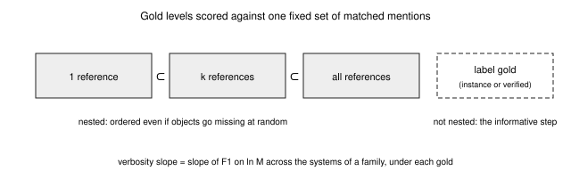

# 3 Measurement setup

<!-- v2 (SPIC, 2026-10-27): plan §2 "§3": one definition each of verified precision, mixed F1, micro-F1 and condensed F1 (Ken minor 1, 2, 4); §3.4-3.5 kept short (detail S2/S1); Holm cited (Ken minor 3); §3.7 renamed "A reporting proposal (untested)" (Ken W3/W4, CC-126 W2). -->

## 3.1 Notation and metrics

For image $i$ in an evaluation set of $n$ images, a system $S$ produces a caption; a matcher maps it to the set $\hat O_i^S$ of mentioned object classes, with $M_i^S = |\hat O_i^S|$ and $M^S = \frac{1}{n}\sum_i M_i^S$ (mentions per image). A gold $\mathcal G$ assigns each image a set $G_i$; $\mathrm{TP}_i^S = |\hat O_i^S \cap G_i|$. We use three families of gold:

- **$k$-reference gold** $G_i^{(k)}$: the classes named in $k$ of the image's references. Analyses that vary $k$ use at most the first five references (COCO-5000, the English LVLM families of Section 7.1, and the COCO English rows of Section 5); the CHAIR gold of Section 6 reads all of them, and the PASCAL-50S test (Section 7.4) uses up to all 50.<!-- src: .session_backup/2026-10-18/gemini_handoff/G-A8.6/coco_ref_counts.json (sha256 ad76f8c1ae90) :: /caps_summary.caps_at_mode (English LVLM families F-B and F-C; COCO-2500 slopes, exponents and support profile; exchangeability COCO English-reference rows) and /caps_summary.reads_all (E1 re-scoring of released outputs, 15 pairs); VERIFIED in manuscript/verification/paperA/G-A8.6.json --> Subsets are drawn at random over all $\binom{K}{k}$ choices ("random-$k$"); first-$k$ (file order) is only a diagnostic (Section 5).
- **Instance gold**: classes with at least one annotated instance (COCO instances, Lin et al., 2014; COCO-80 vocabulary)<!-- cite: lin2014microsoft (A5.2 v3); arXiv 1405.0312, 'Microsoft COCO: Common Objects in Context', verified 2026-10-18 via export.arxiv.org -->.
- **Instance + references**: the union of both (the CHAIR gold of Section 6 and the *full gold* of Section 8.3).

**Gold per set.** The third level, *label gold* (the registrations' *complete gold*), is instance gold on COCO-5000, the English LVLM families, UIT-ViIC test (*UIT-ViIC-231*) and the 295 COCO-2500 val2017 images of Section 7.3 (*COCO-295*). On the 600 XM3600 evaluation images (*XM3600-600*; Section 7.2) it is human-verified labels, scored with **verified precision**: precision computed over the mapped mentions that OIV7 can verify as present or absent, so mentions it cannot verify are excluded (Section 7.2 bounds its effect). We prefer this estimand because OIV7 verifies presence or absence only for its labelled classes, so a mention outside them is unknown rather than wrong; counting such mentions as errors is the lower end of the post hoc bracket of Section 7.2.<!-- PD-28 (1); CONFIRMATION_MAP Amendment 4; G2-B prereg md:130 (oiv7 rung: verified precision over verified mapped mentions = F1_pos of evaluate_xm3600_predictions_v3.py); xm600 = data/xm3600_subset.txt (f5ab86c7) = the Section 7.5 images; cv295 ids all in data/coco_probe/manifest.json --> Only the reference levels are nested: label gold need not contain the reference gold, and on XM3600 its level also changes the precision rule (Fig. 1).

<!-- rev1 (A_META_REVIEW item 13): planned schematic (outline.md figure plan); caption figs/CAPTIONS.md; no data -->

Precision is micro-averaged, $P = \sum_i \mathrm{TP}_i / \sum_i M_i$. Recall is averaged over images with non-empty gold, $R = \frac{1}{|\{i: G_i\neq\emptyset\}|}\sum_i \mathrm{TP}_i/|G_i|$, and $F_1 = 2PR/(P+R)$. We call this **mixed F1** (micro precision, image-averaged recall); every F1 in the paper is mixed F1 unless named otherwise. **Micro-F1**, $F_1^{\mu} = 2\sum_i\mathrm{TP}_i / (\sum_i M_i + \sum_i |G_i|)$, is the form for which Section 4's closed form is exact; Supplementary S1 reports both. **Condensed F1**, after the condensed lists of Sakai (2007) in information retrieval, scores only judged mentions: mentions the gold neither confirms nor rejects are dropped, so it is defined only where verified negatives exist (Section 7.3). CHAIR$_i$ is Rohrbach et al.'s (2018) instance-level CHAIR, which counts repeated mentions (so it is not exactly $1-P$). Where Section 8 uses CHAIR as a caption-level score, it is the class-level $1 - \mathrm{TP}_i/M_i$ (0 when $M_i = 0$).<!-- Code: .session_backup/2026-10-14/research_r10/E1/e1_chair_count.py per_image()/agg(): CHAIR_i = 100*h/n over all mentions (repeats counted), P_cls over distinct classes; .session_backup/2026-10-14/r12/H1/scripts/h1_pilot.py classes() returns a set and chair = FP/M per caption. A8.2 finding F3. Implementation conventions: Supplementary S2. -->

Matchers. English outputs are matched to COCO-80 with the CHAIR synonym list; Vietnamese outputs use a tone-normalized lexicon (Supplementary S2). Every table names its matcher. Each caption is matched once and scored against every gold, so a difference between golds is attributable to the gold; we use no LLM judge, whose verdicts would be model-produced labels.

## 3.2 The frontier and why raw comparisons fail

Across a family of systems that differ mainly in how many objects they name, true positives follow a power law,
$$\mathrm{TP}(M) = a\,M^{b},\qquad 0 < b < 1,$$
so precision $P(M) = a M^{b-1}$ falls with $M$. We call $b$ the frontier exponent and $\mathrm{TP}(M)$ the count frontier. The exponent is a property of the gold as much as of the systems (Section 4): on the same 9 COCO systems (COCO-5000) it is 0.475 with one reference, 0.638 with five, and 0.850 with instance labels<!-- src: .session_backup/2026-10-26/a_full5000/out/r4_full5000_all9.json (sha256 332da8b6264c) :: gold.refs1_randk.b, refs5_randk.b, inst.b; r4 = 9 systems x 5,000 (FILL_RULE, PI-1026c) -->. Moving a system along the frontier changes $P$, $R$, $F_1$ and CHAIR without improving object choice, so a raw difference is uninterpretable until the count difference is removed.<!-- src (A6.3 merge, VERIFIED): '9' (COCO-2500 systems) = .session_backup/2026-10-14/r11_litmaps/L1/check_coco.json :: len(systems) -->

## 3.3 Per-image count-matched controls

A count-matched control compares method $S$ and comparator $B$ at an equal number of classes $k_i$ per image. Controls for systems with a sample pool are defined in Supplementary S2.<!-- v2: §3.3(a) moved verbatim to Supplementary S2 (not applied in Paper A) -->

**Published outputs.** With one released caption per image and system (Section 6), the control is a matched subset of the longer caption's mentions at $k_i = \min(M_i^S, M_i^B)$:

- **matched prefix (protocol primary; post hoc, Section 6.1):** the first $k_i$ distinct classes in order of mention;
- **sentence tie-average:** whole sentences in order, with the boundary sentence's classes tie-averaged;
- **uniform random subset:** $k_i$ classes drawn uniformly from the mentions (expected value over draws).

The matched prefix assumes salience ordering (A2; Section 4.1); the random subset does not. All three form a specification curve (Section 6).

## 3.4 Corpus-total count matching

Matching only $\sum_i M_i$ leaves the allocation across images free; the difference from the per-image control is the allocation channel (Supplementary S2).

## 3.5 The count–allocation–ranking (CAR) decomposition

A method's difference from a base caption telescopes into base re-rank, count, allocation and ranking terms (Supplementary S1).

## 3.6 Statistics

Intervals are 95% percentile intervals from a paired bootstrap over images ($B = 5000$, or the draw count a registration fixes); PASCAL-50S uses 1,000 draws (Section 7.4). Holm (1979) correction is used where a protocol fixes it: the 15 published comparisons of Section 6 and the PASCAL-50S companion family of Section 7.6, which had one evaluable member, so no adjustment applied; the registered tests of Sections 7–8 report each prediction with an uncorrected interval, as registered.<!-- N-M5: G2-B prereg §8 and A-N2 prereg 'multiplicity: No correction; every prediction is reported separately, per dataset, with its CI'; the XM3600, LongCap-Arena, VaPR, A-N1 and A-N3 registrations fix no correction; Holm: E1 protocol (15 comparisons, post hoc) and N9 §5 (six comparisons; not scored). Draw counts: XM3600 B=500 (prereg md:53), G2-B/A-N1/A-N2/A-N3 1000, LongCap-Arena and K2 2000 (minor 9; values not printed, no manifest row added) --> Where a protocol fixes a smallest effect size of interest (SESOI), a gain counts only if its Holm-corrected interval excludes 0 and its point estimate reaches the SESOI (+1.0 precision points for the 15 published comparisons of Section 6). Equivalence claims use two one-sided tests at the registered tolerance.<!-- src (A6.3 merge, VERIFIED): '15' (E1 comparisons) = .session_backup/2026-10-13/r10_cpu/e1_x1pb_verification_v2.json :: overview_15_pairs.n_pairs; '+1.0' (E1 SESOI) = manuscript/research_r10/E1/REPORT.txt :: line 182 -->

**Analysis code and provenance.** Analysis code was written with AI assistance under the authors' direction, under four rules.<!-- PD-25 Q3 (a): fixed methods sentence; the sentence on numbers found in no output file was removed (PD-25, 80%). --> (i) Every reported number is produced by a script from a JSON key and listed, with the file's SHA-256, in a numbers manifest released with the code.<!-- manuscript/journal_draft/number_manifest.tsv (H6 P1) --> (ii) A prediction counts as registered only if it was committed to version control before the first output it predicts; otherwise a timestamped prediction is *pre-specified* (exploratory), and analyses written after a first output are post hoc (times: Supplementary S4)<!-- src: .session_backup/2026-10-18/paperA_tasks/A4.4/tests_status.tsv :: L1_COCO, H3_N1, H1_TC, G2_POLARIS, G3_DOCCI, X1_PB = LOCALLY_FROZEN; E1_A, XM_N2 = POST_HOC; manuscript/prereg/2026-10-18_never_committed_frozen_files.json -->. (iii) Model-produced signals are never treated as gold or as human evidence, and no new human annotation was collected. (iv) Every cited identifier was checked on a primary record (see also the AI declaration).<!-- Merged here from old §11.3 (A7.3 units s11.16–s11.19). Dropped as repeats: the withdrawn-values examples of old rule 2 (a "debiased" Chao2 human ceiling and UIT-ViIC slopes found in a log but in no output file), the old rule-3 lists of which tests carry which label (now in Tab. 7 and Supplementary S4), and the responsibility sentence (in declarations.md). -->

The frontier slope used in Sections 4 and 7 is the ordinary least squares slope of $F_1$ (in points) on $\ln M$ across the systems of a family, with an image-bootstrap interval; it is conditional on the systems. We call it the **verbosity slope**: it is signed, and under reference gold it is mostly negative, so it measures a reward or a penalty for naming more objects.

## 3.7 A reporting proposal (untested)

We propose, without having tested it as a confirmatory claim, that every object-level claim report two columns:

1. **Raw score** (P, R, F1 or CHAIR$_i$, with the gold and matcher named), with mentions per image $M$ next to it; and
2. **one pre-declared count-controlled difference**: the per-image control of Section 3.3 for selection and decoding methods, or the frontier residual at the system's own count for training-time methods (the vertical distance to the pre-registered frontier $\mathrm{TP}(M)=aM^b$ fitted on comparator systems).

Column 2 is fixed before scoring, with other controls in a specification curve. It is a confound control justified by construct validity (Section 3.2), not a better quality score: it does not agree with human judgments better than raw precision (Section 8), and no registered test confirms it (Section 6).
<!-- Example paragraph removed in the PD-23 length pass (its numbers are in Sections 1 and 6): 12 of 15 raw gains; 2, 2 or 6 survive under the three controls. [ src: .session_backup/2026-10-13/r10_cpu/e1_x1pb_verification_v2.json :: overview_15_pairs.n_pairs, overview_15_pairs.raw_dP_sig_pos ][ src: same :: overview_15_pairs.mcp_prefix_survives_holm, mcp_sent_tieavg_survives_holm, mcp_rand_exact_survives_holm ] -->
