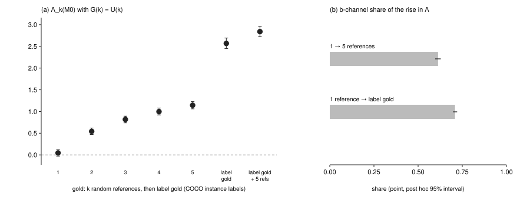

# 4 A descriptive decomposition of the verbosity reward

This section decomposes F1's verbosity reward under a gold, to show how one metric can reward or penalize verbosity. It is a description, not the claim the registered tests confirm: it does not locate the sign change, and its ordering is expected even without its salience assumption (Section 4.2). Proofs are in Supplementary S1.

## 4.1 A propensity model of reference gold

Let object $o$ present in image $i$ have a *naming propensity* $\pi_o \in [0,1]$: the probability that one reference writer names it. Unlike in Chen et al. (2015, §4.2), $\pi$ varies within an image: salient objects are named by almost every writer, background objects rarely.

**(A1) Exchangeable references.** The $K$ references of an image are exchangeable and conditionally independent given the image. Under (A1) every $k$-subset design has the same $b(k)$, $\bar G(k)$ and slope, so a difference between designs tests (A1); it fails on one dataset (Section 5).

Under (A1), an object enters the $k$-reference gold with probability
$$c_k(\pi) = 1-(1-\pi)^k,$$
and the expected gold size $\bar G(k) = U(k) = \sum_o \mathbb E\,c_k(\pi_o)$ is the incidence-based species-accumulation curve (Colwell et al., 2012<!-- cite: Colwell, Chao, Gotelli, Lin, Mao, Chazdon and Longino, J. Plant Ecology 5(1):3-21, DOI 10.1093/jpe/rtr044 (individual- and sample-based rarefaction and extrapolation), verified 2026-10-18 via Crossref -->; Chao et al., 2014). Instance gold corresponds to $c_\infty = 1$ for every present object, including objects that no writer would name.

Consider a family of systems that differ in how many objects they mention, $M$. The $m$-th mention is a nameable present object with probability $s_m$ (otherwise it is hallucinated, or present but outside what any writer would name), and its propensity has law $F_m$. Then
$$\mathrm{TP}_k(M) = \sum_{m\le M} s_m\, g_k(m),\qquad g_k(m) = \mathbb E_{F_m}\big[c_k(\pi)\big].$$

**(A2) Salience ordering.** $F_m$ decreases in $m$ in the likelihood-ratio order: later mentions have stochastically lower propensity.

**(A3) Shared frontier.** The systems of a family share $s_m$ and $F_m$. They need not produce nested captions; they need only sit on one frontier.

Define the local frontier exponent $b_k(M) = d\ln \mathrm{TP}_k / d\ln M$. It equals marginal over average precision, $b_k = p_{\text{marg}}/P$.

## 4.2 Proposition

**Proposition 1.** Under (A1)–(A3):

(a) **Monotone exponent.** $b_k(M)$ is nondecreasing in $k$. Its limits are
$$b_1(M) = \frac{M s_M\,\mathbb E_{F_M}[\pi]}{\sum_{m\le M} s_m\,\mathbb E_{F_m}[\pi]},\qquad b_\infty(M) = \frac{M s_M}{\sum_{m\le M} s_m} =: 1-D,$$
where $D$ is the part of the exponent deficit that comes from the system alone.

(b) **Concave gold growth.** $\bar G(k)$ is increasing and concave in $k$.

(c) **Sign condition** (Lipton et al., 2014, arXiv v2, Thm. 1 and Cor. 1; cited, not new). Micro-F1, $F_1^\mu = 2\,\mathrm{TP}/(M+\bar G)$, increases with $M$ if and only if $p_{\text{marg}} > F_1^\mu/2$, equivalently
$$\frac{b_k}{1-b_k} > \frac{M}{\bar G(k)}.$$
With constant $b$, $F_1^\mu$ has a unique maximum at $M^*(k) = b_k\,\bar G(k)/(1-b_k)$. For mixed F1 the condition differs (Supplementary S1), so the closed form is applied only to micro-F1.

(d) **Single crossing.** Let
$$\Lambda_k(M) = \operatorname{logit} b_k(M) + \ln \bar G(k) - \ln M .$$
$\Lambda_k(M)$ is nondecreasing in $k$. Hence, at a fixed family centre $M_0$, the sign of micro-F1's verbosity reward, $\operatorname{sign}\Lambda_k(M_0)$, changes at most once as references are added, and only from negative to positive; $M^*(k)$ is nondecreasing in $k$. Proof in Supplementary S1.

**Two channels.** $\Lambda_k$ rises through two channels: the *b-channel* $\Delta\operatorname{logit} b_k$, which exists only because later mentions are named less often, and the *$\bar G$-channel* $\Delta\ln\bar G(k)$, which exists under any missingness. Under missingness completely at random (SCAR) the b-channel is zero. Because the $k$-reference golds are nested, the $\bar G$-channel alone already orders the slopes in $k$, so the ordering is expected even if objects are missing from references at random. Confirming the ordered pattern therefore supports it empirically; it does not test the propensity model. Only the b-channel is specific to the model.

## 4.3 Post hoc descriptive checks on COCO-2500

The checks below use 9 systems on COCO-2500 (Qwen2.5-VL-7B variants; Vietnamese captions mapped to COCO-80 and scored against the English references and instance labels)<!-- src: .session_backup/2026-10-14/r12/H4/out/h4_check.json :: coco2500.systems, coco2500.n_img; TODO: confirm the lexicon name (score_coco_probe.vi_objects) and the mention range M 0.84-2.14 (c1 JSON check_coco_gold.*.M_range) -->; COCO-2500 is the discovery set, its predictions were pre-specified and never committed, and it is exploratory<!-- src: manuscript/prereg/2026-10-18_never_committed_frozen_files.json :: files[2] (L1_COCO).mtime_utc = 2026-10-14T07:22:14Z, in_any_git_commit = false -->. COCO-2500 is not the full Karpathy test split: it is a random half of its 5,000 images (seed 42), and four of the nine systems (the two adapters, each with both prompts) were decoded only on that half.<!-- src: data/coco_probe/manifest.json :: {pool = 5000, n = 2500, seed = 42, sampler = random.Random(42).sample after sorting by cocoid}; 5,000-row decodes for 5 systems: data/results/coco5000/*.jsonl, data/results/coco5000_vcd/*.jsonl; 2,500-row decodes for fuse2_s42 and p1_s43 (short, detailed): data/results/coco_transfer/*.jsonl; CC-108 W5 (class b-exempt). "four of the nine systems" = fuse2_s42 and p1_s43 x {short, detailed}. When W4 lands this sentence is replaced by the full-5,000 statement (PI-1026c Q3) --> The rest of this subsection is post hoc.

**Part (a), monotone exponent.** On COCO-2500 with random-$k$ subsets, $b(k)$ rises from 0.479 at $k=1$ to 0.643 at $k=5$ and 0.846 with instance labels<!-- src: .session_backup/2026-10-14/r11_verify/c1_b1_b6_reproduction.json :: B1_L1_mstar_and_stopping.check_coco_gold.{refs1,refs5}_randk.b, inst.b -->; the English LVLM families show the same rise (Section 7.2).

**Assumption (A2), salience ordering, tested directly.** Relative to all mentions, the share of marginal mentions (the last of each caption) falls with reference support $n$: 1.86, 1.25, 0.80, 0.48, 0.26 for $n = 1..5$, monotone in 100% of bootstrap draws, and 3.20 for present objects named by no reference<!-- src: .session_backup/2026-10-14/r12/H4/out/h4_check.json :: coco2500.T2_profile.n1..n5.ratio_r, n0_inst.ratio_r, coco2500.T2_share_draws_r_monotone_n1to5 -->.

**Part (d), single crossing.** Part (d) concerns micro-F1. On COCO-2500 the micro-F1-on-$\ln M$ slope is −1.84 [−3.14, −0.55] at $k=1$, then +5.78, +9.96, +12.71, +14.69 for $k=2..5$<!-- src: .session_backup/2026-10-14/r12/H4/out/h4_check.json :: coco2500.T2_microF1_randk.{1..5}.slope, .1.slope_ci -->. The slope rises monotonically with completeness and changes sign once, from negative to positive; the mixed F1 shows the same pattern (Table 7.1), and where the change occurs is dataset-specific.

The closed form does not give the one-reference sign: at one reference $\Lambda = 0.047$ [−0.027, 0.122] sits at the boundary, and in 88% of bootstrap replicates $\Lambda_U(1) > 0$ while the slope is negative<!-- src: .session_backup/2026-10-18/paperA_tasks/A3.3/MANIFEST_v3.json (sha256 124731b57e45) :: Lambda_U_with_micro_F1_slopes.refs1_randk.Lambda_U.{point_v2, ci}; data_facts.Lambda_U_k1.ci_includes_0 = True; data_facts.k1_share_of_replicates_with_opposite_signs = 0.8815; VERIFIED in manuscript/verification/paperA/A3.3_v3.json --> (68% with the alternative matcher; Supplementary S2)<!-- src: .session_backup/2026-10-18/paperA_tasks/A8.4/sensitivity.json (sha256 969797ae99b7) :: coco2500_lambda_U_bootstrap.values.refs1_randk_share_of_replicates_with_opposite_signs.swapped.nodes.value = 0.6805; VERIFIED in manuscript/verification/paperA/A8.4.json -->. With $M^* = 1.26$ against a median $M$ of 1.19, the systems straddle the optimum<!-- src: .session_backup/2026-10-14/r12/H4/out/h4_check.json :: coco2500.T2_microF1_randk.1.Mstar_micro, coco2500.median_M -->. From two references on, $\Lambda > 0$ with intervals excluding 0, rising at every step (post hoc image bootstrap, $B$ = 2,000; Supplementary S7)<!-- src: same MANIFEST_v3 :: data_facts.Lambda_U_ci_excludes_0.* = True for every gold except refs1_randk -->. The negative one-reference sign is therefore an observation, not a consequence of the proposition.<!-- CC-007: the theory's claim is the ordering in k and the positive large-gold endpoint; 'Fig. 4' reference removed then (no figure existed); Fig. 4 regenerated under PD-29 (2026-10-21) -->

**Channel split.** Between one and five references (Fig. 4), the b-channel carries 61% of the increase in $\Lambda$ on COCO-2500 (post-hoc interval [59.7, 62.8]) and 71% from one reference to instance labels ([69.8, 72.1])<!-- src: points .session_backup/2026-10-18/paperA_tasks/A3.3/MANIFEST_v2.json (sha256 c08d8561d4ab) :: data_facts.b_channel_share_U_vs_v1.coco_randk.U = 0.613, data_facts.b_channel_share_U_vs_v1.coco_refs1_to_inst.U = 0.709 (Ḡ(k) = U(k), mean over all images; decision D-W13-1; VERIFIED in manuscript/verification/paperA/A3.3_v2.json); post-hoc CIs .session_backup/2026-10-18/paperA_tasks/A3.3/check_coco_U_boot.json :: bootstrap.shares.refs1_to_refs5.b_channel_share.ci = [0.5968, 0.6282], bootstrap.shares.refs1_to_inst.b_channel_share.ci = [0.6976, 0.7209] (MANIFEST_v3 124731b57e45; VERIFIED in A3.3_v3.json) -->. These shares are post hoc and from COCO-2500 only; there, most of the rise comes from salience-dependent missingness, which a uniform (SCAR) correction cannot remove.

<!-- caption: figs/CAPTIONS.md (outside the word count, PD-29 (b)); values figs/VALUES.json; replaces A3.3 fig4_v3, which predates Amendment 4 -->

**What the decomposition does not predict.** It does not say where the sign changes, and it does not predict the sign with several references: positive all-references slopes were predicted and failed on two English LVLM families (pre-specified; Section 7.2) and on XM3600 (registered; Section 7.5). An exponent fitted on short-caption systems did not transfer to verbose ones; $M^*$ is descriptive, not an out-of-regime predictor.
