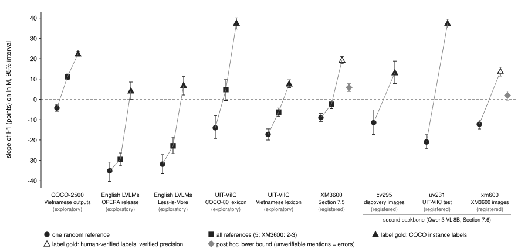

# 6 Experiments I: the verbosity slope across golds

<!-- v2 (SPIC, 2026-10-27): rewritten per manuscript/journal_draft/V2_WRITING_PLAN_SPIC_2026-10-27.md §2 "§7" as amended by CC-129 (W5, W8, W9, J5, J8). Old §7.1-7.4 condensed into §7.1; old §7.5 -> §7.2, §7.6 -> §7.3, §7.7 -> §7.4, §7.8 -> §7.5. Moved detail (old §7.1-7.3 paragraphs, full Table 7.2, eight-LVLM detail, random-deletion detail) is in Supplementary S7, "Material moved from Section 7 in v2". No registered number or verdict changed. -->

This section reports the verbosity slope (Section 3.6) under each gold; the confirmatory claim is its ordering by gold completeness (Section 1). The one-reference sign is registered but not derived from the theory, and the multi-reference sign is not predicted.<!-- rev2 (CC-181 W8): condensed; original paragraph moved verbatim to Supplementary S10 -->

**Table 6.1.** Slope of mixed F1 on $\ln M$ by gold (Section 3.1; Fig. 2), with 95% image-bootstrap intervals; on XM3600 the label gold uses verified precision with micro-pooled recall, as registered. The last two columns are a post hoc precision bracket (no verdict): unverifiable mentions counted as errors (lower) or as correct (upper); "—" = not computed.<!-- rev1 (item 10): G2-B prereg md:130, md:164 (oiv7: F1_pos of evaluate_xm3600_predictions_v3; other golds check_mstar.prf mixed F1) --><!-- rev2 (CC-181 W8): condensed; original paragraph moved verbatim to Supplementary S10 -->

| Family (systems; mention range) | Grade | 1 ref | 5 refs | Label gold | Bracket, lower (post hoc) | Bracket, upper (post hoc) |
|---|---|---|---|---|---|---|
| COCO-5000, Vietnamese outputs, COCO-80 (9; $M$ 0.84–2.18) | exploratory; post hoc full-split extension<!-- label per FILL_RULE (PI-1026c) --> | −4.77 [−6.10, −3.54] | +10.57 [+9.70, +11.43] | +22.13 [+21.39, +22.89]<!-- src: .session_backup/2026-10-26/a_full5000/out/r4_full5000_all9.json (sha256 332da8b6264c) :: gold.{refs1_randk,refs5_randk,inst}.{slope,slope_ci}, gold.inst.M_range, systems (9); r4 = 9 systems x 5,000 (FILL_RULE, PI-1026c) --> | — | — |
| English LVLMs, OPERA release (9; $M$ 2.18–3.29) | exploratory; predictions failed | −35.18 [−40.38, −30.87] | −29.57 [−32.69, −26.37] | +4.24 [−0.09, +8.51]<!-- source key: H3J families.F-B.gold.* --><!-- src (A6.3 merge, VERIFIED): '9' (F-B systems) = .session_backup/2026-10-14/r12/H3/N1_PREDICTIONS.txt :: line 6 --> | — | — |
| English LVLMs, Less-is-More release (11; $M$ 2.19–3.37) | exploratory; predictions failed | −31.89 [−36.60, −27.21] | −22.86 [−26.71, −18.53] | +6.91 [+2.16, +11.17]<!-- source key: H3J families.F-C.gold.* --><!-- src (A6.3 merge, VERIFIED): '11' (F-C systems) = .session_backup/2026-10-14/r12/H3/N1_PREDICTIONS.txt :: line 7 --> | — | — |
| UIT-ViIC test, COCO-80 lexicon (10; $M$ 1.07–2.29) | exploratory | −13.97 [−19.24, −8.01] | +4.80 [−0.57, +9.67] | +37.52 [+34.56, +40.08]<!-- source key: C2J coco80.*.all_10 --><!-- src (A6.3 merge, VERIFIED): '10' (UIT-ViIC systems) = .session_backup/2026-10-14/r11_verify/c2_n1_uitviic_mstar.json :: len(uitviic_test.systems) --> | — | — |
| UIT-ViIC test, Vietnamese reference lexicon (10; $M$ 1.59–6.94) | exploratory | −17.25 [−20.04, −14.53] | −6.28 [−8.31, −4.29] | +7.66 [+5.78, +9.58]<!-- source key: C2J vi_objects_in.*.all_10 --><!-- src (A6.3 merge, VERIFIED): '10' (UIT-ViIC systems) = .session_backup/2026-10-14/r11_verify/c2_n1_uitviic_mstar.json :: len(uitviic_test.systems) --> | — | — |
| XM3600-vi, 600 images, Vietnamese reference lexicon (6; $M$ 1.08–4.29) | registered out-of-sample; 2 of 5 predictions failed (1 of 3 sign predictions)<!-- src: .session_backup/2026-10-14/r12_verify/xm3600_full_verdict.json :: prereg_comparisons[16..20].in_interval_or_pass = PASS, FAIL, PASS, PASS, FAIL (2 FAIL of 5) --> | −8.99 [−10.89, −6.99] | −2.43 [−4.63, −0.30] (2–3 refs) | +19.32 [+17.43, +21.13] (OIV7, verified precision)<!-- source key: XMJ n1_f1_vs_logM_slopes.* --><!-- src (A6.3 merge, VERIFIED): '6' (XM3600 systems) = .session_backup/2026-10-14/r12_verify/xm3600_full_verdict.json :: prereg_comparisons.16.observed_value.n_systems_evaluated; '1' (XM3600 failed out-of-sample sign predictions) = .session_backup/2026-10-14/r12_verify/xm3600_full_verdict.json :: prereg_comparisons[16..18].in_interval_or_pass count==FAIL; '3' (XM3600 out-of-sample sign predictions) = manuscript/prereg/2026-10-14_xm3600_predictions.json :: a_N1_sign_predictions.kill_rule.h6_p2_kill (number in string) --> | +5.83 [+3.82, +7.82]<!-- src: data/results/n_f1/bracket_result.json (4796ed12) :: sets.s75.slopes.lower.{point_4dp, ci95_2dp} (manifest row 657; POST_HOC) --> | +20.13 [+18.35, +21.89]<!-- src: data/results/n_f1/bracket_result.json (4796ed12) :: sets.s75.slopes.upper.{point_4dp, ci95_2dp} (manifest row 659; POST_HOC) --> |
| Second backbone, Qwen3-VL-8B zero-shot, detailed captions capped at 160 new tokens (6 systems per set, clean subsets) | registered; primary claims PASS on each set (COCO-295 = discovery images; UIT-ViIC-231 not counted as support) | COCO-295 −11.46 [−17.27, −5.19]; UIT-ViIC-231 −20.96 [−24.31, −17.40]; XM3600-600 −12.27 [−14.55, −10.08] | not predicted (Section 6.3) | COCO-295 +13.14 [+7.81, +18.82]; UIT-ViIC-231 +37.36 [+35.15, +39.41]; XM3600-600 +13.71 [+11.44, +15.79]<!-- src: data/results/g2b/g2b_score.json (sha256 68be2b7a, commit 47de6b6) :: datasets.{cv295,uv231,xm600}.predictions.G2B-E1.parts[0] and G2B-E2.parts[0]; VERIFIED manuscript/verification/paperA/G2B_AN1_run.json (bc2d7959); G2-B prereg 0932ba1 --> | XM3600-600 +1.97 [−0.44, +4.01]<!-- src: data/results/n_f1/bracket_result.json (4796ed12) :: sets.xm600.slopes.lower.{point, ci95} (manifest row 658; POST_HOC) -->; COCO-295, UIT-ViIC-231 — | XM3600-600 +14.78 [+12.58, +16.79]<!-- src: data/results/n_f1/bracket_result.json (4796ed12) :: sets.xm600.slopes.upper.{point, ci95} (manifest row 660; POST_HOC) -->; COCO-295, UIT-ViIC-231 — |
| Second backbone, same runs, all images (295, 231 and 600 images) | registered sensitivity, no verdict | COCO-295 −11.03 [−16.60, −5.47]; UIT-ViIC-231 −22.14 [−25.43, −18.74]; XM3600-600 −12.77 [−15.03, −10.51] | not predicted | COCO-295 +13.70 [+8.50, +18.63]; UIT-ViIC-231 +37.44 [+35.40, +39.15]; XM3600-600 +14.10 [+11.98, +16.15]<!-- src: data/results/g2b/g2b_score.json (sha256 68be2b7a, commit 47de6b6) :: datasets.{cv295,uv231,xm600}.sensitivity_full_set.{G2B-E1,G2B-E2}.parts[0].{point,ci95} (verdict = null; n_images = n_images_full = 295, 231, 600); registered as sensitivity in G2-B prereg 0932ba1, manuscript/prereg/2026-10-18_g2b_qwen3vl_ladder.md:159 ("The same statistics on all images are reported as a sensitivity analysis, without verdicts"), :171, :219; CC-108 W2 --> | — | — |

<!-- src rows: COCO-5000: .session_backup/2026-10-26/a_full5000/out/r4_full5000_all9.json (sha256 332da8b6264c) :: gold.{refs1_randk,refs5_randk,inst}.{slope,slope_ci,M_range} (r4, 9 systems x 5,000; FILL_RULE).
F-B / F-C: .session_backup/2026-10-14/r12/H3/out/n1_results.json :: families.{F-B,F-C}.gold.{refs1_randk,refs5_randk,inst}.{slope,slope_ci,M_range}.
UIT-ViIC: .session_backup/2026-10-14/r11_verify/c2_n1_uitviic_mstar.json :: uitviic_test.lexicons.{coco80,vi_objects_in}.gold_variants.{refs1_randk,refs5_randk,inst_only}.groups.all_10.{slope_F1_mixed_per_logM,slope_F1_mixed_ci95,M_range}.
XM3600 (XMJ): .session_backup/2026-10-14/r12_verify/xm3600_full_verdict.json (sha256 0b2b3aa5e1a3) :: matcher_v2_tone_normalised.n1_f1_vs_logM_slopes.{refs1_randk,refs_all,oiv7_verified}.{slope_F1_per_logM,slope_ci95_b500,M_range}. The vi_objects_in 5-ref interval is the refs5_randk key ([-8.31,-4.29]); the [-8.34,-3.96] quoted in earlier drafts is the refs5_firstk key of the same file (same gold at K=5, different bootstrap draws).
Bracket columns: J8 of the plan, ruled YES by CC-129 (same table, labelled post hoc, "—" where not computed); the bracket was computed for the Section 7.2 systems (s75) and for xm600 only (DESIGN c8bd21c). -->

<!-- caption: figs/CAPTIONS.md (outside the word count, PD-29 (b)); values figs/VALUES.json -->

## 6.1 Unregistered rows: COCO-5000, English LVLM outputs and UIT-ViIC (exploratory)

**Exploratory rows.** On COCO-5000 the four pre-specified (never committed) predictions held: the slope is ordered, −4.77 < +10.57 < +22.13, and rises at every step $k \to k+1$ and again to instance gold. On the public CHAIR outputs of the two English release families of Section 3.3, the five-reference prediction (slope > 0) **failed** in both (−29.57 and −22.86), as did the OPERA instance-gold prediction (+4.24 [−0.09, +8.51]). UIT-ViIC test was scored before any prediction existed; its five-reference sign depends on the matcher (Table 6.1). Details: Supplementary S7.<!-- src: manuscript/prereg/2026-10-18_never_committed_frozen_files.json :: files[2] (L1_COCO).{mtime_utc = 2026-10-14T07:22:14Z, first_output.mtime_utc = 2026-10-14T07:25:31Z, in_any_git_commit = false}; prediction file check_coco_PREDICTIONS.txt --><!-- PI-1026c --><!-- src: .session_backup/2026-10-14/r11_litmaps/L1/check_coco_PREDICTIONS.txt (c7cad2b2); held keys .session_backup/2026-10-26/a_full5000/out/w4_summary.json (sha256 a11cba1634e5) :: cells.r4_full5000_all9.{P1_holds, P2_inst_ci_above_0, P3_refs1.holds, P4_holds} = true, kill_fires = false; values .session_backup/2026-10-26/a_full5000/out/r4_full5000_all9.json (332da8b6264c) :: gold.* --><!-- src: same r4 file :: gold.{refs1_randk,refs5_randk,inst}.slope; S.P1_holds = true --><!-- src: same r4 file :: gold.{refs1..refs5}_randk.slope, inst.slope; every-step report S.P1_rises_every_step_and_to_inst = true (not P1; FILL_RULE §7.1, CP-111a W3) --><!-- rev2 (CC-181 W8): condensed; original paragraph moved verbatim to Supplementary S10 --><!-- rev2 (CC-181 W8): condensed; original paragraph moved verbatim to Supplementary S10 -->

## 6.2 XM3600: out-of-sample test with a transferred exponent (registered; mixed outcome)

**Design.** XM3600 (Thapliyal et al., 2022) gives 2–3 Vietnamese references per image and human-verified Open Images V7 labels (OIV7), the label gold (Section 3.1). Six systems (Qwen2.5-VL-7B zero-shot and two Vietnamese adapters, one trained with the gold-SFT recipe of an earlier study (Nguyen et al., 2026a<!-- cite: nguyen2026vsps (FAIR 2026); rev2: comment placed next to the mention for the build tie-break -->); short and detailed prompts) are scored on 600 images, a random draw (seed 0) from the 2,119 XM3600 images with a verified label on a mapped OIV7 class, pinned by the registration. The other 3,000 XM3600 images are the development (500) and one-look test (2,500) sets of a separate registered study and are not used here. The exponent is transferred from COCO-2500, not refitted; the predictions and code were committed before the first output (times: Supplementary S10).<!-- cite: thapliyal2022crossmodal, DOI 10.18653/v1/2022.emnlp-main.45, in .session_backup/2026-10-18/paperA_tasks/A5.2/paperA_v3.bib (VERIFIED) --><!-- cite: nguyen2026vsps (FAIR 2026, IEEE, ISBN 979-8-3195-1937-5); p1_s43 is the gold-SFT recipe P1 of that paper; fuse2_s42 is not in FAIR (journal_draft_B/new_vs_FAIR.md; FAIR text has no fusion system) --><!-- rev2 (CC-181 W3, r5): id files and split = data/xm3600_subset.txt (600, this paper), .session_backup/2026-10-22/c_stage2/subsets/xm_dev500.files (500, the other study's development set), .session_backup/2026-10-26/c_test/staging/xm_test2500.files (2,500, its one-look test set, spent); pairwise overlap 0/0/0, union 3,600 (re-run by the writer 2026-10-30); 'held out' removed because the ledger lists XM3600 as all spent (LOG CC-181 W2 line) --><!-- src: scripts/xm3600_oiv7.py:123-124 (pool = images with a verified label on a mapped class; random.Random(args.seed).sample(pool, args.n_eval)), :314 (--n-eval default 600), :315 (--seed 0); data/xm3600/manifest.json :: coverage.images_with_a_verified_label_on_a_mapped_class = 2119, coverage.eval_subset = {n: 600, seed: 0}; subset data/xm3600_subset.txt drawn by `xm3600_oiv7.py build` (committed e564ed6, 2026-10-12), pinned by the registration 4ccbee3 (2026-10-14); CC-108 W5 and ruling 2 (class b-exempt; a full-XM3600 run would read another study's development and one-look test images) --><!-- src: .session_backup/2026-10-18/paperA_tasks/A4.4/tests_status.tsv :: XM_N1 t_commit 2026-10-14T16:38:04Z, t_out 2026-10-14T17:00:36Z; manuscript/prereg/2026-10-14_xm3600_predictions.json (sha256 5d0134bfded0) :: dataset.n_images_eval_subset = 600; commit 4ccbee3 --><!-- rev2 (CC-181 W8): condensed; original paragraph moved verbatim to Supplementary S10 -->

**Registered predictions and verdicts** (as computed by the registered evaluator)<!-- src: .session_backup/2026-10-14/r12_verify/xm3600_full_verdict.json (sha256 0b2b3aa5e1a3) :: prereg_comparisons[16..20].{prediction_id,in_interval_or_pass,observed_value}; pending_runs = []; prediction ids N1-XM-1..N1-XM-5 in order -->:
- **One-reference slope < 0: PASS** (−8.99 [−10.89, −6.99]).
- **All-references slope > 0, the risky test: FAIL** (−2.43 [−4.63, −0.30] with all 2–3 references).
- **OIV7 slope > 0: PASS** (+19.32 [+17.43, +21.13]).
- **Ordering one reference < all references < OIV7: PASS** (−8.99 < −2.43 < +19.32).
- **Sign agreement with $M^*_{\text{mixed}}$ − median $M$: FAIL.** It holds for 3 of 4 gold variants in-sample (the all-references gold disagrees: $M^*_{\text{mixed}} = 1.76$ lies above the median $M$ of 1.38, but the slope is negative) and for 2 of 4 with the transferred exponent.<!-- rev2 (CC-181 W8): condensed; original paragraph moved verbatim to Supplementary S10 -->
<!-- src: same :: matcher_v2_tone_normalised.n1_f1_vs_logM_slopes.{refs1_randk,refs_all,oiv7_verified}.{slope_F1_per_logM,slope_ci95_b500}; prereg_comparisons[20].observed_value.{in_sample_Mstar_mixed_agreement_count,prior_b_Mstar_micro_agreement_count,per_gold.refs_all.Mstar_mixed_in_sample,per_gold.refs_all.median_M}; "missing also on the one-reference gold" (transferred rule misses refs_all and refs1_randk) per CC-129 "N1-XM-5 per gold" check -->

Neither registered withdrawal rule was triggered, because only one of the three sign predictions failed (rules: Supplementary S4). The registration also froze 15 gold-size values on these images; 14 were reproduced, and the one-reference non-empty gold size missed its interval (1.8768 against 1.8831; OUT; Supplementary S7).<!-- src (A6.3 merge, VERIFIED): '2' (XM3600 registered demotion threshold) = manuscript/prereg/2026-10-14_xm3600_predictions.json :: a_N1_sign_predictions.kill_rule.h6_p2_kill (number in string) --><!-- src: .session_backup/2026-10-14/r12_verify/xm3600_full_verdict.json :: prereg_comparisons[1..15].in_interval_or_pass (14 IN); prereg_comparisons[6] (GBAR-refs1_randk-Gbar_nonempty) prereg_interval_or_threshold = 1.8831, observed_value = 1.8768, in_interval_or_pass = OUT (manifest rows 223-225); CC-129 W1 --><!-- rev2 (CC-181 W8): condensed; original paragraph moved verbatim to Supplementary S10 -->

**Reading.** The slopes are ordered, as predicted. Because the label gold is scored with verified precision (Section 3.1), we bounded its slope post hoc (no verdict; Supplementary S7): counting unverifiable mentions as errors leaves +5.83 [+3.82, +7.82] here, still above both reference slopes at point level, but +1.97 [−0.44, +4.01] on the second backbone's XM3600-600 outputs (Table 6.1), so the positive label-gold slope depends on excluding unverifiable mentions. The positive slope with 2–3 references failed: the crossing lies at a more complete gold, which the transferred exponent missed (in-sample 0.503 against 0.549). XM3600 supports the ordering of the slopes, not the location of the sign change.<!-- src: data/results/n_f1/bracket_result.json (sha256 4796ed12) :: outcome_paper = ii, sentence_paper; sets.s75.slopes.lower.{point_4dp, ci95_2dp}; sets.xm600.slopes.lower.{point, ci95}; per set: sets.s75.outcome_from_lower = i, sets.xm600.outcome_from_lower = ii (paper-level AND, DESIGN.md R3, CC-063); design c8bd21c; run record manuscript/prereg/2026-10-21_n_f1_bracket/run_record.json (062ab6a5); VERIFIED manuscript/verification/paperA/N_F1_bracket_run.json (60e58bfe; byte-identical re-run); CONFIRMATION_MAP Amendment 4 row 27 --><!-- src: .session_backup/2026-10-14/r12_verify/xm3600_full_verdict.json :: matcher_v2_tone_normalised.n1_f1_vs_logM_slopes.refs_all.b_in_sample; prereg b from .session_backup/2026-10-14/r11_verify/c1_b1_b6_reproduction.json :: B1_L1_mstar_and_stopping.check_coco_gold.refs2_randk.b --><!-- v2: the sentence on the one-reference mechanism (median M 1.38 below the transferred optimum 1.471; src xm3600_full_verdict.json :: prereg_comparisons[16].observed_value.{observed_median_M,prereg_Mstar_all_600_prior_b}) moved to Supplementary S7 --><!-- rev2 (CC-181 W8): condensed; original paragraph moved verbatim to Supplementary S10 --><!-- rev2 (CC-181 W8): condensed; original paragraph moved verbatim to Supplementary S10 -->

## 6.3 A second backbone (registered)

**Design.** The families above use one backbone (Qwen2.5-VL-7B). The second-backbone test repeats the measurement with Qwen3-VL-8B zero-shot, six systems per set (three temperatures × a short and a detailed Vietnamese prompt; detailed captions capped at 160 new tokens), on three sets: **COCO-295** (295 COCO val2017 images from the COCO-2500 discovery set, so a replication on discovery images), **UIT-ViIC-231** (COCO train2017 images the backbone may have seen; a failure counts against the claim, a pass is not counted as support) and **XM3600-600** (the Section 6.2 images, whose first-backbone outcome was known at registration).<!-- src: prereg 2026-10-18_g2b_qwen3vl_ladder.json :: decode.max_new_tokens = 160 for all 11 detailed runs (judge CC-043 check); token caps manuscript/prereg/2026-10-18_g2b_qwen3vl_ladder.md :: line 36 (short 60, detailed 160); design .session_backup/2026-10-13/decisions/D15.txt (MT19), whose "uncontaminated" premise judge CC-024 withdrew (G2-B prereg 0932ba1) --><!-- src: image provenance .session_backup/2026-10-18/paperA_tasks/P2/MANIFEST.json (sha256 2ba055342c90) :: numbers[24] datasets.cv295.in_coco_val2017 = 295, numbers[28] datasets.uv231.n_images = 231, numbers[29] datasets.uv231.coco_url_split = {train2017: 231}, numbers[32] datasets.xm600.n_images = 600; VERIFIED in manuscript/verification/paperA/P2.json --><!-- rev2 (CC-181 W8): condensed; original paragraph moved verbatim to Supplementary S10 -->

The registered primary claims are a negative one-reference slope, a positive label-gold slope, the ordering of the slopes, and the ordering of the exponent (rules: Supplementary S4). Verdicts use clean subsets, the images on which every caption of every system passes the registered language check<!-- src: manuscript/prereg/2026-10-18_g2b_qwen3vl_ladder.md :: line 159 (Analysis sets: clean subset; looks_vietnamese, CJK_RE); kill rule KL -->.

**Primary result.** All four primary claims PASS on each set (Supplementary Table S7.5). They were scored once, after all 23 registered decodes were committed; no withdrawal rule was triggered and no run excluded. Verdicts are on the clean subsets (263 of 295, 209 of 231 and 537 of 600 images); the all-image values are a registered sensitivity analysis without verdicts (Table 6.1). In the detailed runs 99.7% of captions reached the 160-token cap, so the second-backbone slope is in effect a short-versus-detailed contrast whose upper $M$ is set by the cap; within-cluster slopes are not interpreted (Supplementary S7).<!-- src: data/results/g2b/g2b_score.json (sha256 68be2b7a, commit 47de6b6) :: datasets.*.predictions.G2B-{E1,E2,O1}.parts[*].{point,ci95}, predictions.*.n_images, verdicts, kill_rules (K1/K2/K3/KN1/KD fires=false), excluded_runs = {}; run record data/results/g2b/g2b_score_record/ (precheck 23/23); VERIFIED manuscript/verification/paperA/G2B_AN1_run.json (bc2d7959); rev2 (CC-181 W8): the in-text repeat of the Table 6.2 level values, the lower-rule point comparison and the random-deletion sentence moved to Supplementary S7 --><!-- rev2 (CC-181 W8): condensed; original paragraph moved verbatim to Supplementary S10 -->

**Registered secondary claims** (clean subsets; Supplementary S7). Rise at every added reference (G2B-O2): **PASS** on COCO-295 and UIT-ViIC-231. Language, sampling and backbone (G2B-P2, G2B-P3a, G2B-P4): **INCONCLUSIVE**. Temperature (G2B-P3b): **FAIL** on UIT-ViIC-231 and XM3600-600 (INCONCLUSIVE on COCO-295): the registered negative intercept shift at T = 0.8 is not observed, +0.31 [−0.64, +1.30] and +0.42 [−1.03, +1.77] precision points. Condensed F1 (A-N1) is **MIXED**: its shrinkage margin Q (> 0 to pass) is 12.84 [9.86, 14.36] on XM3600-600 and 3.82 [2.58, 5.07] on UIT-ViIC-231 (PASS) but 0.26 [−1.76, 2.11] on COCO-295 (INCONCLUSIVE), and support required all three.<!-- src: data/results/g2b/g2b_score.json (sha256 68be2b7a) :: datasets.*.predictions.{G2B-O2,G2B-P2,G2B-P3a,G2B-P3b,G2B-P4}.{verdict, parts[*].{rule,delta,point,ci95,verdict}}; data/results/g2b/an1_score.json (sha256 ec0938e0, commit 47de6b6) :: sets.*.primary_analysis.primary.{rule = sign_gt_0, point, ci95, verdict}, outcome = MIXED; cite: sakai2007alternatives; rev2: bullet list with the G2B-O2 example interval moved verbatim to Supplementary S7 --><!-- rev2 (CC-181 W8): condensed; original paragraph moved verbatim to Supplementary S10 -->

<!-- rev2 (CC-181 W8): Table 6.2 moved verbatim to Supplementary S10 (Table S10.1); the same clean-subset values are in Supplementary Table S7.5 -->

**Eight public LVLMs (registered secondary).** Decoded in English on COCO-295 and UIT-ViIC test, one-reference F1 does not rank the eight models as complete gold does (ranking prediction **PASS** on both sets). The per-model ladder prediction is **FAIL** on COCO-295: Qwen3-VL-8B fails the complete-gold part (−1.124 [−11.52, 6.62]; point ≤ 0) and two models are INCONCLUSIVE, while all 8 models hold on UIT-ViIC; so the pattern is not claimed for every public LVLM (Supplementary S7).<!-- src: data/results/a_n2/a_n2_run.json (sha256 1f6ce422, commit 80405b1) :: datasets.{cv295,uv231en}.verdicts_on_analysis_set.LBA-P1 / LBA-P2 (manifest row 625 for −1.124), kill_rules.KA2.failing_models; VERIFIED manuscript/verification/paperA/A_N2_run.json (8f7cf06d); CP-041 binding; rev2: tau_b and cap sentences moved to Supplementary S7 --><!-- rev2 (CC-181 W8): condensed; original paragraph moved verbatim to Supplementary S10 -->

## 6.4 Large reference sets: PASCAL-50S (registered 2026-10-29)

**Design.** PASCAL-50S (Vedantam et al., 2015) gives 50 references for each of the 1,000 UIUC PASCAL Sentences images (Rashtchian et al., 2010), all in VOC2008 trainval, whose object labels on 20 classes (Everingham et al., 2010) serve as the label gold (V20). Seven of the eight public English LVLMs of Section 6.3 (the fixed 8 GPU-hour cap dropped Idefics3-8B), each with a short and a detailed prompt, give 14 runs, scored once after the registration was committed (Supplementary S7). The analysis set is the 997 images whose caption is clean in every run; intervals use 1,000 image-bootstrap draws. Two departures from the registration are disclosed in Section 9.2; neither changes a verdict.<!-- src: data/results/p50/p50_decide.json (sha256 0da4cab90fe9) :: models (7), runs (14), analysis_set.n_images = 997, n_boot (1000); prereg manuscript/prereg/2026-10-28_pascal50s/PREREG.md (2026-10-28_a_p50_kladder) §2, §6; commit 353437f; rev2 (CC-181 W8): full design paragraph with commit and start times moved verbatim to Supplementary S7; 'Section 9.1' corrected to 9.2, where the departures are --><!-- rev2 (CC-181 W8): condensed; original paragraph moved verbatim to Supplementary S10 --><!-- rev2 (CC-181 W8): condensed; original paragraph moved verbatim to Supplementary S10 -->

**Registered verdicts.** The primary prediction (P50-A4) tests whether the ordering of Section 6.2 replicates: one reference < all 50 references < VOC labels, all on the V20 vocabulary.
- **One reference < 50 references: PASS** (+37.16 [+35.07, +39.09]).
- **50 references < VOC labels: FAIL** (−2.29 [−5.15, +0.61]; the point is ≤ 0, so the registered rule gives FAIL although the interval includes 0, as does the original point-estimate criterion of A4).<!-- rev2 (CC-181 W8): condensed; original paragraph moved verbatim to Supplementary S10 -->
- **P50-A4 (compound): FAIL**, meaning that the predicted direction was not shown, not that the reverse was shown.<!-- rev2 (CC-181 W8): condensed; original paragraph moved verbatim to Supplementary S10 -->
- **Rise at every registered level, k = 1 → 2 → 5 → 10 → 20 → 50, COCO-80 (P50-O2, secondary): PASS** at every step (Fig. 3; step values in Supplementary S7).
<!-- src: data/results/p50/p50_decide.json (sha256 0da4cab90fe9) :: analysis_set.P50-A4.parts[0..1].{point, ci95, verdict, not_FAIL}, analysis_set.P50-A4.verdict = FAIL; analysis_set.P50-A4r.verdict = null ("the label rung was kept"); analysis_set.P50-O2.parts[0..4].{point, ci95, verdict}, analysis_set.P50-O2.verdict = PASS; rules PREREG §3.5-3.6 (sign_gt_0, compound, no correction, CC-144 ruling 6) -->

On PASCAL-50S the registered ordering did not replicate: the label-gold part (50 references < VOC labels) was FAIL (−2.29 [−5.15, +0.61]). We report this as a failed out-of-sample replication of the ordering claim of Section 6.2; the confirmatory claim of this paper is restricted to the XM3600 and second-backbone tests, and the label-gold part is listed in Table 1 as FAIL. The images and captions have been public since 2008–2015 and may be in the pretraining data of these models; they are unseen by us, not necessarily by the models. Every one of the 14 caption files shared 8-grams with the references (18 to 419 per file); such overlaps can be generic phrases or memorised text, and by registration they were not a verdict input.<!-- rev1 (item 7c): data/results/p50/ngram_p50_*.preds.json :: files.* (counts only) --><!-- branch text PREREG §9.2, inserted as written with the fills [part] = "the label-gold part (50 references < VOC labels)", [value] = −2.29 [−5.15, +0.61], [failing part] = "label-gold part"; §9.1's "for the reference ladder only" does not apply (label rung kept) -->

**Without a verdict.** The slope signs were not predicted: on COCO-80 the slope rises from −31.38 [−32.70, −29.95] with one reference to −0.83 [−2.58, +1.07] with 50; on V20 it is +9.74 [+7.29, +12.12] with 50 references and +7.45 [+4.98, +9.94] under the VOC labels (Fig. 3; the 50-minus-one contrast and the all-1,000-image sensitivity, −2.37 [−5.44, +0.62] for the failed part, in Supplementary S7). Two limits were registered before the run: V20 has only 20 classes with "person" dominant, and the English matcher maps "aeroplane" to no class; neither was tested as an explanation. The registration also assumed, without measuring it, that the VOC labels are more complete than the 50-reference gold. A separate registered attempt to measure such a premise before any decode, on ADE20K training images (Zhou et al., 2017) with one (rarely two) Localized Narratives per image (Pont-Tuset et al., 2020), found the label level 1.24 times as complete as one narrative, below the registered factor of 2, so it ended before any model was run (Supplementary S7); it measured a different dataset, not PASCAL-50S.<!-- rev2 (CC-181 W7, r9; A-T1 PREREG d7bc92f6 §6 clause 0 and §7.1 'premise not met: one sentence in §6.4 with the numbers'): src .session_backup/machines/M1/root/outputs/a_t1/gold_D1.json (sha256 e0248451a598, mirror of M1 /root/outputs/a_t1/gold_D1.json, LOG l.809) :: premise_by_share.'0.001'.ratio_label_over_narr = 1.2443910256410255 (printed 1.24), evaluable_2x = false; factor 2 = PREREG §3 'Σ|L| / Σ|N| ≥ 2'; outcome LOG l.810 (OPS-1030f PREMISE_NOT_MET); cite: zhou2017scene (DOI 10.1109/CVPR.2017.544), ponttuset2020connecting (DOI 10.1007/978-3-030-58558-7_38), Crossref checked 2026-10-30 --><!-- src (moved values): data/results/p50/p50_decide.json (sha256 0da4cab90fe9) :: analysis_set.P50-NS.{refs1_randk|coco80, refs50|coco80, refs50|V20, voc20|V20}.{point, ci95}; sensitivity_all_images.P50-A4.parts[1].{point, ci95} (verdict null); limits PREREG §10 items 3 and 5 --><!-- rev2 (CC-181 W8): condensed; original paragraph moved verbatim to Supplementary S10 --><!-- rev2 (CC-181 W8): condensed; original paragraph moved verbatim to Supplementary S10 -->

**Gold sizes (post hoc descriptive, no verdict).** Counted after the result without model outputs: On all 1,000 PASCAL-50S images, the VOC labels hold 1,787 class instances on the 20 VOC classes against 2,162 named in the 50 references (ratio 0.83). This post hoc descriptive count, with no verdict, is consistent with the label rung not being a substantially more complete gold than the 50 references under the 2x convention; the registered P50-A4 FAIL stands as registered. The registered X5 numbers already implied this outcome (1,782 VOC pairs on the 997-image analysis set against 2 × 1,039.6; Section 6.6), so the comparison is approximate; per-class rows are in Supplementary S7.<!-- rev2 (CC-181 W6, CC-182): G0 = data/results/a_g0/g0.json (sha256 23e12cbd179e) :: S_voc_voc20 = 1787, S_ref_refs50_V20 = 2162, ratio_voc_over_ref = 0.8265 (printed 0.83), outcome = B, n_images = 1000; outcome sentence B copied verbatim from manuscript/prereg/2026-10-30_a_g0/NOTE.md (pinned before the run, CC-181 W4) with {S_voc}, {S_ref}, {ratio} filled; X5 anchor data/results/p50/p50x_decide.json (75e152d266a4) :: X5.levels.refs1_randk|V20.{sum_complete_scored = 1782 (997 images), sum_k_scored_mean = 1039.6}; CC-182 W1: say B already follows from X5; label POST HOC DESCRIPTIVE, NO VERDICT --><!-- rev2 (CC-181 W8): condensed; original paragraph moved verbatim to Supplementary S10 -->

<!-- rev1 (item 13): decided P50-NS values only, read from number_manifest.tsv by scripts/figures/paperA_figs.py; caption figs/CAPTIONS.md -->

**System dependence.** The intervals hold the 14 runs fixed; on V20 the runs form a short and a detailed cluster, so the slope is in effect a short-versus-detailed contrast, and per model the VOC-label slope is negative for two of seven models (descriptive; Supplementary S7). No system-level interval can be computed, because the 14 caption files were deleted under the registered data rule.<!-- src: data/results/p50/p50_decide.json (0da4cab90fe9) :: analysis_set.M.V20; PAIR_m_descriptive.*.voc20|V20 (negative for llava15_7b and llava_ov_7b); rev2: full paragraph moved verbatim to Supplementary S7 -->

## 6.5 System-level robustness (post hoc)

Post hoc, we refitted every cell of Table 6.1 with each system left out in turn (system jackknife; Supplementary S7); no registered verdict changes. On XM3600 the ordering holds in all 6 leave-one-out fits, and no single drop changes the sign of the label-gold slope in any family (smallest leave-one-out slope +1.49). The reference-gold signs on XM3600, however, rest on one verbose system: the zero-shot detailed run names 4.29 objects per caption, against 1.08–1.78 for the other five, and without it the one-reference slope is +10.52 instead of −8.99 and the all-references slope +18.07 instead of −2.43. On the second backbone the one-reference sign is stable (−12.52 to −11.86).<!-- src: data/results/a1_robustness/a1_system_robustness.json (sha256 af77ffa0f82b) :: families.*.label gold.loo_min (min +1.49, Less-is-More), families.G2-B xm600.1 ref.{loo_min, loo_max}; data/results/a1_robustness/loo_triples.json (sha256 d74f34c431fb) :: xm3600_loo_n_ordered = 6 of 6, xm3600_loo_triples.xm3600_zeroshot-detailed; .session_backup/2026-10-14/r12_verify/xm3600_full_verdict.json :: matcher_v2_tone_normalised.systems.*.refs1_randk.M (1.0833 … 1.785; 4.2933); rev2 (CC-181 W8): Table 6.3 and the full section moved verbatim to Supplementary S7 --><!-- rev2 (CC-181 W8): condensed; original paragraph moved verbatim to Supplementary S10 -->

## 6.6 Which objects references name: a registered mechanism check (secondary)

A random-deletion check, run post hoc on the sets of Sections 6.2–6.3 (design fixed before the run; Supplementary S7), was registered for PASCAL-50S in a companion protocol (co-primary in its family {X4, X5}, secondary to the confirmatory claim; direction anticipated from 8 of 8 exploratory and 4 of 4 post hoc cells, Supplementary S7). It asks which objects people mention, not how many: with the 50-reference consensus as complete gold, a null gold keeps for each image a uniformly random subset of its classes of the size of the one- or five-reference gold (1,000 replicates), and X4 predicts that the slope against the real gold lies below the null's 2.5th percentile (FAIL at or above the null median).<!-- rev1 (item 8): label per CC-159 placement; 8/8 and 4/4 = manuscript/prereg/2026-10-29_a_companion/RULE.md l.78, l.120 --><!-- src: manuscript/prereg/2026-10-29_a_companion/RULE.md (prereg_id 2026-10-29_a_p50_companion) §3.1-3.2, §5; committed with the P50 PREREG in 353437f (2026-10-29T00:49:49Z), before the first output; secondary placement per CC-159 Q1 default (headline stays the A4 ordering) --><!-- rev2 (CC-181 W8): condensed; original paragraph moved verbatim to Supplementary S10 --><!-- rev2 (CC-181 W8): condensed; original paragraph moved verbatim to Supplementary S10 -->

- **X4, one reference: PASS.** Observed −31.38 against a null 95% range of [−14.97, −12.12] (excess over the null mean −17.82; p ≤ 0.001).
- **X4, five references: PASS.** Observed −20.99 against [−9.28, −6.87] (excess −12.89; p ≤ 0.001, the floor at 1,000 replicates; p describes the random choice of gold, not the sampling of images or systems).<!-- rev2 (CC-181 W8): condensed; original paragraph moved verbatim to Supplementary S10 -->
- **X5, the same test with the VOC labels as complete gold: NOT EVALUABLE.** Its registered evaluability condition was not met: the VOC label sets hold 1,782 image–class pairs on the analysis set, fewer than 2,079.2, twice the 1,039.6 pairs the one-reference gold keeps.
- **Multiplicity.** With X5 not evaluable, the registered Holm family {X4, X5} has one member, so no adjustment applied; a descriptive family-wise Holm reading (Supplementary S7) changes no verdict.<!-- rev1 (item 8): 2,079.2 = 2 × X5.levels.refs1_randk|V20.sum_k_scored_mean (DERIVED); familywise = data/results/p50/p50x_decide.json (75e152d266a4) :: familywise_descriptive.p.* --><!-- rev2 (CC-181 W8): condensed; original paragraph moved verbatim to Supplementary S10 -->
<!-- src: data/results/p50/p50x_decide.json (sha256 75e152d266a4) :: X4.levels.{refs1_randk, refs5_randk}.{observed, null_lo, null_hi, excess, p_one_sided, verdict}, X4.verdict = PASS; X5.verdict = NOT_EVALUABLE, X5.levels.refs1_randk|V20.{reason, sum_complete_scored = 1782, sum_k_scored_mean = 1039.6} (X5 observed/null values are printed by the evaluator but carry no result, RULE §7 "Not testable"); holm_companion.{family, final, survives}; n_images = 997, n_runs = 14 -->

The X4 result is consistent with reference gold penalising verbose captions through which objects people mention, not only how many, and with the b-channel of Section 4.2; it is a within-mention mechanism test, not proof of cause.<!-- RULE §8, CC-159 ruling 5: no "first" claim; X1/X2 descriptive only (CC-159 rulings 1-2) -->

