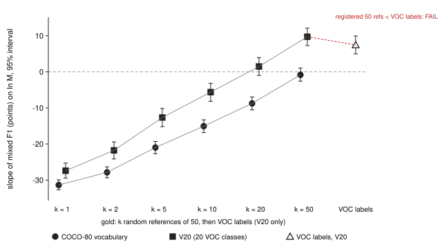

# 7 Experiments II: the verbosity slope across golds

<!-- v2 (SPIC, 2026-10-27): rewritten per manuscript/journal_draft/V2_WRITING_PLAN_SPIC_2026-10-27.md §2 "§7" as amended by CC-129 (W5, W8, W9, J5, J8). Old §7.1-7.4 condensed into §7.1; old §7.5 -> §7.2, §7.6 -> §7.3, §7.7 -> §7.4, §7.8 -> §7.5. Moved detail (old §7.1-7.3 paragraphs, full Table 7.2, eight-LVLM detail, random-deletion detail) is in Supplementary S7, "Material moved from Section 7 in v2". No registered number or verdict changed. -->

This section reports the slope of object F1 on $\ln M$ (Section 3.6); the confirmatory claim is its ordering by gold completeness (Section 1). The one-reference sign is registered but not derived from the theory, and the multi-reference sign is not predicted. Rows of Table 7.1 are registered or exploratory and report mixed F1.

**Table 7.1.** Slope of mixed F1 on $\ln M$ by gold (label gold: Section 3.1; plotted in Fig. 2). On XM3600 images the label-gold F1 combines verified precision with recall over the verified-present classes pooled over images (micro), as registered.<!-- rev1 (item 10): G2-B prereg md:130, md:164 (oiv7: F1_pos of evaluate_xm3600_predictions_v3; other golds check_mstar.prf mixed F1) --> 95% image-bootstrap intervals. The last two columns are a post hoc precision bracket (not registered; no verdict): the label-gold slope when mentions the labels cannot verify are counted as errors (lower) or as correct (upper); "—" means not computed.

| Family (systems; mention range) | Grade | 1 ref | 5 refs | Label gold | Bracket, lower (post hoc) | Bracket, upper (post hoc) |
|---|---|---|---|---|---|---|
| COCO-5000, Vietnamese outputs, COCO-80 (9; $M$ 0.84–2.18) | exploratory; post hoc full-split extension<!-- label per FILL_RULE (PI-1026c) --> | −4.77 [−6.10, −3.54] | +10.57 [+9.70, +11.43] | +22.13 [+21.39, +22.89]<!-- src: .session_backup/2026-10-26/a_full5000/out/r4_full5000_all9.json (sha256 332da8b6264c) :: gold.{refs1_randk,refs5_randk,inst}.{slope,slope_ci}, gold.inst.M_range, systems (9); r4 = 9 systems x 5,000 (FILL_RULE, PI-1026c) --> | — | — |
| English LVLMs, OPERA release (9; $M$ 2.18–3.29) | exploratory; predictions failed | −35.18 [−40.38, −30.87] | −29.57 [−32.69, −26.37] | +4.24 [−0.09, +8.51]<!-- source key: H3J families.F-B.gold.* --><!-- src (A6.3 merge, VERIFIED): '9' (F-B systems) = .session_backup/2026-10-14/r12/H3/N1_PREDICTIONS.txt :: line 6 --> | — | — |
| English LVLMs, Less-is-More release (11; $M$ 2.19–3.37) | exploratory; predictions failed | −31.89 [−36.60, −27.21] | −22.86 [−26.71, −18.53] | +6.91 [+2.16, +11.17]<!-- source key: H3J families.F-C.gold.* --><!-- src (A6.3 merge, VERIFIED): '11' (F-C systems) = .session_backup/2026-10-14/r12/H3/N1_PREDICTIONS.txt :: line 7 --> | — | — |
| UIT-ViIC test, COCO-80 lexicon (10; $M$ 1.07–2.29) | exploratory | −13.97 [−19.24, −8.01] | +4.80 [−0.57, +9.67] | +37.52 [+34.56, +40.08]<!-- source key: C2J coco80.*.all_10 --><!-- src (A6.3 merge, VERIFIED): '10' (UIT-ViIC systems) = .session_backup/2026-10-14/r11_verify/c2_n1_uitviic_mstar.json :: len(uitviic_test.systems) --> | — | — |
| UIT-ViIC test, Vietnamese reference lexicon (10; $M$ 1.59–6.94) | exploratory | −17.25 [−20.04, −14.53] | −6.28 [−8.31, −4.29] | +7.66 [+5.78, +9.58]<!-- source key: C2J vi_objects_in.*.all_10 --><!-- src (A6.3 merge, VERIFIED): '10' (UIT-ViIC systems) = .session_backup/2026-10-14/r11_verify/c2_n1_uitviic_mstar.json :: len(uitviic_test.systems) --> | — | — |
| XM3600-vi, 600 images, Vietnamese reference lexicon (6; $M$ 1.08–4.29) | registered out-of-sample; 2 of 5 predictions failed (1 of 3 sign predictions)<!-- src: .session_backup/2026-10-14/r12_verify/xm3600_full_verdict.json :: prereg_comparisons[16..20].in_interval_or_pass = PASS, FAIL, PASS, PASS, FAIL (2 FAIL of 5) --> | −8.99 [−10.89, −6.99] | −2.43 [−4.63, −0.30] (2–3 refs) | +19.32 [+17.43, +21.13] (OIV7, verified precision)<!-- source key: XMJ n1_f1_vs_logM_slopes.* --><!-- src (A6.3 merge, VERIFIED): '6' (XM3600 systems) = .session_backup/2026-10-14/r12_verify/xm3600_full_verdict.json :: prereg_comparisons.16.observed_value.n_systems_evaluated; '1' (XM3600 failed out-of-sample sign predictions) = .session_backup/2026-10-14/r12_verify/xm3600_full_verdict.json :: prereg_comparisons[16..18].in_interval_or_pass count==FAIL; '3' (XM3600 out-of-sample sign predictions) = manuscript/prereg/2026-10-14_xm3600_predictions.json :: a_N1_sign_predictions.kill_rule.h6_p2_kill (number in string) --> | +5.83 [+3.82, +7.82]<!-- src: data/results/n_f1/bracket_result.json (4796ed12) :: sets.s75.slopes.lower.{point_4dp, ci95_2dp} (manifest row 657; POST_HOC) --> | +20.13 [+18.35, +21.89]<!-- src: data/results/n_f1/bracket_result.json (4796ed12) :: sets.s75.slopes.upper.{point_4dp, ci95_2dp} (manifest row 659; POST_HOC) --> |
| Second backbone, Qwen3-VL-8B zero-shot, detailed captions capped at 160 new tokens (6 systems per set, clean subsets) | registered; primary claims PASS on each set (COCO-295 = discovery images; UIT-ViIC-231 not counted as support) | COCO-295 −11.46 [−17.27, −5.19]; UIT-ViIC-231 −20.96 [−24.31, −17.40]; XM3600-600 −12.27 [−14.55, −10.08] | not predicted (Section 7.3) | COCO-295 +13.14 [+7.81, +18.82]; UIT-ViIC-231 +37.36 [+35.15, +39.41]; XM3600-600 +13.71 [+11.44, +15.79]<!-- src: data/results/g2b/g2b_score.json (sha256 68be2b7a, commit 47de6b6) :: datasets.{cv295,uv231,xm600}.predictions.G2B-E1.parts[0] and G2B-E2.parts[0]; VERIFIED manuscript/verification/paperA/G2B_AN1_run.json (bc2d7959); G2-B prereg 0932ba1 --> | XM3600-600 +1.97 [−0.44, +4.01]<!-- src: data/results/n_f1/bracket_result.json (4796ed12) :: sets.xm600.slopes.lower.{point, ci95} (manifest row 658; POST_HOC) -->; COCO-295, UIT-ViIC-231 — | XM3600-600 +14.78 [+12.58, +16.79]<!-- src: data/results/n_f1/bracket_result.json (4796ed12) :: sets.xm600.slopes.upper.{point, ci95} (manifest row 660; POST_HOC) -->; COCO-295, UIT-ViIC-231 — |
| Second backbone, same runs, all images (295, 231 and 600 images) | registered sensitivity, no verdict | COCO-295 −11.03 [−16.60, −5.47]; UIT-ViIC-231 −22.14 [−25.43, −18.74]; XM3600-600 −12.77 [−15.03, −10.51] | not predicted | COCO-295 +13.70 [+8.50, +18.63]; UIT-ViIC-231 +37.44 [+35.40, +39.15]; XM3600-600 +14.10 [+11.98, +16.15]<!-- src: data/results/g2b/g2b_score.json (sha256 68be2b7a, commit 47de6b6) :: datasets.{cv295,uv231,xm600}.sensitivity_full_set.{G2B-E1,G2B-E2}.parts[0].{point,ci95} (verdict = null; n_images = n_images_full = 295, 231, 600); registered as sensitivity in G2-B prereg 0932ba1, manuscript/prereg/2026-10-18_g2b_qwen3vl_ladder.md:159 ("The same statistics on all images are reported as a sensitivity analysis, without verdicts"), :171, :219; CC-108 W2 --> | — | — |

<!-- src rows: COCO-5000: .session_backup/2026-10-26/a_full5000/out/r4_full5000_all9.json (sha256 332da8b6264c) :: gold.{refs1_randk,refs5_randk,inst}.{slope,slope_ci,M_range} (r4, 9 systems x 5,000; FILL_RULE).
F-B / F-C: .session_backup/2026-10-14/r12/H3/out/n1_results.json :: families.{F-B,F-C}.gold.{refs1_randk,refs5_randk,inst}.{slope,slope_ci,M_range}.
UIT-ViIC: .session_backup/2026-10-14/r11_verify/c2_n1_uitviic_mstar.json :: uitviic_test.lexicons.{coco80,vi_objects_in}.gold_variants.{refs1_randk,refs5_randk,inst_only}.groups.all_10.{slope_F1_mixed_per_logM,slope_F1_mixed_ci95,M_range}.
XM3600 (XMJ): .session_backup/2026-10-14/r12_verify/xm3600_full_verdict.json (sha256 0b2b3aa5e1a3) :: matcher_v2_tone_normalised.n1_f1_vs_logM_slopes.{refs1_randk,refs_all,oiv7_verified}.{slope_F1_per_logM,slope_ci95_b500,M_range}. The vi_objects_in 5-ref interval is the refs5_randk key ([-8.31,-4.29]); the [-8.34,-3.96] quoted in earlier drafts is the refs5_firstk key of the same file (same gold at K=5, different bootstrap draws).
Bracket columns: J8 of the plan, ruled YES by CC-129 (same table, labelled post hoc, "—" where not computed); the bracket was computed for the Section 7.2 systems (s75) and for xm600 only (DESIGN c8bd21c). -->

<!-- caption: figs/CAPTIONS.md (outside the word count, PD-29 (b)); values figs/VALUES.json -->

## 7.1 Unregistered rows: COCO-5000, English LVLM outputs and UIT-ViIC (exploratory)

**COCO-5000.** Four predictions were pre-specified on COCO-2500, the seed-42 half of COCO-5000: they were timestamped before the first output but never committed, so the test is exploratory<!-- src: manuscript/prereg/2026-10-18_never_committed_frozen_files.json :: files[2] (L1_COCO).{mtime_utc = 2026-10-14T07:22:14Z, first_output.mtime_utc = 2026-10-14T07:25:31Z, in_any_git_commit = false}; prediction file check_coco_PREDICTIONS.txt -->. All four held on COCO-2500 and on COCO-5000 (post hoc full-split extension)<!-- PI-1026c --><!-- src: .session_backup/2026-10-14/r11_litmaps/L1/check_coco_PREDICTIONS.txt (c7cad2b2); held keys .session_backup/2026-10-26/a_full5000/out/w4_summary.json (sha256 a11cba1634e5) :: cells.r4_full5000_all9.{P1_holds, P2_inst_ci_above_0, P3_refs1.holds, P4_holds} = true, kill_fires = false; values .session_backup/2026-10-26/a_full5000/out/r4_full5000_all9.json (332da8b6264c) :: gold.* -->: the slope is ordered, −4.77 < +10.57 < +22.13<!-- src: same r4 file :: gold.{refs1_randk,refs5_randk,inst}.slope; S.P1_holds = true -->, and it rises at every step $k \to k+1$ and again to instance gold<!-- src: same r4 file :: gold.{refs1..refs5}_randk.slope, inst.slope; every-step report S.P1_rises_every_step_and_to_inst = true (not P1; FILL_RULE §7.1, CP-111a W3) -->. The positive five-reference slope is a dataset-specific outcome (Supplementary S7).

**English LVLM outputs.** For the public CHAIR outputs of the two release families of Section 6 (pre-specified, never committed; exploratory)<!-- src: .session_backup/2026-10-14/r12/H3/N1_PREDICTIONS.txt; manuscript/prereg/2026-10-18_never_committed_frozen_files.json :: files[1] (H3_N1).{mtime_utc = 2026-10-14T12:43:39Z, first_output.mtime_utc = 2026-10-14T12:47:47Z, in_any_git_commit = false} -->, the one-reference and ordering predictions held in both, and the five-reference prediction (slope > 0) **failed** in both (−29.57 and −22.86)<!-- src (A6.3 merge, VERIFIED): '−29.57' (F-B refs5 slope) = .session_backup/2026-10-14/r12/H3/out/n1_results.json :: families.F-B.gold.refs5_randk.slope; '−22.86' (F-C refs5 slope) = .session_backup/2026-10-14/r12/H3/out/n1_results.json :: families.F-C.gold.refs5_randk.slope -->, as did the instance-gold prediction for OPERA (+4.24 [−0.09, +8.51])<!-- src (A6.3 merge, VERIFIED): .session_backup/2026-10-14/r12/H3/out/n1_results.json :: families.F-B.gold.inst.{slope, slope_ci} -->. What failed is the crossing's location, not its direction: five references do not turn the slope positive for systems that name about three objects (median $M$ 3.13 and 3.03)<!-- src: .session_backup/2026-10-14/r12/H3/out/n1_results.json :: families.{F-B,F-C}.gold.refs1_randk.median_M -->.

**UIT-ViIC.** UIT-ViIC test (231 COCO train2017 images; exposure possible<!-- src: .session_backup/2026-10-18/paperA_tasks/P2/MANIFEST.json (sha256 2ba055342c90) :: numbers[29] datasets.uv231.coco_url_split = {train2017: 231}; VERIFIED in manuscript/verification/paperA/P2.json; label per judge CC-024 -->) was scored before any prediction existed. Under both matchers the slope is ordered and negative at one reference, but the five-reference sign depends on the matcher (Table 7.1).

## 7.2 XM3600: out-of-sample test with a transferred exponent (registered; mixed outcome)

**Design.** XM3600 (Thapliyal et al., 2022)<!-- cite: thapliyal2022crossmodal, DOI 10.18653/v1/2022.emnlp-main.45, in .session_backup/2026-10-18/paperA_tasks/A5.2/paperA_v3.bib (VERIFIED) --> gives 2–3 Vietnamese references per image and human-verified Open Images V7 labels (OIV7), the label gold (Section 3.1); its images are Open Images images. Six systems (Qwen2.5-VL-7B zero-shot and two Vietnamese adapters, one trained with the gold-SFT recipe of an earlier study (Nguyen et al., 2026a); short and detailed prompts)<!-- cite: nguyen2026vsps (FAIR 2026, IEEE, ISBN 979-8-3195-1937-5); p1_s43 is the gold-SFT recipe P1 of that paper; fuse2_s42 is not in FAIR (journal_draft_B/new_vs_FAIR.md; FAIR text has no fusion system) --> are scored on 600 images, a random draw (seed 0) from the 2,119 XM3600 images with a verified label on a mapped OIV7 class, pinned by the registration. The other XM3600 images are held out for a separate registered study.<!-- src: scripts/xm3600_oiv7.py:123-124 (pool = images with a verified label on a mapped class; random.Random(args.seed).sample(pool, args.n_eval)), :314 (--n-eval default 600), :315 (--seed 0); data/xm3600/manifest.json :: coverage.images_with_a_verified_label_on_a_mapped_class = 2119, coverage.eval_subset = {n: 600, seed: 0}; subset data/xm3600_subset.txt drawn by `xm3600_oiv7.py build` (committed e564ed6, 2026-10-12), pinned by the registration 4ccbee3 (2026-10-14); CC-108 W5 and ruling 2 (class b-exempt; a full-XM3600 run would read another study's development and one-look test images) --> The exponent is transferred from COCO-2500, not refitted; the predictions and code were committed on 2026-10-14 at 16:38Z, before the first output (17:00Z)<!-- src: .session_backup/2026-10-18/paperA_tasks/A4.4/tests_status.tsv :: XM_N1 t_commit 2026-10-14T16:38:04Z, t_out 2026-10-14T17:00:36Z; manuscript/prereg/2026-10-14_xm3600_predictions.json (sha256 5d0134bfded0) :: dataset.n_images_eval_subset = 600; commit 4ccbee3 -->.

**Registered predictions and verdicts** (as computed by the registered evaluator)<!-- src: .session_backup/2026-10-14/r12_verify/xm3600_full_verdict.json (sha256 0b2b3aa5e1a3) :: prereg_comparisons[16..20].{prediction_id,in_interval_or_pass,observed_value}; pending_runs = []; prediction ids N1-XM-1..N1-XM-5 in order -->:
- **One-reference slope < 0: PASS** (−8.99 [−10.89, −6.99]).
- **All-references slope > 0, the risky test: FAIL** (−2.43 [−4.63, −0.30] with all 2–3 references).
- **OIV7 slope > 0: PASS** (+19.32 [+17.43, +21.13]).
- **Ordering one reference < all references < OIV7: PASS** (−8.99 < −2.43 < +19.32).
- **Sign agreement with $M^*_{\text{mixed}}$ − median $M$: FAIL.** It holds for 3 of 4 gold variants; the exception is the all-references gold, where the in-sample $M^*_{\text{mixed}} = 1.76$ lies above the median $M$ of 1.38 but the slope is negative. With the transferred exponent, agreement is 2 of 4, missing also on the one-reference gold.
<!-- src: same :: matcher_v2_tone_normalised.n1_f1_vs_logM_slopes.{refs1_randk,refs_all,oiv7_verified}.{slope_F1_per_logM,slope_ci95_b500}; prereg_comparisons[20].observed_value.{in_sample_Mstar_mixed_agreement_count,prior_b_Mstar_micro_agreement_count,per_gold.refs_all.Mstar_mixed_in_sample,per_gold.refs_all.median_M}; "missing also on the one-reference gold" (transferred rule misses refs_all and refs1_randk) per CC-129 "N1-XM-5 per gold" check -->

Two registered rules applied: if 2 or more of the three sign predictions failed, the result would be demoted to a diagnostic; if the one-reference prediction failed, the sign-change claim would be dropped (Supplementary S4).<!-- src (A6.3 merge, VERIFIED): '2' (XM3600 registered demotion threshold) = manuscript/prereg/2026-10-14_xm3600_predictions.json :: a_N1_sign_predictions.kill_rule.h6_p2_kill (number in string) --> With one of three sign predictions failed, neither rule was triggered. The registration also froze 15 gold-size values on these images; 14 were reproduced, and the one-reference non-empty gold size missed its interval (1.8768 against 1.8831; OUT; Supplementary S7)<!-- src: .session_backup/2026-10-14/r12_verify/xm3600_full_verdict.json :: prereg_comparisons[1..15].in_interval_or_pass (14 IN); prereg_comparisons[6] (GBAR-refs1_randk-Gbar_nonempty) prereg_interval_or_threshold = 1.8831, observed_value = 1.8768, in_interval_or_pass = OUT (manifest rows 223-225); CC-129 W1 -->.

**Reading.** The slopes are ordered, as predicted. The verified labels are scored with verified precision (Section 3.1), so we bounded the label-gold slope post hoc (design fixed before the run; no verdict; Supplementary S7). Counted as errors, unverifiable mentions leave the slope at +5.83 [+3.82, +7.82] here, still above both reference slopes at point level, but on the second backbone's XM3600-600 outputs the lower bound is +1.97 [−0.44, +4.01] (Table 7.1)<!-- src: data/results/n_f1/bracket_result.json (sha256 4796ed12) :: outcome_paper = ii, sentence_paper; sets.s75.slopes.lower.{point_4dp, ci95_2dp}; sets.xm600.slopes.lower.{point, ci95}; per set: sets.s75.outcome_from_lower = i, sets.xm600.outcome_from_lower = ii (paper-level AND, DESIGN.md R3, CC-063); design c8bd21c; run record manuscript/prereg/2026-10-21_n_f1_bracket/run_record.json (062ab6a5); VERIFIED manuscript/verification/paperA/N_F1_bracket_run.json (60e58bfe; byte-identical re-run); CONFIRMATION_MAP Amendment 4 row 27 -->. For the two sets jointly, the positive label-gold slope therefore depends on excluding unverifiable mentions (post hoc). Under the lower rule the ordering holds at point level only; no interval on the differences was computed. The positive slope with 2–3 references failed: the crossing lies at a more complete gold, which the transferred exponent missed (in-sample 0.503 against 0.549).<!-- src: .session_backup/2026-10-14/r12_verify/xm3600_full_verdict.json :: matcher_v2_tone_normalised.n1_f1_vs_logM_slopes.refs_all.b_in_sample; prereg b from .session_backup/2026-10-14/r11_verify/c1_b1_b6_reproduction.json :: B1_L1_mstar_and_stopping.check_coco_gold.refs2_randk.b --> <!-- v2: the sentence on the one-reference mechanism (median M 1.38 below the transferred optimum 1.471; src xm3600_full_verdict.json :: prereg_comparisons[16].observed_value.{observed_median_M,prereg_Mstar_all_600_prior_b}) moved to Supplementary S7 -->XM3600 supports the ordering of the slopes, not the location of the sign change.

**Exchangeability of XM3600 references.** On the 150 images with three references the adjacency share, 0.533 [0.414, 0.647], is at or below the null of 2/3<!-- src: .session_backup/2026-10-14/r12_verify/xm3600_full_verdict.json :: n2_reference_adjacency_verification.full_3600_150_3ref_images.{n_images_3_refs,adjacent_share,bootstrap_ci95_b5000,exchangeable_null_for_K3} -->. The verdict file lists this check (N2-XM-FULL150) as PASS, but the registration quotes the check's own result, so we treat it as post hoc (Table 1; Supplementary S5).<!-- src: .session_backup/2026-10-18/paperA_tasks/A4.4/tests_status.tsv :: XM_N2 status POST_HOC; xm3600_full_verdict.json :: prereg_comparisons[21].in_interval_or_pass = PASS (manifest row 245); label conflict per CC-129 W1, coordinator record pending -->

## 7.3 A second backbone (registered)

**Design.** The families above use one backbone (Qwen2.5-VL-7B). The second-backbone test repeats the measurement with Qwen3-VL-8B zero-shot, six systems per set (three temperatures × a short and a detailed Vietnamese prompt; detailed captions capped at 160 new tokens)<!-- src: prereg 2026-10-18_g2b_qwen3vl_ladder.json :: decode.max_new_tokens = 160 for all 11 detailed runs (judge CC-043 check); token caps manuscript/prereg/2026-10-18_g2b_qwen3vl_ladder.md :: line 36 (short 60, detailed 160); design .session_backup/2026-10-13/decisions/D15.txt (MT19), whose "uncontaminated" premise judge CC-024 withdrew (G2-B prereg 0932ba1) -->, on three sets<!-- src: image provenance .session_backup/2026-10-18/paperA_tasks/P2/MANIFEST.json (sha256 2ba055342c90) :: numbers[24] datasets.cv295.in_coco_val2017 = 295, numbers[28] datasets.uv231.n_images = 231, numbers[29] datasets.uv231.coco_url_split = {train2017: 231}, numbers[32] datasets.xm600.n_images = 600; VERIFIED in manuscript/verification/paperA/P2.json -->:
- **COCO-295:** 295 COCO val2017 images, all in the COCO-2500 discovery set, so a replication on discovery images<!-- src: CONFIRMATION_MAP §2 scope (binding 3): all 295 cocoids are in data/coco_probe/manifest.json; PD-10 binding 3, CC-027 (e) -->;
- **UIT-ViIC-231:** UIT-ViIC test (COCO train2017 images the backbone may have seen), where a failure would count against the claim but a pass is not counted as support<!-- src: CC-024; G2-B prereg §4 -->;
- **XM3600-600:** the Section 7.2 images; the first-backbone outcome on them was known when this test was registered<!-- src: data/xm3600_subset.txt (sha f5ab86c7, committed e564ed6) = the §7.5 (v2 §7.2) images, pinned in manuscript/prereg/2026-10-14_xm3600_predictions.md:29 (PD-23 judge check) -->.

The registered primary claims are a negative one-reference slope, a positive label-gold slope, the ordering of the slopes, and the ordering of the exponent (rules: Supplementary S4). Verdicts use clean subsets, the images on which every caption of every system passes the registered language check<!-- src: manuscript/prereg/2026-10-18_g2b_qwen3vl_ladder.md :: line 159 (Analysis sets: clean subset; looks_vietnamese, CJK_RE); kill rule KL -->.

**Primary result.** All four primary claims PASS on each set. They were scored once, after all 23 registered decodes were committed; no withdrawal rule was triggered and no run excluded. On the clean subsets (263 of 295, 209 of 231 and 537 of 600 images), the one-reference and label-gold slopes are those of Table 7.1, and the slope rises at each level (Table 7.2): all references minus one reference is +12.00 [+7.85, +15.73], +22.75 [+19.70, +25.95] and +5.89 [+4.76, +6.87]; label gold minus all references is +12.60 [+6.91, +18.38], +35.56 [+30.86, +40.18] and +20.10 [+17.39, +23.05]<!-- src: data/results/g2b/g2b_score.json (sha256 68be2b7a, commit 47de6b6) :: datasets.*.predictions.G2B-{E1,E2,O1}.parts[*].{point,ci95}, predictions.*.n_images, verdicts, kill_rules (K1/K2/K3/KN1/KD fires=false), excluded_runs = {}; run record data/results/g2b/g2b_score_record/ (precheck 23/23); VERIFIED manuscript/verification/paperA/G2B_AN1_run.json (bc2d7959) -->. The all-image values are a registered sensitivity analysis without verdicts (Table 7.1; Supplementary S7).<!-- src: G2-B prereg 0932ba1, manuscript/prereg/2026-10-18_g2b_qwen3vl_ladder.md:159, :171, :219 ("Full-set (sensitivity) numbers are never presented as verdicts"); CC-108 W2 --> <!-- pass 3: nested-rungs/missingness sentence removed here for length; it is stated in Sections 4.2 and 10.1 --> Under the lower precision rule, the XM3600-600 label-gold slope (+1.97) stays above the all-reference slope implied by the levels (−6.39) at point level only (post hoc derived; no interval).<!-- src: data/results/a1_robustness/loo_triples.json (sha256 d74f34c431fb; script scripts/paperA/a1_loo_triples.py 6a7a49f4199c) :: g2b_xm600_rung_implied_all_refs_slope = G2B-E1.parts[0].point + G2B-O1.parts[0].point, g2b_xm600_lower_bracket_label_slope, g2b_xm600_lower_label_above_implied_all = true; DERIVED (POST_HOC), CC-129 W9 (CC-129 printed -6.38 from rounded inputs) --> A post hoc random-deletion check (design committed before the run) finds that the slope against reference gold restricted to label-gold classes lies below the 95% range of size-matched random deletions in all eight cells tested, so which objects annotators name matters beyond how many (no verdict; Supplementary S7).<!-- src: data/results/scar/scar_null_result.json (sha256 242fc04e) :: results.{cv295,uv231,xm600,s75}/refs1_randk.{observed_intersection_slope,null_lo,null_hi} and the refs_all cells; design manuscript/prereg/2026-10-21_scar_null/SCAR_DESIGN.md (59a4887; PD-23 (d), PD-23b, CC-048); VERIFIED manuscript/verification/paperA/SCAR_null_run.json (5212f745; byte-identical re-run) -->

**Truncation.** In the detailed runs, 3,367 of 3,378 captions (99.7%) reached the 160-token cap by the recorded token counts (Supplementary S7)<!-- src: data/results/n_m3/caphit_result.json (sha256 72404c62) :: pooled_9_ladder_detailed.counts.hits_recorded = 3367, pooled_9_ladder_detailed.counts.n = 3378, pooled_9_ladder_detailed.shares.share_hits_recorded = 0.99674 (99.7%, one decimal); hit := recorded n_tokens >= 160 (hit_rule); VERIFIED manuscript/prereg/2026-10-21_n_m3_caphit/VERIFY.md (705d6567, 326/326 fields); CONFIRMATION_MAP Amendment 5b row 33 (CC-076) -->. Each set's six systems therefore form two clusters, short and detailed, whose mention counts differ by less than 7% within a cluster (Section 7.5)<!-- src: data/results/a1_robustness/a1_system_robustness.json :: families.G2-B cv295.1 ref.subsets.prompt=detailed.lnM_spread = 0.0587 (6.0%, the largest of the six G2-B prompt subsets) -->. The second-backbone slope is effectively a short-versus-detailed contrast whose upper $M$ is set by the cap, not chosen by the model; within-cluster slopes are not interpreted.<!-- CC-129 W8 -->

**Registered secondary claims.** Each verdict below is the registered one on the clean subsets; the full table is in Supplementary S7.<!-- src: data/results/g2b/g2b_score.json (sha256 68be2b7a) :: datasets.*.predictions.{G2B-O2,G2B-P2,G2B-P3a,G2B-P3b,G2B-P4}.{verdict, parts[*].{rule,delta,point,ci95,verdict}}; equivalence band 0.05 and intercept threshold 2 = parts[*].delta (manifest rows added 2026-10-27, CC-129 ruling 2); secondary ids: language = G2B-P2, backbone = G2B-P4, sampling = G2B-P3a, temperature = G2B-P3b -->
- **Rise at every added reference (G2B-O2): PASS** on COCO-295 and UIT-ViIC-231 (each step > 0; e.g. one to two references +3.99 [+1.70, +6.02] on COCO-295)<!-- src: same :: datasets.cv295.predictions.G2B-O2.parts[0].{point,ci95,verdict} -->.
- **Language (G2B-P2) and sampling (G2B-P3a), same exponent within ±0.05: INCONCLUSIVE** (language on COCO-295 and UIT-ViIC-231, sampling on UIT-ViIC-231).
- **Temperature (G2B-P3b): FAIL** on UIT-ViIC-231 and XM3600-600, INCONCLUSIVE on COCO-295. The b differences sit inside or across ±0.05, but the registered negative intercept shift at T = 0.8 is not observed: +0.31 [−0.64, +1.30] (UIT-ViIC-231) and +0.42 [−1.03, +1.77] (XM3600-600) precision points, against a registered sign < 0.
- **Backbone, same b within ±0.05 and intercepts differing by more than 2 points (G2B-P4): INCONCLUSIVE** on all three sets.<!-- pass 3: the INCONCLUSIVE intervals of G2B-P2, P3a and P4 are in Supplementary S7 (full table); verdicts unchanged -->
- **Condensed F1 (A-N1).** Condensed F1, after the condensed lists of Sakai (2007), drops unjudged mentions (Section 3.1). Its registered margin of shrinkage Q (> 0 to pass) is 12.84 [9.86, 14.36] on XM3600-600 (PASS), 3.82 [2.58, 5.07] on UIT-ViIC-231 (PASS) and 0.26 [−1.76, 2.11] on COCO-295 (INCONCLUSIVE); the registered outcome is **MIXED**, because support required COCO-295 as well.<!-- src: data/results/g2b/an1_score.json (sha256 ec0938e0, commit 47de6b6) :: sets.*.primary_analysis.primary.{rule = sign_gt_0, point, ci95, verdict}, outcome = MIXED; addendum manuscript/prereg/2026-10-19_an1_g2b_addendum.json (80852f4) :: outcome_rule; test id A-N1; VERIFIED G2B_AN1_run.json (bc2d7959); cite: sakai2007alternatives, DOI 10.1145/1277741.1277756 -->

**Table 7.2.** Second backbone (mixed F1; XM3600 label gold as in Table 7.1), registered primary level statistics on the clean subsets (verdicts as registered; point and 95% image-bootstrap interval). Secondary statistics and the all-image values are in Supplementary S7.

| Statistic (registered id) | COCO-295 (n = 263) | UIT-ViIC-231 (n = 209) | XM3600-600 (n = 537) |
|---|---|---|---|
| Slope, all references − one reference (G2B-O1) | +12.00 [+7.85, +15.73], PASS | +22.75 [+19.70, +25.95], PASS | +5.89 [+4.76, +6.87], PASS |
| Slope, label gold − all references (G2B-O1) | +12.60 [+6.91, +18.38], PASS | +35.56 [+30.86, +40.18], PASS | +20.10 [+17.39, +23.05], PASS |
| Exponent, b(all references) − b(one reference) (G2B-P1) | +0.097 [+0.038, +0.151], PASS | +0.223 [+0.187, +0.260], PASS | +0.070 [+0.051, +0.087], PASS |
| Exponent, b(label gold) − b(all references) (G2B-P1) | +0.207 [+0.125, +0.289], PASS | +0.391 [+0.340, +0.440], PASS | +0.511 [+0.461, +0.562], PASS |
<!-- src: data/results/g2b/g2b_score.json (sha256 68be2b7a, commit 47de6b6) :: datasets.{cv295,uv231,xm600}.predictions.{G2B-O1,G2B-P1}.parts[*].{point,ci95,verdict} and predictions.<id>.n_images; values copied from the CP-111 W1 table (.session_backup/2026-10-26/a_cp111/w1_table72.py); prediction verdicts G2B-O1 and G2B-P1 PASS on cv295, uv231 and xm600 -->

**Eight public LVLMs (registered secondary).** A further registered test decodes eight public LVLMs in English on COCO-295 and on UIT-ViIC test with English references. Its ranking prediction is **PASS** on both sets: one-reference F1 does not rank the eight models as complete gold does (τ_b upper bound below 0.9; values in Supplementary S7). Its per-model ladder prediction is **FAIL** on COCO-295: Qwen3-VL-8B (detailed captions capped at 160 new tokens) fails the complete-gold part (slope −1.124 [−11.52, 6.62], a FAIL under the registered "point ≤ 0" rule; the interval includes 0), two models are INCONCLUSIVE, and the ladder holds for 8 of 8 models on UIT-ViIC. By the registered every-model withdrawal rule, the pattern is not claimed for every public LVLM; every detailed caption of Qwen3-VL-8B and Idefics3-8B reached the cap (Supplementary S7).<!-- src: data/results/a_n2/a_n2_run.json (sha256 1f6ce422, commit 80405b1) :: datasets.{cv295,uv231en}.verdicts_on_analysis_set.LBA-P1 (ranking prediction) / LBA-P2 (per-model ladder prediction; manifest row 625 for −1.124), kill_rules.KA2.failing_models (every-model withdrawal rule), hit_max share 1.0 (detailed_en); VERIFIED manuscript/verification/paperA/A_N2_run.json (8f7cf06d); writer bindings CP-041 (do not call the rankings anti-correlated: the cv295 CI reaches 0); test id A-N2 -->

## 7.4 Large reference sets: PASCAL-50S (registered 2026-10-29)

**Design.** PASCAL-50S (Vedantam et al., 2015) gives 50 references for each of the 1,000 UIUC PASCAL Sentences images (Rashtchian et al., 2010), all in VOC2008 trainval, whose object labels on 20 classes (Everingham et al., 2010) serve as the label gold (V20). The test reuses the frozen eight-model English LVLM set of Section 7.3 with its short and detailed prompts; the 8 GPU-hour cap, fixed before the run, kept seven models (Idefics3-8B left first in the registered drop order), so the family has 14 runs. The registration, its evaluator and the 1,000-image list were committed on 2026-10-29 at 00:49:49Z, before the run started (00:51:22Z); the outputs were scored once. The analysis set is the 997 images whose caption is clean in every run, and intervals use 1,000 image-bootstrap draws, as registered. Whether the five original UIUC captions of an image are among its 50 references is unknown, and no adjacency or exchangeability check was registered for PASCAL-50S. Two departures from the registration (no hash of the deleted caption files; a structure check of the reference file on a local machine before the commit) are disclosed in Section 10.1; neither changes a verdict.<!-- rev1 (items 7a, 7b, 8, 14): n_boot = data/results/p50/p50_decide.json :: n_boot (1000); departures PREREG 2026-10-28_a_p50_kladder §0 l.35 and §6 --><!-- src: data/results/p50/p50_decide.json (sha256 0da4cab90fe9) :: models (7), runs (14), analysis_set.n_images = 997, n_refs_min_max = [50, 50], label_rung = kept, left = {}, plan.model_cap_s.idefics3_8b (dropped by plan, not by fault); prereg manuscript/prereg/2026-10-28_pascal50s/PREREG.md (prereg_id 2026-10-28_a_p50_kladder) §2 drop order, §6 cap; commit 353437f at 2026-10-29T00:49:49Z; first output (EVENTS "start run") 2026-10-29T00:51:22Z; data/results/p50/EVENTS. Vedantam et al. described only by the dataset facts quoted in PREREG §1.1 (CC-159 ruling 5: re-read before any further sentence) -->

**Registered verdicts.** The primary prediction (P50-A4) tests whether the ordering of Section 7.2 replicates: one reference < all 50 references < VOC labels, all on the V20 vocabulary.
- **One reference < 50 references: PASS** (+37.16 [+35.07, +39.09]).
- **50 references < VOC labels: FAIL** (−2.29 [−5.15, +0.61]; the point is ≤ 0, so the registered rule gives FAIL although the interval includes 0; under the original point-estimate criterion of A4 it also fails).
- **P50-A4 (compound): FAIL.** The second part's interval includes 0, so the FAIL means that the predicted direction was not shown, not that the reverse was shown.
- **Rise at every registered level, k = 1 → 2 → 5 → 10 → 20 → 50, COCO-80 (P50-O2, secondary): PASS** at every step: +3.51 [+3.03, +4.01], +6.88 [+6.33, +7.41], +5.91 [+5.41, +6.38], +6.32 [+5.84, +6.80] and +7.93 [+7.30, +8.59].
<!-- src: data/results/p50/p50_decide.json (sha256 0da4cab90fe9) :: analysis_set.P50-A4.parts[0..1].{point, ci95, verdict, not_FAIL}, analysis_set.P50-A4.verdict = FAIL; analysis_set.P50-A4r.verdict = null ("the label rung was kept"); analysis_set.P50-O2.parts[0..4].{point, ci95, verdict}, analysis_set.P50-O2.verdict = PASS; rules PREREG §3.5-3.6 (sign_gt_0, compound, no correction, CC-144 ruling 6) -->

On PASCAL-50S the registered ordering did not replicate: the label-gold part (50 references < VOC labels) was FAIL (−2.29 [−5.15, +0.61]). We report this as a failed out-of-sample replication of the ordering claim of Section 7.2; the confirmatory claim of this paper is restricted to the XM3600 and second-backbone tests, and the label-gold part is listed in Table 1 as FAIL. The images and captions have been public since 2008–2015 and may be in the pretraining data of these models; they are unseen by us, not necessarily by the models. Every one of the 14 caption files shared 8-grams with the references (18 to 419 per file); such overlaps can be generic phrases or memorised text, and by registration they were not a verdict input.<!-- rev1 (item 7c): data/results/p50/ngram_p50_*.preds.json :: files.* (counts only) --><!-- branch text PREREG §9.2, inserted as written with the fills [part] = "the label-gold part (50 references < VOC labels)", [value] = −2.29 [−5.15, +0.61], [failing part] = "label-gold part"; §9.1's "for the reference ladder only" does not apply (label rung kept) -->

**Without a verdict.** On COCO-80 the slope with 50 references minus the slope with one reference is +30.56 [+29.04, +32.03] (registered descriptive contrast). The slope signs were not predicted: on COCO-80 the slope rises from −31.38 [−32.70, −29.95] with one reference to −0.83 [−2.58, +1.07] with 50; on V20 it is +9.74 [+7.29, +12.12] with 50 references and +7.45 [+4.98, +9.94] under the VOC labels (all levels in Fig. 3 and Supplementary S7). On all 1,000 images (registered sensitivity, no verdict) the two A4 parts are +37.26 [+35.35, +39.38] and −2.37 [−5.44, +0.62]. Two limits were stated in the registration before the run: V20 has only 20 classes and its images were chosen 50 per class, so "person" dominates, and the English matcher maps "aeroplane" to no class, which lowers airplane recall against the VOC labels. Whether either explains the failed part was not tested. A third reading was also not tested: that the VOC labels are more complete than the 50-reference gold on these 20 classes was assumed, not measured, and the 50-reference slope on V20 already exceeds the VOC-label slope, so the failure may reflect a label level that is not more complete, rather than a more complete gold without a larger slope.

<!-- rev1 (item 13): decided P50-NS values only, read from number_manifest.tsv by scripts/figures/paperA_figs.py; caption figs/CAPTIONS.md -->

**System dependence.** The intervals hold the 14 runs fixed (7 models × short and detailed prompts). On V20 the mean number of named classes forms two clusters, 1.12–1.35 for short and 1.61–2.24 for detailed captions, so the slope is in effect a short-versus-detailed contrast, as in every registered family. Per model (descriptive, two runs each) the VOC-label slope ranges from −1.05 to +14.75 and is negative for LLaVA-1.5-7B and LLaVA-OneVision-7B (Supplementary S7). Whether detailed captions reached the 160-token cap was not recorded. No system-level interval exists, and none can be computed, because the 14 caption files were deleted under the registered data rule; the decide files, the event log, the evaluator hashes and the job script are in the deposit.<!-- rev1 (items 5b, 6): M clusters = data/results/p50/p50_decide.json (0da4cab90fe9) :: analysis_set.M.V20 (short runs 1.123-1.347, detailed runs 1.608-2.236; runs order = runs[]); PAIR_m_descriptive.*.voc20|V20 (min llava15_7b −1.05, max qwen25vl_7b +14.75); cap hit: no field in p50_decide.json or plan.json --><!-- src: data/results/p50/p50_decide.json (sha256 0da4cab90fe9) :: analysis_set.descriptive_coco80_refs50_vs_refs1.{point, ci95} (verdict null); analysis_set.P50-NS.{refs1_randk|coco80, refs50|coco80, refs50|V20, voc20|V20}.{point, ci95}; sensitivity_all_images.P50-A4.parts[0..1].{point, ci95} (verdict null); limits PREREG §10 items 3 and 5 -->

## 7.5 System-level robustness (post hoc)

The intervals of Table 7.1 hold the systems fixed. We recomputed every cell of Table 7.1 with each system left out in turn and formed a system jackknife interval (standard error from the leave-one-out slopes; t with n − 1 degrees of freedom). This analysis is post hoc and changes no registered verdict.

**Table 7.3.** Slope of mixed F1 on $\ln M$ (XM3600 label gold as in Table 7.1): full family, the range over leave-one-system-out fits, and the system jackknife 95% interval in brackets.

| Family (systems) | 1 ref | 5 refs | Label gold |
|---|---|---|---|
| COCO-5000 (9) | −4.77: −11.98 to −2.33 [−22.17, +12.64] | +10.57: +4.54 to +12.67 [−4.18, +25.32] | +22.13: +19.96 to +22.93 [+16.85, +27.41] |
| English LVLMs, OPERA (9) | −35.28: −36.64 to −34.51 [−38.98, −31.59] | −29.65: −31.03 to −28.54 [−33.78, −25.52] | +4.26: +3.39 to +6.24 [−1.53, +10.06] |
| English LVLMs, Less-is-More (11) | −31.88: −34.15 to −30.81 [−37.46, −26.30] | −22.86: −26.08 to −21.86 [−30.20, −15.52] | +6.99: +1.49 to +9.54 [−6.85, +20.83] |
| UIT-ViIC, COCO-80 lexicon (10) | −13.97: −16.06 to −2.87 [−38.52, +10.58] | +4.81: +1.88 to +18.54 [−25.49, +35.12] | +37.54: +35.29 to +44.13 [+21.12, +53.95] |
| UIT-ViIC, Vietnamese lexicon (10) | −17.24: −23.62 to −15.48 [−32.56, −1.92] | −6.28: −7.62 to −4.88 [−12.91, +0.36] | +7.66: +5.79 to +20.68 [−20.21, +35.53] |
| XM3600 (6) | −8.99: −11.16 to +10.52 [−52.29, +34.31] (sign flips without zero-shot detailed) | −2.43: −4.56 to +18.07 [−47.88, +43.02] (sign flips without zero-shot detailed) | +19.32: +19.12 to +23.21 [+10.79, +27.86] |
| Second backbone, COCO-295 (6) | −11.46: −12.22 to −10.85 [−14.26, −8.65] | not predicted | +13.14: +12.52 to +14.00 [+10.35, +15.92] |
| Second backbone, UIT-ViIC-231 (6) | −20.96: −21.38 to −20.69 [−22.16, −19.75] | not predicted | +37.36: +37.04 to +37.81 [+35.98, +38.73] |
| Second backbone, XM3600-600 (6) | −12.27: −12.52 to −11.86 [−13.68, −10.86] | not predicted | +13.71: +13.55 to +13.86 [+13.16, +14.25] |
<!-- src: data/results/a1_robustness/a1_system_robustness.json (sha256 af77ffa0f82b) :: families.<family>.<gold>.{slope_full, loo_min, loo_max, jackknife_t95[0..1], loo_sign_flips}; full slopes reproduce Table 7.1 (reproduces_table = true, tolerance 0.15 where the source stores per-system values rounded to 2 dp, else 0.01); script scripts/paperA/a1_system_robustness.py; COCO-5000 row: .session_backup/2026-10-26/a_full5000/out/w4_summary.json (sha256 a11cba1634e5) :: cells.r4_full5000_all9.system_robustness.<col>.{slope_full, loo_min, loo_max, jackknife_t95, loo_sign_flips = []} (a1_system_robustness.analyse on r4 tables; FILL_RULE) -->
Rows for the OPERA, Less-is-More and UIT-ViIC families are computed from per-system values stored to two decimals, so their full slopes differ from Table 7.1 by up to 0.10.

**The ordering.** On XM3600 the ordering one reference < all references < label gold holds in all 6 leave-one-out fits, including the fit without the zero-shot detailed run (+10.52 < +18.07 < +23.21)<!-- src: data/results/a1_robustness/loo_triples.json (sha256 d74f34c431fb; script scripts/paperA/a1_loo_triples.py sha256 6a7a49f4199c; input a1_system_robustness.json af77ffa0f82b :: families.XM3600.{1 ref,5 refs,label gold}.loo) :: xm3600_loo_n_ordered = 6 of xm3600_loo_n_drops = 6; xm3600_loo_triples.xm3600_zeroshot-detailed; DERIVED (POST_HOC), CC-129 W4 / J2 (manifest rows added 2026-10-27) -->; on the second backbone the label-gold minimum (+13.55) is above the one-reference maximum (−11.86).

**Label gold.** Dropping any one system never changes the sign of the label-gold slope, in any family (smallest leave-one-out slope +1.49, Less-is-More). Its jackknife interval (Table 7.3) includes 0 for the two English LVLM families and for UIT-ViIC with the Vietnamese lexicon. This sign stability holds under the registered precision rule; under the lower rule of the bracket no leave-one-out fit was computed.

**Reference gold.** On XM3600 the zero-shot detailed run names 4.29 objects per caption, against 1.08–1.78 for the other five systems<!-- src: .session_backup/2026-10-14/r12_verify/xm3600_full_verdict.json :: matcher_v2_tone_normalised.systems.*.refs1_randk.M (1.0833 … 1.785; 4.2933; 1.785 printed as 1.78) -->. Without it the one-reference slope is +10.52 instead of −8.99, and the all-references slope +18.07 instead of −2.43; dropping any other system leaves them between −11.16 and −8.32, and between −4.56 and −1.73. On XM3600 the reference-gold signs therefore rest on one verbose system. On the second backbone the one-reference sign is stable (−12.52 to −11.86). The one-reference jackknife interval includes 0 on COCO-5000, UIT-ViIC with the COCO-80 lexicon and XM3600; within-prompt subsets are in Supplementary S7.<!-- pass 3: the correlation -0.38 and the within-prompt subset sentence moved to Supplementary S7 (already there, 'Within one prompt and zero-shot only') for length;  src: data/results/a1_robustness/a1_system_robustness.json :: families.*.label gold.subsets.{prompt=short,prompt=detailed,zero-shot only}.slope_full where lnM_spread > ln 1.1 (all > 0); the 10% cut is the writer's, stated here; COCO-5000 short/detailed one-reference subset slopes moved to Supplementary S7 in v2 -->

<!-- pass 3: the Scope sentence removed here for length; the same scope is stated in Sections 9.5 and 10.1 -->

## 7.6 Which objects references name: a registered mechanism check (secondary)

The post hoc random-deletion check of Section 7.3 was registered for PASCAL-50S in a companion protocol committed with the P50 registration. It is co-primary in its registered companion family {X4, X5} and secondary to the paper's confirmatory claim: it asks which objects people mention, not how many, and it does not change the confirmatory claim. The direction was anticipated: it held in 8 of 8 exploratory cells (Supplementary S7) and in 4 of 4 cells of a post hoc check on spent development sets. Take the 50-reference consensus as the complete gold.<!-- rev1 (item 8): label per CC-159 placement; 8/8 and 4/4 = manuscript/prereg/2026-10-29_a_companion/RULE.md l.78, l.120 --> For each image, a null gold keeps a uniformly random subset of its classes, of the same size as the one- or five-reference gold on that image (1,000 replicates). The prediction (X4) is that the slope against the real one- or five-reference gold lies below the 2.5th percentile of the null; a slope at or above the null median is a FAIL.<!-- src: manuscript/prereg/2026-10-29_a_companion/RULE.md (prereg_id 2026-10-29_a_p50_companion) §3.1-3.2, §5; committed with the P50 PREREG in 353437f (2026-10-29T00:49:49Z), before the first output; secondary placement per CC-159 Q1 default (headline stays the A4 ordering) -->

- **X4, one reference: PASS.** Observed −31.38 against a null 95% range of [−14.97, −12.12] (excess over the null mean −17.82; p ≤ 0.001).
- **X4, five references: PASS.** Observed −20.99 against [−9.28, −6.87] (excess −12.89; p ≤ 0.001). Here 0.001 is the floor at 1,000 replicates; the null holds images and runs fixed, so p describes the random choice of gold, not the sampling of images or systems.
- **X5, the same test with the VOC labels as complete gold: NOT EVALUABLE.** Its registered evaluability condition was not met: the VOC label sets hold 1,782 image–class pairs on the analysis set, fewer than 2,079.2, twice the 1,039.6 pairs the one-reference gold keeps. The evaluator printed an observed value, but it carries no result and is not reported.
- **Multiplicity.** The companion family {X4, X5} was registered for Holm correction at one-sided α = 0.025; with X5 not evaluable the family has one member, so no adjustment applied. A descriptive family-wise Holm reading over {P50-A4, P50-O2, X4} gives p = 0.939 for P50-A4 (does not survive) and 0.001 for P50-O2 and X4 (Supplementary S7); it changes no verdict.<!-- rev1 (item 8): 2,079.2 = 2 × X5.levels.refs1_randk|V20.sum_k_scored_mean (DERIVED); familywise = data/results/p50/p50x_decide.json (75e152d266a4) :: familywise_descriptive.p.* -->
<!-- src: data/results/p50/p50x_decide.json (sha256 75e152d266a4) :: X4.levels.{refs1_randk, refs5_randk}.{observed, null_lo, null_hi, excess, p_one_sided, verdict}, X4.verdict = PASS; X5.verdict = NOT_EVALUABLE, X5.levels.refs1_randk|V20.{reason, sum_complete_scored = 1782, sum_k_scored_mean = 1039.6} (X5 observed/null values are printed by the evaluator but carry no result, RULE §7 "Not testable"); holm_companion.{family, final, survives}; n_images = 997, n_runs = 14 -->

On the 997-image analysis set (of 1,000 PASCAL-50S images) with 50 references each, the slope of object F1 on ln M under one and under five references lay below the 95% range of a size-matched random-deletion null drawn from the 50-reference consensus (excess −17.82 and −12.89; registered; companion family of one evaluable member, no adjustment). This is consistent with reference gold penalising verbose captions through which objects people mention, not only how many, and with the b-channel of Section 4.2; it is the only registered test that probes missingness that is not completely at random, and it is a within-mention mechanism test, not proof of cause.<!-- rev1 (item 8): fills corrected (997-image analysis set; one-member family) --><!-- branch text RULE §7 "X4 PASS", inserted as written with the fills; "Holm-adjusted across [family]" filled as "Holm over the companion family, in which X5 was not evaluable" -->

Rohrbach et al. (2018) already reported that gold built from captions alone inflates hallucination scores; and caption writers are known to name objects selectively (Misra et al., 2016); the addition here is the size-matched random-deletion null on a 50-reference gold, which quantifies that reporting bias. A descriptive extrapolation from five references to the 50-reference value, with no verdict, is in Supplementary S7.<!-- RULE §8, CC-159 ruling 5: no "first" claim; X1/X2 descriptive only (CC-159 rulings 1-2) -->

