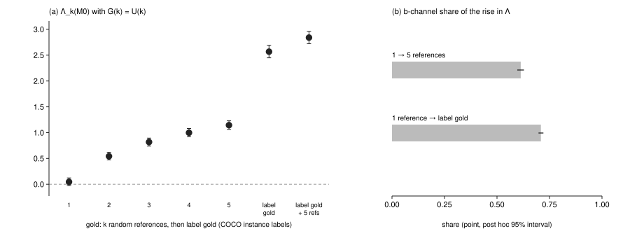

# Supplementary Material

Entries reproduce, in full, material that the main text shortens or omits, with times in UTC.<!-- Earlier numbering, now resolved in the visible text: Appendix A–F = S1–S6; §4.4, §4.5, §10.5, §11.3, §11.4 = current §4.2, §4.3, §11.1, §3.6, §11.3. -->

<!-- Built in the A7.3 v2 cut pass (2026-10-18). Each entry holds the full original text of a moved unit, or of a condensed unit whose removed detail the plan sends here (length_plan_v2.tsv, column 'dest'), with its source comments, so nothing that left the main text is lost. Entries are labelled with their unit ID and old location; editing them into running supplement prose is a later task. Old appendix letters: A -> S1, B -> S2, C -> S3, D -> S4, E -> S5, F -> S6. -->

## S1 Proofs and derivations

<!-- [s3.20, from sec3_measurement_setup.md:46–48; CAR decomposition, old §3.5] -->

For a method $S$, a base caption $G$ (greedy) and a ranking source $V$ (the pool vote), the difference $F(S) - F(G)$ telescopes into four terms:
$$F(S) - F(G) = \underbrace{D}_{\text{base re-rank}} + \underbrace{C}_{\text{count}} + \underbrace{B}_{\text{allocation}} + \underbrace{A}_{\text{ranking}},$$
where $D = F(V \text{ at } G\text{'s } k_i) - F(G)$; $C$ moves from $G$'s per-image counts to counts with $S$'s total, keeping $G$'s allocation shape; $B$ moves to $S$'s own per-image counts $k_i$ under $V$'s ranking; and $A = F(S) - F(V\text{ at }S\text{'s }k_i)$ is exactly the per-image control of Section 3.3. Because the telescoping order matters, we also report the Shapley value of each factor (count, allocation, ranking), averaged over the orders in which the factors are switched on. Two cautions apply. First, the intermediate vertices of the Shapley cube are not exactly count-neutral, so the allocation and ranking terms can absorb small count shifts;<!-- RV1 item 2c --> we report the mean count at every vertex. Second, terms come with image-bootstrap intervals; a term whose interval covers 0 is not interpreted.

<!-- [s3.21, from sec3_measurement_setup.md:50–50; remark, old §3.5 (moved)] -->

**Remark (re-thresholding cannot move A).** If a method only re-thresholds the comparator's own per-candidate score (it keeps candidates in the comparator's order and changes how many it keeps), then at the method's own $k_i$ it selects exactly the control's set, so $A = 0$ by construction. Only a method that brings in evidence the comparator's score does not contain (retrieval, grounding, a probe, new training signal) can make $A \neq 0$. This is the probability ranking principle applied to object mentions; we state it as a classification rule for methods, not as a new result.

<!-- [s4.17, from sec4_theory.md:42–42; two-channel detail, old §4.2] -->

**Two channels.** The increase of $\Lambda_k$ has two parts: the *b-channel* $\Delta\operatorname{logit} b_k$, which exists only because later mentions are less likely to be named (salience-dependent missingness), and the *$\bar G$-channel* $\Delta\ln\bar G(k)$, which exists under any missingness. If gold objects were missing completely at random (the SCAR assumption of positive–unlabeled learning), $b_k$ would not depend on $k$ and the b-channel would be zero: observed $M^*$ would only rescale with the label frequency. A uniform PU-style correction therefore cannot remove the part of the flip carried by the b-channel.

<!-- [s4.18, from sec4_theory.md:44–46; closed form, old §4.2 (moved)] -->

**Closed form.** With deterministic salience $\pi_m = \pi_1 m^{-\theta}$ and $s_m \propto m^{-D}$,
$$b_k(M) \approx 1 - D - \theta\,\varphi_k(\pi_M),\qquad \varphi_k(\pi) = \frac{k\pi(1-\pi)^{k-1}}{1-(1-\pi)^k},$$
where $\varphi_k$ is the elasticity of $c_k$ ($\varphi_1 = 1$, $\varphi_k \to 0$ as $k\to\infty$). Then $\theta = b_\infty - b_1$ is the reference-incompleteness part of the exponent deficit and $D$ the system part.

<!-- [s4.19-21, from sec4_theory.md:48–55; proof sketch, old §4.3 (moved)] -->

#### Proof sketch<!-- old §4.3 -->

(a) Write $1/b_k = \sum_{m\le M} \frac{s_m}{M s_M}\cdot\frac{g_k(m)}{g_k(M)}$. With $x = (1-\pi)^k$, $\frac{d}{dk}\ln c_k(\pi) = h(x)/k$ where $h(x) = -x\ln x/(1-x)$, and $h$ is increasing on $(0,1)$ because $h'(x)$ has the sign of $x - 1 - \ln x \ge 0$. Hence $c_{k'}(\pi)/c_k(\pi)$ is decreasing in $\pi$ for $k' > k$: the kernel $c_k(\pi)$ is reverse-rule of order 2 in $(k,\pi)$. Under (A2), for $m < M$ the symmetrized double integral over $x<y$ of $[c_{k'}(x)c_k(y) - c_k(x)c_{k'}(y)]\,[f_M(x)f_m(y) - f_M(y)f_m(x)]$ is nonnegative by the basic composition formula for totally positive kernels (Karlin, 1968, *Total Positivity*, Vol. I; we did not check the section number against a primary page, because the book has no DOI or Crossref record and only its author, title and year could be checked; the step itself was re-derived and checked numerically)<!-- was an [UNVERIFIED] note; author, title and year checked in Open Library; @book entry karlin1968total in paperA.bib; check script .session_backup/2026-10-15/paperA_keys/karlin_check.py -->, so $g_k(m)/g_k(M)$ is nonincreasing in $k$ and $1/b_k$ falls. As $k\to\infty$, $c_k(\pi)\to 1$ for $\pi > 0$, which gives $b_\infty$.
(b) Each $c_k(\pi)$ is increasing and concave in $k$; expectations and sums preserve both.
(c) $d\ln F_1^\mu/d\ln M = b - M/(M+\bar G)$, which is positive iff $b/(1-b) > M/\bar G$; at $M^*$ the second derivative is $-b(1-b)/M^{*2} < 0$.
(d) $\operatorname{logit} b_k$ is nondecreasing in $k$ by (a), and $\ln\bar G(k)$ is increasing by (b); their sum is nondecreasing, so it crosses 0 at most once and only upward.

All steps were checked numerically on a grid ($k = 1,\dots,10$; RR2 of $c_k$, of a lag-1 dependent kernel and of the 5-reference kernel) in a numerical self-check script<!-- h4_check.py; src: .session_backup/2026-10-14/r12/H4/scripts/h4_check.py (self-check T1); output .session_backup/2026-10-14/r12/H4/out/h4_check.json -->. Lipton et al. theorem numbering checked against arXiv 1402.1892v2 (Theorem 1, Corollary 1; numbering in the LNCS version not checked). The composition step was re-derived: with rows $(k',k)$ of the RR2 kernel $c$ and columns $(M,m)$ of the RR2 family $f$ under (A2), the basic composition formula gives $g_{k'}(M)g_k(m) - g_{k'}(m)g_k(M) \ge 0$.

<!-- [s4.22, from sec4_theory.md:57–57; subset design, old §4.3] -->

**Under (A1), the subset design does not matter.** Every $k$-subset design (first-$k$, random-$k$, fixed slots) has the same expected $b(k)$, $\bar G(k)$ and slope. A difference between designs is therefore a test of (A1) (Section 5).

<!-- [s4.23-24, from sec4_theory.md:59–61; which F1, old §4.4] -->

#### Which F1<!-- old §4.4 -->

The closed form in (c)–(d) is exact for micro-F1. The mixed F1 of Section 3.1 (micro precision, image-averaged recall) has the sign condition $P\,d > R\,(1-b)$, where $d$ is the exponent of recall in $M$ ($d < b$; e.g. 0.425 vs 0.478 on COCO with one reference)<!-- src: .session_backup/2026-10-14/r11_verify/c1_b1_b6_reproduction.json :: B1_L1_mstar_and_stopping.check_coco_gold.refs1_firstk.d_recall, .b -->. Image-averaged recall lowers the optimum $M^*$ and makes the one-reference penalty more robust. Every table and figure in Section 7 reports mixed F1, except that the label-gold F1 on XM3600 images pairs verified precision with micro recall over verified-present classes, as registered; micro-F1 otherwise appears only where a table of this supplement names it, and we never apply the micro closed form to mixed F1.

<!-- [s4.34, from sec4_theory.md:84–84; closed-form fit and [MODEL] extrapolation, old §4.5 (moved)] -->

**Closed form.** Fitting $b_k = 1 - D - \theta\varphi_k(\pi_M)$ to the five random-$k$ points gives root-mean-square error 0.0017 with $D = 0.342$ on COCO-5000<!-- src: .session_backup/2026-10-26/a_full5000/out/cf_r4_full5000_all9.json (sha256 39e64bdbbdf8) :: coco_free_D.rmse, .D (h4_check closed_form on r4 b(k)); r4 = 9 systems x 5,000 (FILL_RULE, PI-1026c) -->. Forcing $D$ to the instance-plus-references value fits worse (0.0139)<!-- src: same F file :: coco_D_from_inst+refs.rmse -->. Read as a model-based extrapolation, the reference limit $b_\infty$ is near 0.66, about 0.21 below the instance-plus-reference value: the share of present objects that caption writers do not name, which more references cannot recover. This extrapolation rests on two parameters fitted to four points; Supplementary S1 gives the fit, and the registered large-$k$ test on PASCAL-50S (50 references per image) is reported in Section 7.4: the slope rose at every registered level (k = 1, 2, 5, 10, 20, 50), but it is a test of the ordering, not of this extrapolation, which it neither confirms nor refutes.<!-- src: data/results/p50/p50_decide.json (0da4cab90fe9) :: analysis_set.P50-O2.verdict = PASS; nocaps not used (PI-1026ap Q3) --><!-- the large-reference-set test (B3); earlier plan: run on the second machine after a licence check --><!-- src: '0.66' (COCO b_inf = 1 - D) = .session_backup/2026-10-26/a_full5000/out/cf_r4_full5000_all9.json (39e64bdbbdf8) :: 1 - coco_free_D.D; '0.21' = coco_free_D.D - coco_D_from_inst+refs.D (r4; r0 values 0.67 and 0.20 from h4_check.json T5_closed_form) -->

<!-- [s5.16, from sec5_exchangeability.md:52–52; positive dependence (Esary bound, lag-1 chain), old §5.3] -->

**Positive dependence shrinks the gold.** For positively associated indicators, $P(o \notin G_k) \ge (1-\pi)^k$ (Esary, Proschan and Walkup, 1967, Ann. Math. Statist. 38(5):1466–1474, DOI 10.1214/aoms/1177698701) (bibliographic data verified via Crossref; we did not check where in the paper the product inequality appears, because the publisher full text is behind a bot challenge), so coverage and $\bar G(k)$ grow more slowly than under independence. For a lag-1 chain with autocorrelation $\rho$, $c_k(\pi) = 1-(1-\pi)\big(1-(1-\rho)\pi\big)^{k-1} \approx k_{\text{eff}}\,\pi$ for small $\pi$, with $k_{\text{eff}} = 1 + (k-1)(1-\rho)$: $k$ captions from one writer act like $k_{\text{eff}} < k$ independent ones. The chain kernel is still reverse-rule of order 2 (checked numerically for $\rho \in \{0.2, 0.5, 0.8\}$), so Proposition 1 holds in $k_{\text{eff}}$ and the crossing moves to larger $k$. The chain model predicts that dependence acts on the gold size to first order and on the exponent only to second order.

<!-- [s11.09, from sec11_limitations_ethics.md:17–17; large-k behaviour, old §11.1 (moved)] -->

**Large-$k$ behaviour.** The reference limit of the exponent is a two-parameter extrapolation from five points. A test with 10 or 50 references per image, the large-reference-set test, is registered but not run: it needs GPU decodes on two large-reference datasets, which are out of scope for this paper.<!-- B3, registered in ca644df --><!-- src (A6.3 merge, VERIFIED): '10' (nocaps references per image) = .session_backup/2026-10-14/r12_verify/b3_licence_verification.json :: datasets.nocaps.references_per_image -->

### Further detail for Section 4

<!-- v2 move (2026-10-27): verbatim from .session_backup/2026-10-27/paperA_v2/before/sec4_theory.md (old §4.2 parts (a)-(d), old §4.3 and Fig. 4); headings demoted; cross-references renumbered to v2 by the same pass as the rest of this supplement; no number or verdict changed -->

#### Proposition

**Proposition 1.** Under (A1)–(A3):

(a) **Monotone exponent.** $b_k(M)$ is nondecreasing in $k$. Its limits are
$$b_1(M) = \frac{M s_M\,\mathbb E_{F_M}[\pi]}{\sum_{m\le M} s_m\,\mathbb E_{F_m}[\pi]},\qquad b_\infty(M) = \frac{M s_M}{\sum_{m\le M} s_m} =: 1-D,$$
where $D$ is the part of the exponent deficit that comes from the system alone.

(b) **Concave gold growth.** $\bar G(k)$ is increasing and concave in $k$.

(c) **Sign condition** (Lipton et al., 2014, arXiv v2, Thm. 1 and Cor. 1; cited, not new). Micro-F1, $F_1^\mu = 2\,\mathrm{TP}/(M+\bar G)$, increases with $M$ if and only if $p_{\text{marg}} > F_1^\mu/2$, equivalently
$$\frac{b_k}{1-b_k} > \frac{M}{\bar G(k)}.$$
With constant $b$, $F_1^\mu$ has a unique maximum at $M^*(k) = b_k\,\bar G(k)/(1-b_k)$. For mixed F1 the condition differs (Supplementary S1), so the closed form is applied only to micro-F1.

(d) **Single crossing.** Let
$$\Lambda_k(M) = \operatorname{logit} b_k(M) + \ln \bar G(k) - \ln M .$$
$\Lambda_k(M)$ is nondecreasing in $k$. Hence, at a fixed family centre $M_0$, the sign of micro-F1's verbosity slope, $\operatorname{sign}\Lambda_k(M_0)$, changes at most once as references are added, and only from negative to positive; $M^*(k)$ is nondecreasing in $k$. Proof in Supplementary S1.

**Two channels.** $\Lambda_k$ rises through two channels: the *b-channel* $\Delta\operatorname{logit} b_k$, which exists only because later mentions are named less often, and the *$\bar G$-channel* $\Delta\ln\bar G(k)$, which exists under any missingness. Under missingness completely at random (SCAR) the b-channel is zero. Because the $k$-reference golds are nested, the $\bar G$-channel alone already orders the slopes in $k$, so the ordering is expected even if objects are missing from references at random. Confirming the ordered pattern therefore supports it empirically; it does not test the propensity model. Only the b-channel is specific to the model.

#### Post hoc descriptive checks on COCO-5000

The checks below use 9 systems on COCO-5000 (Qwen2.5-VL-7B variants; Vietnamese captions mapped to COCO-80 with a Vietnamese object lexicon and scored against the English references and instance labels; $M$ 0.84–2.18)<!-- src: .session_backup/2026-10-26/a_full5000/out/r4_full5000_all9.json (sha256 332da8b6264c) :: n_img, systems, gold.inst.M_range; lexicon score_coco_probe.vi_objects; r4 = 9 systems x 5,000 (FILL_RULE, PI-1026c) -->; its seed-42 half, COCO-2500, is the discovery set, on which the predictions were pre-specified and never committed, so the checks are exploratory<!-- src: manuscript/prereg/2026-10-18_never_committed_frozen_files.json :: files[2] (L1_COCO).mtime_utc = 2026-10-14T07:22:14Z, in_any_git_commit = false; data/coco_probe/manifest.json :: seed = 42, n = 2500 -->. COCO-5000 is the full Karpathy test split (5,000 images); all nine systems were decoded on every image, four of them (the two adapters, each with both prompts) in a post hoc top-up of the 2,500 images outside the seed-42 discovery half.<!-- decision PI-1026c --> The parity check and top-up used 1.79 GPU-hours; the top-up was interrupted once by a machine reboot and resumed from the last written image in an unchanged software environment, and before it a 50-image re-decode of the discovery half matched the earlier captions byte for byte for all four runs.<!-- src: data/coco_probe/manifest_full5000.json, manifest_rest2500.json; merged decodes data/results/coco_transfer_full5000/*.jsonl (fuse2_s42 short cd947944, detailed f205805a; p1_s43 short b0dbbdc5, detailed b12fbeb9), post-merge gates 1-2 PASS (.session_backup/2026-10-26/a_full5000/w4_merge.log); GPU time .session_backup/machines/M3/root/outputs/a_w4/gpu_ledger.tsv = 6,461 s over the 6 run lines (the resume_total line duplicates the two resume lines); reboot ~13:15Z at fuse2_s42 short 241/2500, resumed ~13:26Z, env_after_reboot.txt equal to env.txt apart from its timestamp line; parity gate (b) 50/50 x 4 (w4_merge.py parity); procedure scripts/paperA/a_w4/W4_TOPUP_NOTE.md, FILL_RULE.md (commit 78d0e22) --><!-- src: data/coco_probe/manifest.json :: {pool = 5000, n = 2500, seed = 42, sampler = random.Random(42).sample after sorting by cocoid}; 5,000-row decodes for 5 systems: data/results/coco5000/*.jsonl, data/results/coco5000_vcd/*.jsonl; 2,500-row decodes for fuse2_s42 and p1_s43 (short, detailed): data/results/coco_transfer/*.jsonl; CC-108 W5 (class b-exempt). "four of the nine systems" = fuse2_s42 and p1_s43 x {short, detailed}. When W4 lands this sentence is replaced by the full-5,000 statement (PI-1026c Q3) --> The rest of this subsection is post hoc.

**Part (a), monotone exponent.** On COCO-5000 with random-$k$ subsets, $b(k)$ rises from 0.475 at $k=1$ to 0.638 at $k=5$ and 0.850 with instance labels<!-- src: .session_backup/2026-10-26/a_full5000/out/r4_full5000_all9.json (sha256 332da8b6264c) :: gold.{refs1,refs5}_randk.b, inst.b; r4 = 9 systems x 5,000 (FILL_RULE, PI-1026c) -->; the English LVLM families show the same rise (Section 7.1).

**Assumption (A2), salience ordering, tested directly.** Relative to all mentions, the share of marginal mentions (the last of each caption) falls with reference support $n$: 1.82, 1.24, 0.84, 0.48, 0.25 for $n = 1..5$, monotone in 100% of bootstrap draws, and 3.16 for present objects named by no reference<!-- src: .session_backup/2026-10-26/a_full5000/out/h4_r4_full5000_all9.json (sha256 39c97d0de681) :: T2_profile.n1..n5.ratio_r, n0_inst.ratio_r, T2_share_draws_r_monotone_n1to5; r4 = 9 systems x 5,000 (FILL_RULE, PI-1026c) -->.

**Part (d), single crossing.** Part (d) concerns micro-F1. On COCO-5000 the micro-F1-on-$\ln M$ slope is −2.26 [−3.16, −1.39] at $k=1$, then +5.45, +9.65, +12.36, +14.29 for $k=2..5$<!-- src: .session_backup/2026-10-26/a_full5000/out/h4_r4_full5000_all9.json (sha256 39c97d0de681) :: T2_microF1_randk.{1..5}.slope, .1.slope_ci; FILL_RULE branch D1; r4 = 9 systems x 5,000 (FILL_RULE, PI-1026c) -->. The slope rises monotonically with completeness and changes sign once, from negative to positive; the mixed F1 shows the same pattern (Table 7.1), and where the change occurs is dataset-specific.

The closed form does not give the one-reference sign: at one reference $\Lambda = 0.014$ [−0.040, 0.066] sits at the boundary, and in 66% of bootstrap replicates $\Lambda_U(1) > 0$ while the slope is negative<!-- src: .session_backup/2026-10-26/a_full5000/out/a33_r4_full5000_all9.json (sha256 3ec89a6f4298) :: bootstrap.gold.refs1_randk.Lambda_U.{point, ci}, bootstrap.refs1_randk_share_of_replicates_with_opposite_signs (A3.3 bootstrap re-run, B = 2,000, seed 20261018); r4 = 9 systems x 5,000 (FILL_RULE, PI-1026c) --><!-- FILL_RULE A8.4 copy rule (CP-111a W5 (vi)): no patched A8.4 copy exists, so the parenthetical '(68% with the alternative matcher; Supplementary S2)' is dropped -->. With $M^* = 1.24$ against a median $M$ of 1.21, the systems straddle the optimum<!-- src: .session_backup/2026-10-26/a_full5000/out/h4_r4_full5000_all9.json (sha256 39c97d0de681) :: T2_microF1_randk.1.Mstar_micro, median_M; range C gold.refs1_randk.M_range; r4 = 9 systems x 5,000 (FILL_RULE, PI-1026c) -->. From two references on, $\Lambda > 0$ with intervals excluding 0, rising at every step (post hoc image bootstrap, $B$ = 2,000; Supplementary S7)<!-- src: same B file :: bootstrap.gold.refs{2..5}_randk.Lambda_U.ci[0] > 0, points rising -->. The negative one-reference sign is therefore an observation, not a consequence of the proposition.<!-- CC-007: the theory's claim is the ordering in k and the positive large-gold endpoint; 'Fig. 4' reference removed then (no figure existed); Fig. 4 regenerated under PD-29 (2026-10-21) -->

**Channel split.** Between one and five references (Fig. 4), the b-channel carries 61% of the increase in $\Lambda$ on COCO-5000 (post-hoc interval [60.1, 62.3]) and 71% from one reference to instance labels ([70.3, 71.9])<!-- src: .session_backup/2026-10-26/a_full5000/out/a33_r4_full5000_all9.json (sha256 3ec89a6f4298) :: bootstrap.shares.{refs1_to_refs5,refs1_to_inst}.b_channel_share.{point, ci}; S 0.611/0.711 (summarize.py:57-58, from 3-dp-rounded C inputs b and U) vs B 0.6116/0.7114; agree in whole percent (the FILL_RULE 3-dp check failed for this input-rounding reason; CP-117 W10); r4 = 9 systems x 5,000 (FILL_RULE, PI-1026c) -->. These shares are post hoc and from COCO-5000 only; there, most of the rise comes from salience-dependent missingness, which a uniform (SCAR) correction cannot remove.

<!-- caption: figs/CAPTIONS.md (outside the word count, PD-29 (b)); values figs/VALUES.json; replaces A3.3 fig4_v3, which predates Amendment 4 -->

**What the decomposition does not predict.** It does not say where the sign changes, and it does not predict the sign with several references: positive all-references slopes were predicted and failed on two English LVLM families (pre-specified; Section 7.1) and on XM3600 (registered; Section 7.2). An exponent fitted on short-caption systems did not transfer to verbose ones; $M^*$ is descriptive, not an out-of-regime predictor.

<!-- end S1 -->

## S2 Matchers, lexicons, metric conventions and control implementation

The matcher-sensitivity analysis is the second part of S2.<!-- file appB_matcher_sensitivity.md -->

<!-- [s3.05, from sec3_measurement_setup.md:11–11; metric conventions, old §3.1] -->

Precision is micro-averaged, $P = \sum_i \mathrm{TP}_i / \sum_i M_i$. Our implementation (a convention inherited from earlier work in this project<!-- object_prf -->) averages recall over images with non-empty gold, $R = \frac{1}{|\{i: G_i\neq\emptyset\}|}\sum_i \mathrm{TP}_i/|G_i|$, and reports $F_1 = 2PR/(P+R)$. We call this *mixed F1*. Section 4's closed form is exact for *micro-F1*, $F_1^{\mu} = 2\sum_i\mathrm{TP}_i / (\sum_i M_i + \sum_i |G_i|)$; every table that tests the theory reports both (Supplementary S1)<!-- H4 T2b -->. CHAIR$_i$ is the instance-level CHAIR of Rohrbach et al. (2018): the share of object mentions that are absent from the gold, with a repeated mention of a class counted each time. It is therefore not exactly $1-P$, which counts each class once per image; it is the quantity whose published values we reproduce in Section 6.1. Where Section 8 uses CHAIR as a caption-level score, it is the class-level complement of precision, $1 - \mathrm{TP}_i/M_i$ (0 when $M_i = 0$), computed against the gold named in each table.<!-- Code: .session_backup/2026-10-14/research_r10/E1/e1_chair_count.py per_image()/agg(): CHAIR_i = 100*h/n over all mentions (repeats counted), P_cls over distinct classes; .session_backup/2026-10-14/r12/H1/scripts/h1_pilot.py classes() returns a set and chair = FP/M per caption. A8.2 finding F3. -->

<!-- [s3.06, from sec3_measurement_setup.md:13–13; matchers, old §3.1] -->

Matchers. English outputs are matched to COCO-80 with the CHAIR synonym list (Rohrbach et al., 2018). Vietnamese outputs use a tone-normalized lexicon matcher; its versions and their differences are documented in the companion manuscript on KTVIC (in preparation; a copy is available to the editor).<!-- v2: was a placeholder pointer (CP-089 F1/F2); replaced per plan §3.2 / CC-129 W2, W12; no Paper B number cited --> All matcher versions are pinned by file hash, and every table names the matcher. The decoding settings of the second-backbone and eight-LVLM tests (temperatures, nucleus sampling, seed, numeric precision and token caps) are those fixed in their registrations, which are released with the code.<!-- minor 17 (R3-M5): values in manuscript/prereg/2026-10-18_g2b_qwen3vl_ladder.md §3 and 2026-10-19_a_n2_lvlm_gold_ladder.md; not printed here, so no manifest row is added -->

<!-- [s3.11, from sec3_measurement_setup.md:25–25; pool controls, old §3.3(a)] -->

**(a) Systems with a sample pool.** When the comparator can produce several captions per image (sampled at temperature $T$, plus the greedy caption), each candidate class $o$ in image $i$ has a sample vote share $v_{io}$ (fraction of sampled captions naming $o$) and a greedy flag $g_{io}\in\{0,1\}$.

<!-- [s3.12-13, from sec3_measurement_setup.md:27–30; pool controls, old §3.3(a)] -->

- **(v,g) tie-averaged control.** Rank candidates by $v$, break ties by $g$, keep the top $k_i = M_i^S$. If the boundary falls inside a tied block, score the expected true positives under a uniformly random choice within the block (equivalently, average over all tie-breaks). This is the primary per-image control.<!-- fixed in PD-2 Q1 -->
- **POOL-VOTE control.** Rank candidates by the total number of pool captions (samples plus greedy) that name them, ties broken by the greedy flag, and keep the top $k_i$. The two controls can differ in strength, which is why both are reported.

Both controls are reported side by side for every pool-based comparison.<!-- D17 binding condition 3 --> A method beats count control only if it beats both.

### Further detail for Section 3: pool controls and matcher sensitivity

<!-- v2 move (2026-10-27): verbatim from .session_backup/2026-10-27/paperA_v2/before/sec3_measurement_setup.md §3.3(a) and appB_matcher_sensitivity.md; headings demoted; cross-references renumbered to v2 by the same pass as the rest of this supplement; no number or verdict changed -->

**(a) Systems with a sample pool.** Each candidate class $o$ has a sample vote share $v_{io}$ and a greedy flag $g_{io}$ (Supplementary S2).

- **(v,g) tie-averaged control** (primary)<!-- PD-2 Q1 -->: rank candidates by $v$, break ties by $g$, keep the top $k_i = M_i^S$, and average over tie-breaks at the boundary.
- **POOL-VOTE control:** rank candidates by the number of pool captions that name them.

A method must beat both.<!-- D17 condition 3 -->

#### Matcher and label-map sensitivity

<!-- All numbers: .session_backup/2026-10-18/paperA_tasks/A8.4/sensitivity.json (sha256 969797ae99b7), label "post hoc sensitivity, not a registered test"; VERIFIED in manuscript/verification/paperA/A8.4.json. "nodes" = one English matcher (the E1 CHAIR rules, e1_chair_count.nodes) used for the reference gold in place of score_coco_probe.en_classes. -->

This is a post-hoc sensitivity analysis, not a registered test. We re-ran every analysis in this paper that uses an English reference gold with one English matcher throughout: the CHAIR rules that score the English captions of Section 6 replace the reference-side extractor. We also re-ran the XM3600 analyses without the five doubtful Open Images mappings. The COCO rows below are the matcher sensitivity on COCO-2500, the seed-42 discovery half (Supplementary S1), not re-run on COCO-5000.<!-- r0 --><!-- FILL_RULE A8.4 copy rule (CP-111a W5 (vi)): no patched A8.4 copy reproduced its frozen r0 sensitivity.json before commit 3 -->

**Reproduction.** Run with the original matcher and map, the copied code reproduces the cited values exactly (34 of 34 comparisons)<!-- src: sensitivity.json :: reproduction_with_original_matcher_or_map.{all_equal = true, n_checks = 34} -->.

**No headline change.** No verdict, ordering, endpoint or sign changes in 55 checks<!-- src: sensitivity.json :: answer.{any_headline_change = false, headline_checks_evaluated = 55, headline_changes = []} -->.

**Small shifts in the values:**
- COCO-2500 slopes: one reference −4.28 to −4.92, five references 11.08 to 10.87<!-- src: sensitivity.json :: coco2500_frontier.values.refs1_randk.slope.{original,swapped.nodes}.value; coco2500_frontier.values.refs5_randk.slope.{original,swapped.nodes}.value -->.
- Micro-F1 slope at one reference: −1.84 to −2.31<!-- src: sensitivity.json :: coco2500_theory_checks.values.coco2500.T2_microF1_randk.1.slope.swapped.nodes.value -->.
- $\Lambda_U(1)$: 0.047 to 0.017, with its interval still including 0, [−0.055, 0.094]<!-- src: sensitivity.json :: coco2500_lambda_U_split.values.Lambda_U.refs1_randk.swapped.nodes.value; coco2500_lambda_U_bootstrap.values.gold.refs1_randk.Lambda_U.ci.swapped.nodes.value = [-0.0547, 0.0939] -->.
- b-channel shares: 0.613 to 0.634 and 0.709 to 0.717<!-- src: sensitivity.json :: coco2500_lambda_U_split.values.b_channel_share_U.{coco_randk,coco_refs1_to_inst}.swapped.nodes.value -->.
- Adjacent-doubleton shares of Section 5: by at most 0.015<!-- src: sensitivity.json :: exchangeability_english_rows.values.uitviic_en_test_coco80.adjacent_share.delta_swapped_minus_original.nodes = -0.0149 (largest absolute shift) -->.
- XM3600 OIV7 slope: 19.32 to 19.25 with the doubtful links dropped, and to 21.60 with the doubtful entries dropped<!-- src: sensitivity.json :: xm3600_oiv7_map.values.oiv7_verified.slope_F1_per_logM.swapped.{oiv7_drop_pos,oiv7_drop_entry}.value -->.

**Two descriptive statements change:**
- the gap between the first-k and random-k one-reference slopes grows from 0.07 to 0.15;
- the share of bootstrap replicates in which $\Lambda_U(1)$ and the one-reference slope have opposite signs falls from 0.88 to 0.68 (Supplementary S1)<!-- src: sensitivity.json :: answer.other_changes[0] (firstk_randk_gap 0.07 -> 0.15), answer.other_changes[1] (opposite_sign_share_k1 0.8815 -> 0.6805) -->.

**Registered gold-size checks.** The registered XM3600 gold-size checks compare with values frozen under the original map, so dropping mappings moves them by construction. They were reproduced for 14 of 15 values originally, and for 10 or 9 of 15 after the drops<!-- src: sensitivity.json :: answer.other_changes[2,3] (gold_size_checks_in 14/15 -> 10/15 and 9/15) -->.

<!-- end S2 -->

## S3 Re-scoring of published comparisons: per-comparison results and control checks

### Material moved from Section 6 in revision 1

<!-- rev1 (item 12f): verbatim from sec6_rescoring_published_methods.md §6.2 (after Table 6.1) and §6.3; headings demoted -->
**Under the order-preserving controls, most of the raw gain is a count effect (post hoc).** Twelve raw gains are significant; under the two controls that keep the order of mention, two remain. The mean gain falls from +3.41 to +0.62 points with the matched prefix and to +0.65 with the sentence tie-average, and the same two remain under both (Supplementary S3).<!-- the 81.8% / 80.9% decomposition sentence is in Supplementary S3 (word cap, PD-29 pass) --><!-- src (A6.3 merge, VERIFIED): '+3.41' (E1 mean raw gain) = .session_backup/2026-10-13/r10_cpu/e1_x1pb_verification_v2.json :: overview_15_pairs.mean_dP_raw; '+0.62' (E1 mean gain, matched prefix) = .session_backup/2026-10-13/r10_cpu/e1_x1pb_verification_v2.json :: overview_15_pairs.mean_dP_MCP_prefix; '+0.65' (E1 mean gain, sentence tie-average) = .session_backup/2026-10-13/r10_cpu/e1_x1pb_verification_v2.json :: overview_15_pairs.mean_dP_MCP_sent_tieavg -->

**One gain reverses.** OPERA on Shikra has a raw precision gain over beam search of +3.47 [+0.75, +6.03] points, and a significant loss at matched prefix, −1.23 [−2.42, −0.08]<!-- src: .session_backup/2026-10-13/r10_cpu/e1_x1pb_verification_v2.json :: pairs_15."opera/shikra__ours vs opera/shikra__beam5".dP_raw.est/.ci95, .dP_MCP_prefix.est/.ci95; overview_15_pairs.mcp_prefix_sig_neg_unadj = 1 -->. Its captions name 16% fewer objects<!-- src: same :: pairs_15."opera/shikra__ours vs opera/shikra__beam5".M_ratio.est = 0.842 -->, consistent with the raw gain coming from naming fewer objects (post hoc).

**The random-subset control is the outlier.** Under it, 6 of 15 gains remain and the mean gain stays at +2.76 points, because it removes the count difference but not the order effect (assumption A2; Supplementary S3).<!-- src (A6.3 merge, VERIFIED): '6' (E1 random subset survives Holm+SESOI) = .session_backup/2026-10-13/r10_cpu/e1_x1pb_verification_v2.json :: overview_15_pairs.mcp_rand_exact_survives_holm; '15' (E1 comparisons) = .session_backup/2026-10-13/r10_cpu/e1_x1pb_verification_v2.json :: overview_15_pairs.n_pairs; '+2.76' (E1 mean gain, random subset) = .session_backup/2026-10-13/r10_cpu/e1_x1pb_verification_v2.json :: overview_15_pairs.mean_dP_MCP_rand_exact -->

**Withdrawal rule (fixed after the pilot).** The protocol abandons the count-confound claim if more than 5 of 15 gains<!-- src: .session_backup/2026-10-13/r10_cpu/e1_x1pb_verification_v2.json :: overview_15_pairs.k4_threshold_gt_one_third --> remain significant at matched count: not triggered under the order-preserving controls, triggered under the random subset<!-- src: same :: overview_15_pairs.k4_en_verdict_prefix, k4_en_verdict_sent_tieavg, k4_en_verdict_random_subset -->. We report the whole curve and draw no confirmatory conclusion.

#### Placebos and positive controls (old Section 6.3)

**Registered seed placebo.** The placebo compares two sampling seeds of one model on the same images; a control that finds a "gain" there is miscalibrated. Under rules registered before any placebo output, a control is admissible if $|\Delta P| \le 0.5$ with an interval covering 0, and the first admissible control is primary (Supplementary S4). The prediction held: the matched prefix is admissible and was selected<!-- src: .session_backup/2026-10-13/decisions/PD-15.txt :: line 1-2 "K2 HELD with C* = matched_prefix" and item 1 "matched_prefix is admissible"; evaluator output .session_backup/2026-10-18/n9k2_scoring/k2/k2_scores.json (sha256 0f0e952e) :: C_STAR = matched_prefix, K2_PREDICTION = HELD; rule text manuscript/prereg/2026-10-18_e1_k2_placebo_addendum.md (b8b2500) §3 -->. The placebo was decoded in the leaderboard harness of Section 6.4, which failed its fidelity check; both seeds share that harness, so the result calibrates the paired control only and is not evidence for any count-control claim.

**Positive control.** Removing the first hallucinated object from each baseline caption should raise precision at matched prefix by at least 3 points (fixed after the pilot); the control is underpowered at 500 images on 2 of 8 baselines<!-- src: .session_backup/2026-10-13/r10_cpu/e1_x1pb_verification_v2.json :: controls_K2_K3.registered_k3_en_summary.verdict = FAIL_UNDERPOWERED_ON_2_OF_8_BASELINES_AT_N500 -->, so the nulls of Table 6.1 are results at this sample size (Supplementary S3).<!-- src (A6.3 merge, VERIFIED): '8' (E1 K3 baselines) = .session_backup/2026-10-13/r10_cpu/e1_x1pb_verification_v2.json :: controls_K2_K3.registered_k3_en_summary.n_baselines -->

**Count versus length.** We predicted that object count explains precision gains better than word length (pre-specified, committed after its first output: exploratory)<!-- src: .session_backup/2026-10-18/paperA_tasks/A4.4/tests_status.tsv :: X1_PB status LOCALLY_FROZEN, t_disk 2026-10-14T04:12:41Z, t_out 2026-10-14T05:57:56Z, t_commit 2026-10-14T07:01:40Z (+01h03m44s) -->; the difference, +0.186 [−0.257, +0.579] points against a required +1.0, triggered its withdrawal rule, and the claim is withdrawn<!-- src: .session_backup/2026-10-13/r10_cpu/e1_x1pb_verification_v2.json :: x1_pb_english.summary.kill_rule_assessment_v2.PB_signed_mean_15pairs_est, _ci95; x1_pb_english.summary.x1_pb_verdict = KILL_CI_CONTAINS_0 -->.<!-- src (A6.3 merge, VERIFIED): '+1.0' (X1 P-B required difference) = .session_backup/2026-10-14/research_r10/X1/REPORT.txt :: line 203 -->

<!-- [s6.12, from sec6_rescoring_published_methods.md:33–33; count effect per-pair intervals, old §6.2] -->

**Most of the raw gain is a count effect.** Twelve raw gains are significant; under the two controls that keep the order of mention, two survive. The mean gain falls from +3.41 to +0.62 points with the matched prefix and to +0.65 with the sentence tie-average. The same two comparisons survive both order-preserving controls: OPERA versus greedy decoding on InstructBLIP (+3.88 [+2.49, +5.27] points at matched prefix)<!-- src: same :: pairs_15."opera/instructblip__ours vs opera/instructblip__greedy".dP_MCP_prefix.est, .ci95; .survives_holm_and_sesoi1 = true --> and the end-of-sequence method on MiniGPT-v2 (+2.81 [+0.91, +4.67])<!-- src: same :: pairs_15."lim/r12-ours-cap vs lim/r11-minigptv2".dP_MCP_prefix.est, .ci95; .survives_holm_and_sesoi1 = true -->. In a descriptive decomposition with the baselines' own captions as reference points, count and per-image allocation account for 81.8% of the raw gain under the matched prefix and 80.9% under the sentence tie-average<!-- src: same :: overview_15_pairs.pct_gain_explained_by_count_and_alloc_prefix, pct_gain_explained_by_count_and_alloc_sent_tieavg -->; we do not attach intervals to these shares, because several comparisons share a baseline.<!-- src (A6.3 merge, VERIFIED): '+3.41' (E1 mean raw gain) = .session_backup/2026-10-13/r10_cpu/e1_x1pb_verification_v2.json :: overview_15_pairs.mean_dP_raw; '+0.62' (E1 mean gain, matched prefix) = .session_backup/2026-10-13/r10_cpu/e1_x1pb_verification_v2.json :: overview_15_pairs.mean_dP_MCP_prefix; '+0.65' (E1 mean gain, sentence tie-average) = .session_backup/2026-10-13/r10_cpu/e1_x1pb_verification_v2.json :: overview_15_pairs.mean_dP_MCP_sent_tieavg -->

<!-- [s6.14, from sec6_rescoring_published_methods.md:37–37; random-subset control detail, old §6.2] -->

**The random-subset control is the outlier, and it is the weakest control.** Under the uniform random subset, 6 of 15 gains survive and the mean gain stays at +2.76 points. This control keeps a random $k_i$ of the longer caption's mentions, so it removes the count difference but not the order effect: when later mentions are less often correct (assumption A2, which the support profile of Supplementary S1 confirms on COCO), a random subset of a long caption keeps more late, weak mentions than the shorter caption has, and the longer caption is penalized less than at matched prefix. The gap between the two controls is largest where the count ratio is smallest; for OPERA on Shikra against greedy decoding (count ratio 0.808), the matched-prefix difference is −1.23 [−2.62, +0.08] and the random-subset difference is +5.45 [+3.36, +7.40]<!-- src: same :: pairs_15."opera/shikra__ours vs opera/shikra__greedy".M_ratio.est, .dP_MCP_prefix.est/.ci95, .dP_MCP_rand_exact.est/.ci95 -->. The random-subset control also fails its own two-seed check (two random draws of the same caption set must agree; |ΔP| within the seed placebo's bound and an interval covering 0) in 2 of 8 baselines<!-- src: same :: controls_K2_K3.placebos_K2.two_seed_random_subset.*.passes_K2 (6 true of 8) -->. We report it because a reader who believes mentions are not salience-ordered would choose it.<!-- src (A6.3 merge, VERIFIED): '6' (E1 random subset survives Holm+SESOI) = .session_backup/2026-10-13/r10_cpu/e1_x1pb_verification_v2.json :: overview_15_pairs.mcp_rand_exact_survives_holm; '15' (E1 comparisons) = .session_backup/2026-10-13/r10_cpu/e1_x1pb_verification_v2.json :: overview_15_pairs.n_pairs; '+2.76' (E1 mean gain, random subset) = .session_backup/2026-10-13/r10_cpu/e1_x1pb_verification_v2.json :: overview_15_pairs.mean_dP_MCP_rand_exact -->

<!-- [s6.18, from sec6_rescoring_published_methods.md:47–47; substitute placebo, old §6.3 (moved)] -->

**Substitute placebo (not the registered one).** Swapping the two captions of each image at random between method and baseline gives a null by construction. All 15 comparisons pass it<!-- src: same :: controls_K2_K3.placebos_K2.self_swap_permutation.*.passes_K2 (15 of 15); substitute_placebos_metadata.is_registered_two_seed_placebo = False -->. This checks the bootstrap machinery, not the calibration of a control, and we do not count it as the registered placebo.

<!-- [s6.19, from sec6_rescoring_published_methods.md:49–49; positive control K3 and MDE, old §6.3] -->

**Positive control.** Removing the first hallucinated object from each baseline caption should raise precision at matched prefix by at least 3 points (a rule of the re-scoring protocol, fixed after the pilot). The point estimate reaches 3 points for 6 of 8 baselines, and the lower interval bound does for 3 of 8<!-- src: same :: controls_K2_K3.registered_k3_en_summary.point_ge_3_count, ci_lo_ge_3_count -->; the verdict under that rule is that the control is underpowered at 500 images on 2 of 8 baselines<!-- src: same :: controls_K2_K3.registered_k3_en_summary.verdict = FAIL_UNDERPOWERED_ON_2_OF_8_BASELINES_AT_N500 -->. The protocol's remedy, enlarging the image set to 2,000<!-- src: manuscript/research_r10/E1/REPORT.txt §4 K3 "enlarge to 2,000 images" -->, has not been taken; the null results in Table 6.1 are therefore results at this sample size, and Supplementary S3 gives the minimum detectable effect for each comparison (80% power, standard error from the interval width, α = 0.05 and 0.05/15)<!-- src: .session_backup/2026-10-18/paperA_tasks/A8.5/appC_mde.tex and mde.json; VERIFIED in manuscript/verification/paperA/A8.5.json -->.<!-- src (A6.3 merge, VERIFIED): '8' (E1 K3 baselines) = .session_backup/2026-10-13/r10_cpu/e1_x1pb_verification_v2.json :: controls_K2_K3.registered_k3_en_summary.n_baselines; '2,000' (E1 K3 remedy image count) = manuscript/research_r10/E1/REPORT.txt :: line 192 -->

<!-- [s6.22, from sec6_rescoring_published_methods.md:55–55; N9 checkpoint list, old §6.4] -->

<!-- Resolved in the cut pass: N9's base run failed the registered fidelity check, so N9 was not scored (Section 6.4; PD-15). -->

Decoding and stopping methods are one half of the literature. Most recent anti-hallucination methods are trained (preference optimization, reinforcement learning, data augmentation), and their authors do not release per-caption outputs, so they must be decoded again. The registered checkpoint leaderboard was to decode 9 public LLaVA-1.5-7B checkpoints (among them POVID (arXiv 2402.11411), RLAIF-V (arXiv 2405.17220), HALVA (arXiv 2405.18654), CHAIR-DPO (arXiv 2508.20181), SENTINEL (ICCV 2025, doi:10.1109/ICCV51701.2025.00067), HA-DPO (arXiv 2311.16839), HSA-DPO (arXiv 2404.14233) and OPA-DPO (CVPR 2025, doi:10.1109/CVPR52734.2025.00992), plus the base model<!-- identifiers verified 2026-10-21 on OpenAlex/arXiv: CHAIR-DPO = Compagnoni et al., arXiv 2508.20181; SENTINEL = ICCV 2025, 10.1109/iccv51701.2025.00067; OPA-DPO = CVPR 2025, 10.1109/cvpr52734.2025.00992 (arXiv 2501.09695) -->)<!-- IDs: manuscript/research_r15/VERIFY/verify.json (title and first author match on the arXiv page) for 2402.11411, 2405.17220, 2311.16839, 2404.14233, 2405.18654; HALVA also .session_backup/2026-10-14/r11_litmaps/L6/REPORT.txt line 47 -->, on the same 500 CHAIR images, with greedy decoding and 512 new tokens, and to score each against the base model raw, at matched prefix, with the sentence tie-average and with the CAR decomposition of Section 3.5. The leaderboard's fidelity check failed on the base run, so the leaderboard was not scored and no method output was read (Section 6.4).<!-- src (A6.3 merge, VERIFIED): '9' (N9 checkpoints incl. base) = .session_backup/2026-10-14/r11_litmaps/L6/REPORT.txt :: line 142; '512' (N9 decoding budget) = .session_backup/2026-10-14/r11_litmaps/L6/REPORT.txt :: line 141 -->

<!-- [Harness variance (A-N5), added 2026-10-19 under judge PD-19; exploratory, post hoc and base-only; pointer in Section 6.4] -->

**Leaderboard base run (Section 6.4).** Descriptive and base-only: CHAIR_i 13.91<!-- src: .session_backup/2026-10-19/n9_kf_disclosure/kf_local.json (sha256 9b62eb04) :: K_F.base_agg.CHAIR_i --> against a published 15.4,<!-- src: same :: K_F.published.CHAIR_i --> CHAIR_s 50.3<!-- src: same :: K_F.base_agg.CHAIR_s --> against 50.0<!-- src: same :: K_F.published.CHAIR_s --> (tolerance 1.5),<!-- src: same :: K_F.max_abs_diff.CHAIR_s (K_F.diff.CHAIR_s = 0.3) --> on the 495 of 500 images<!-- src: same :: K_F.n_img = 495; '500' = K_F.descriptive_exact_caption_match_vs_lim_r1.n; denominator: .session_backup/2026-10-19/n9_kf_disclosure/DENOMINATOR_NOTE.txt (e1_chair_count.load_gt scores only images with an instance annotation; 5 CHAIR-500 images have none) --> with a COCO instance annotation, which the registered scorer requires; the same scorer gives CHAIR_i 15.26, CHAIR_s 50.5 and Recall 77.5 on the released Less-is-More base captions<!-- src: .session_backup/2026-10-14/research_r10/E1/e1_results.json (sha256 a62c7925) :: systems["lim/r1-llava1.5-7b"].{CHAIR_i = 15.26, CHAIR_s = 50.5, Recall = 77.5, n_img = 495}; the registered descriptive line, manuscript/prereg/2026-10-18_n9_count_matched_leaderboard.md :: line 214; .session_backup/2026-10-13/decisions/PD-15.txt item 3 -->, and 3.6% of the 500 base captions match those exactly<!-- src: .session_backup/2026-10-19/n9_kf_disclosure/kf_local.json (sha256 9b62eb04) :: K_F.descriptive_exact_caption_match_vs_lim_r1.{share = 0.036, n = 500}; .session_backup/2026-10-19/n9_kf_disclosure/divergence.json (sha256 b560eba9) :: exact_match_share = 0.036, n_pairs = 500 --> (harness variance, exploratory: below).

Harness variance (exploratory: post hoc, base-only): on the same 495 images,<!-- src: .session_backup/2026-10-19/HV_LK/a_n5/a_n5_result.json (sha256 f29dbda068f1; listed in .session_backup/2026-10-19/HV_LK/MANIFEST.json, sha256 76a0328b) :: n_img = 495; direction: ours (n9_base) minus LiM released r1 --> the base captions decoded in the checkpoint-leaderboard harness minus the released Less-is-More base captions give CHAIR_i −1.351 [−2.694, −0.052],<!-- src: same :: paired_gap.CHAIR_i.{est = -1.351, ci95 = [-2.694, -0.052]} --> CHAIR_s −0.202 [−4.242, +4.040] (interval includes 0)<!-- src: same :: paired_gap.CHAIR_s.{est = -0.202, ci95 = [-4.242, 4.04]} --> and object F1 +1.430 [+0.026, +2.816],<!-- src: same :: paired_gap.F1_cls.{est = 1.43, ci95 = [0.026, 2.816]} --> and 10 of the 15 re-scored published comparisons (post hoc)<!-- src: same :: e1_counts_abs_published_diff_smaller_than.paired_gap_ours_minus_lim_r1.CHAIR_i.point.{n_smaller = 10, of = 15, threshold_abs = 1.351}; E1 status: .session_backup/2026-10-18/paperA_tasks/A4.4/tests_status.tsv :: E1_A = POST_HOC --> have a smaller |ΔCHAIR_i| than the CHAIR_i point gap; this concerns reproduction variance only.

<!-- end S3 -->

## S4 Registration ledger, full frozen-prediction texts and run histories

Quoted and frozen registration texts in this section keep their original set codes: cv295 = COCO-295, uv231 = UIT-ViIC-231 and xm600 = XM3600-600 in the main text; a "rung" of a registration is a gold level.<!-- rev1 (item 12b): renames reverted inside S4 so the frozen texts stay verbatim -->

### Table S4.0: full registration ledger (moved from Section 1.2 in revision 1)

**Table S4.0.** Every registered prediction of this paper, with its status, its registered verdict copied from the decide file, and where it is reported, followed by the post hoc rows that carry sentences of the abstract. Registered = committed before the first output it predicts (Section 3.6); exploratory analyses and their times are in Supplementary S4.<!-- CC-129 W1: maps all 26 prereg_comparisons of .session_backup/2026-10-14/r12_verify/xm3600_full_verdict.json (sha256 0b2b3aa5e1a3; entries 0-25) and AUDIT_2026-10-26 §2.1 rows A1-A25 (sha 38f1b5ae2aa0); verdict words copied, never re-judged; ids X-* are xm3600 entries outside A1-A25 (named in CC-129 W1); P-* are post hoc rows. Replaces old Table 11.1 (moved to Supplementary S4). -->

| ID | Test (registered id) | Status | Verdict | Where |
|---|---|---|---|---|
| X-0 | XM3600 frozen inputs (FROZEN-INPUTS-SHA256) | registered | PASS<!-- src: xm3600_full_verdict.json :: prereg_comparisons[0].in_interval_or_pass --> | S4 |
| X-G | XM3600 gold sizes, 15 values (GBAR-*) | registered | 14 IN<!-- src: .session_backup/2026-10-14/r12_verify/xm3600_full_verdict.json :: prereg_comparisons[1..15].in_interval_or_pass (14 IN; prereg_comparisons[6] OUT) --> | 7.2, S7 |
| X-G6 | of which: one-reference gold size, non-empty images (GBAR-refs1_randk-Gbar_nonempty) | registered | OUT<!-- src: same :: prereg_comparisons[6].in_interval_or_pass (manifest row 225) --> | 7.2 |
| A1 | One-reference slope < 0 (N1-XM-1) | registered | PASS | 7.2 |
| A2 | All-references slope > 0 (N1-XM-2) | registered | **FAIL** | 7.2 |
| A3 | Label-gold slope > 0 (N1-XM-3) | registered | PASS | 7.2 |
| A4 | Ordering 1 ref < all refs < label gold (N1-XM-4) | registered | PASS | 7.2 |
| A5 | Sign agreement with the F1 optimum (N1-XM-5) | registered | **FAIL** | 7.2 |
| X-21 | XM3600 reference adjacency, 150 images (N2-XM-FULL150) | verdict file: registered; registration quotes its own result: post hoc | PASS (verdict file); treated as post hoc | 7.2 |
| X-22 | Two-panel transfer, Vietnamese vs English references (C3-XM-PANEL-DRHO-113-TO-80) | registered | PASS, with a mixed estimator whose interval includes 1 (no primary estimator registered)<!-- verbatim evaluator token: PASS_DRHO113_MIXED_MCP_CI_INCLUDES_1; src: xm3600_full_verdict.json :: prereg_comparisons[22].in_interval_or_pass (verbatim); xm3600_full_verdict_v2.md records "MIXED — no primary estimator registered" (D21_v2 item 5) --> | this table only |
| X-23–25 | Reference vs verified-label predictions for the adapters (C3-OIV7-1, -2, -3) | registered | PASS ×3<!-- src: xm3600_full_verdict.json :: prereg_comparisons[23..25].in_interval_or_pass --> | this table only |
| A6 | Second backbone, four primary claims × three sets (G2B-E1, E2, O1, P1) | registered | PASS | 7.3, Table 7.2 |
| A7 | Rise at every added reference (G2B-O2) | registered | PASS | 7.3 |
| A8 | Language: same exponent (G2B-P2) | registered | INCONCLUSIVE | 7.3 |
| A9 | Sampling: same exponent (G2B-P3a) | registered | INCONCLUSIVE | 7.3 |
| A10 | Temperature (G2B-P3b) | registered | **FAIL** (UIT-ViIC-231, XM3600-600); INCONCLUSIVE (COCO-295) | 7.3 |
| A11 | Backbone (G2B-P4) | registered | INCONCLUSIVE | 7.3 |
| A12 | Condensed F1 shrinks gold dependence (A-N1) | registered | MIXED | 7.3 |
| A13 | Eight LVLMs: one-reference ranking differs (LBA-P1) | registered | PASS | 7.3 |
| A14 | Eight LVLMs: per-model ladder (LBA-P2) | registered | **FAIL** (COCO-295) | 7.3 |
| A15 | Span-label agreement rises with the gold (AN3-P1) | registered | **FAIL** | 8.2 |
| A16 | Condensed F1 agrees better with span labels (AN3-P2) | registered | INCONCLUSIVE | 8.2 |
| A17 | LongCap-Arena (i): humans penalize count | registered | PASS | 8.1 |
| A18 | LongCap-Arena (ii): count-matched precision tracks humans better | registered | **FAIL** | 8.1 |
| A19 | LongCap-Arena (iii): count-equal pairs agree more | registered | **FAIL** | 8.1 |
| A20 | VaPR mostly, not fully, count-matched | registered | PASS | 8.4 |
| A21 | RLAIF-V chosen-fewer share ≥ 0.60 | registered | **FAIL** | 8.4 |
| A22 | Seed placebo admits the matched prefix (E1 K2) | registered | HELD (calibration only) | 6.3 |
| A23 | Count-matched checkpoint leaderboard, predictions (a)–(c) (N9) | registered | NOT TESTABLE: fidelity check failed | 6.4 |
| A24 | PASCAL-50S: ordering 1 ref < 50 refs < VOC labels (P50-A4) | registered | **FAIL** (1 ref < 50 refs PASS, +37.16 [+35.07, +39.09]; 50 refs < VOC labels FAIL, −2.29 [−5.15, +0.61])<!-- src: data/results/p50/p50_decide.json (sha256 0da4cab90fe9) :: analysis_set.P50-A4.{verdict, parts[*].verdict} --> | 7.4 |
| A24a | PASCAL-50S: rise at every registered level, k = 1, 2, 5, 10, 20, 50 (P50-O2) | registered (secondary) | PASS<!-- src: data/results/p50/p50_decide.json (sha256 0da4cab90fe9) :: analysis_set.P50-O2.verdict --> | 7.4 |
| A24b | PASCAL-50S: reference-gold slope below a size-matched random-deletion null (X4) | registered (co-primary in its companion family; secondary to the confirmatory claim) | PASS (one evaluable member; no adjustment)<!-- src: data/results/p50/p50x_decide.json (sha256 75e152d266a4) :: X4.verdict, holm_companion.final.X4 --> | 7.6 |
| A24c | PASCAL-50S: the same with VOC labels as complete gold (X5) | registered (co-primary in its companion family; secondary to the confirmatory claim) | NOT EVALUABLE<!-- src: data/results/p50/p50x_decide.json (sha256 75e152d266a4) :: X5.verdict, X5.levels.refs1_randk|V20.reason --> | 7.6 |
| A24d | PASCAL-50S: extrapolated precision from five references (X1, X2) | registered as descriptive | no verdict<!-- src: data/results/p50/p50x_decide.json (sha256 75e152d266a4) :: X1.verdict = null, X2.verdict = null; RULE §2.2 (CC-159 rulings 1-2) --> | S7 |
| A25 | Tone-mark normalisation sensitivity (shared instrument check) | registered | no verdict field | S2 |
| P-1 | Leave-one-system-out robustness | post hoc | no verdict | 7.5 |
| P-2 | Verified-precision bracket | post hoc (design fixed before the run) | no verdict | 7.2 |
| P-3 | Re-scoring of 15 published comparisons | post hoc | no verdict | 6 |
| P-4 | Cap share of detailed captions | post hoc, descriptive | no verdict | 7.3 |
<!-- src (rows A1-A25): verdicts copied from manuscript/goal_reset/AUDIT_2026-10-26.md §2.1 (38f1b5ae2aa0), whose sources are: A1-A5 xm3600_full_verdict.json prereg_comparisons[16..20]; A6-A11 data/results/g2b/g2b_score.json (68be2b7a) predictions.*.verdict; A12 data/results/g2b/an1_score.json (ec0938e0) outcome; A13-A14 data/results/a_n2/a_n2_run.json (1f6ce422) verdicts_on_analysis_set, kill_rules.KA2; A15-A16 data/results/a_n3/a_n3_run.json (7a5a614d) predictions.*.verdict; A17-A19 .session_backup/2026-10-15/r13_human/q2_longcap_arena.json (overall verdict MIXED); A20 q4_vapr_count_control.json verdict; A21 c6_n3_rlaifv_rlhfv_audit.json l6_d2_evaluation; A22 k2_scores.json K2_PREDICTION; A23 kf_local.json K_F.verdict; A24-A24d (2026-10-29) data/results/p50/{p50_decide.json 0da4cab90fe9, p50x_decide.json 75e152d266a4} (B3 row superseded by prereg 2026-10-28_a_p50_kladder); A25 data/results/tone_norm/SUMMARY.json (decision C-028; no PASS/FAIL field). P-1 a1_system_robustness.json (af77ffa0) + loo_triples.json (d74f34c431fb); P-2 bracket_result.json (4796ed12); P-3 e1_x1pb_verification_v2.json; P-4 caphit_result.json (72404c62). X-21 label conflict (verdict file PASS vs tests_status POST_HOC) left for the coordinator's record per CC-129 W1. X-22..X-25: reported nowhere else (no Paper B or FAIR text holds them; FAIR predates the 2026-10-14 prereg), so they are listed here in verdict words only, no number (CC-129 W1). -->

<!-- [s4.35, from sec4_theory.md:86–86; what the proposition does not predict (XM3600 registration timing), old §4.5] -->

**What the proposition does not predict.** It does not say where the crossing lies, and the multi-reference sign is not predicted by the theory: predictions of a positive slope with all available references failed in three settings (the two English LVLM families below, where they were pre-specified, and XM3600 with 2–3 references, where they were registered; Section 7.2). On 20 public English LVLM outputs (OPERA and Less-is-More releases, 7 backbones), predictions pre-specified before scoring (file timestamp 2026-10-14 12:43Z, never committed; treated as exploratory)<!-- src: manuscript/prereg/2026-10-18_never_committed_frozen_files.json :: files[1] (H3_N1).mtime_utc = 2026-10-14T12:43:39Z, in_any_git_commit = false --> expected a positive slope at five references; the slope stayed negative (−29.57 [−32.69, −26.37] and −22.86 [−26.71, −18.53] in the two families) and became positive only with instance labels<!-- src: .session_backup/2026-10-14/r12/H3/out/n1_results.json :: families.F-B.gold.refs5_randk.slope/_ci, families.F-C.gold.refs5_randk.slope/_ci; frozen file .session_backup/2026-10-14/r12/H3/N1_PREDICTIONS.txt -->. The verdict under the pre-specified rule was FAILED. The pattern is still consistent with (a) and (d): within each family the slope rises monotonically from one to five references and does not cross back<!-- src: same :: families.F-B.gold.refs{1..5}_randk.slope -->. The exponent fitted on short-caption systems did not transport to verbose ones, and the crossing moved to a more complete gold. $M^*$ is a descriptive decomposition with in-sample $b$, not an out-of-regime predictor; the out-of-sample test with $b$ transferred from COCO-2500 is registered for XM3600 (the XM3600 pre-registration, committed to version control at 2026-10-14 16:38Z, before the first XM3600 result at 17:00Z<!-- manuscript/prereg/2026-10-14_xm3600_predictions.json, commit 4ccbee3 --><!-- src: .session_backup/2026-10-18/paperA_tasks/A4.4/tests_status.tsv :: XM_N1 t_out 2026-10-14T17:00:36Z, t_commit 2026-10-14T16:38:04Z -->; the registration is valid. All six systems have been scored (Section 7.2): the one-reference and OIV7 sign predictions and the ordering held; the prediction that 2–3 references give a positive slope failed, and with it the sign-agreement check for that gold (1 of 3 out-of-sample sign predictions failed, below the registered demotion threshold of 2)).<!-- src (A6.3 merge, VERIFIED): '7' (N1 English LVLM backbones) = .session_backup/2026-10-14/r12/H3/REPORT.txt :: line 5; '1' (XM3600 failed out-of-sample sign predictions) = .session_backup/2026-10-14/r12_verify/xm3600_full_verdict.json :: prereg_comparisons[16..18].in_interval_or_pass count==FAIL; '3' (XM3600 out-of-sample sign predictions) = manuscript/prereg/2026-10-14_xm3600_predictions.json :: a_N1_sign_predictions.kill_rule.h6_p2_kill (number in string); '2' (XM3600 registered demotion threshold) = manuscript/prereg/2026-10-14_xm3600_predictions.json :: a_N1_sign_predictions.kill_rule.h6_p2_kill (number in string) -->

<!-- [s6.06-07, from sec6_rescoring_published_methods.md:11–15; E1 registration, old §6.1] -->

**Registration.** The re-scoring protocol was written after a pilot had already scored these 15 comparisons, and it reports that pilot's raw and matched-prefix results. The protocol was committed to version control at 2026-10-14 07:01Z<!-- manuscript/research_r10/E1/REPORT.txt, commit 6c647a6 -->; the pilot's results file was written at 01:48Z the same day<!-- src: .session_backup/2026-10-14/research_r10/E1/e1_results.json (mtime 2026-10-14T01:48:40Z); manuscript/research_r10/E1/REPORT.txt §0 and §3 report the pilot, §4 holds the rules (disk copy mtime 01:54:58Z, identical to the committed file); git show -s 6c647a6 (2026-10-14T07:01:40Z); re-derived in manuscript/verification/paperA/A4.2.json -->. The following were therefore fixed after the pilot results were known:<!-- src (A6.3 merge, VERIFIED): '15' (E1 comparisons) = .session_backup/2026-10-13/r10_cpu/e1_x1pb_verification_v2.json :: overview_15_pairs.n_pairs -->
- the primary endpoint (matched prefix, Holm over the 15 comparisons, a smallest effect size of interest of +1.0);<!-- src (A6.3 merge, VERIFIED): '15' (E1 comparisons) = .session_backup/2026-10-13/r10_cpu/e1_x1pb_verification_v2.json :: overview_15_pairs.n_pairs; '+1.0' (E1 SESOI) = manuscript/research_r10/E1/REPORT.txt :: line 182 -->
- the fidelity check, the positive control and the protocol's withdrawal rule.<!-- K1, K3, K4 -->

We do not count these rules, or the numbers in Table 6.1, as registered before their outputs. The sentence tie-average and the uniform random subset were added after the pilot. Only quantities added later that had no output when they were registered count as registered before their outputs, such as the seed placebo, which needed new decoding (Section 6.3).

<!-- [s6.17, from sec6_rescoring_published_methods.md:43–45; K2 placebo rules, old §6.3] -->

<!-- Resolved in the cut pass: the K2 placebo ran and HELD; the matched prefix is admissible and was selected (Section 6.3; .session_backup/2026-10-13/decisions/PD-15.txt). -->

**Registered seed placebo: HELD.** The registered placebo compares two sampling seeds of one model on the same images; any control that finds a "gain" there is miscalibrated. The released outputs contain one seed per decoder, so the placebo needed new decoding. It was run on LLaVA-1.5-7B with two sampling seeds on the 500 CHAIR images.<!-- was: [PENDING: E1 K2 two-seed placebo (LLaVA-1.5-7B, two sampling seeds, CHAIR-500 images; run inside the N9 harness), prereg `.session_backup/2026-10-14/research_r10/E1/REPORT.txt` §4 K2; the selection rule below is to be committed with the N9 prereg before decoding.] -->
Decision rules for the placebo, registered before any placebo output (in the re-scoring protocol and a later addendum)<!-- E1 protocol §4 K2, 6c647a6; addendum b8b2500 --><!-- src: manuscript/paperA_plan/CONFIRMATION_MAP.md (ca7812c) §1 row K2 and §3 K2 quotes; no K2 output exists (A4.2 v3 ledger row 45, NO_RESULT_ON_DISK) -->: (i) withdrawal rule: a control with $|\Delta P| > 1.0$<!-- registered text: |ΔP_MCP| (MCP = the count-matched family of differences) --> or an interval excluding 0 on the seed placebo is miscalibrated and is dropped from the curve<!-- src: .session_backup/2026-10-13/r10_cpu/e1_x1pb_verification_v2.json :: controls_K2_K3.registered_k2_en_two_sampling_seeds.definition; registered_k2_en_status = PENDING_PHASE_B_TWO_SAMPLING_SEEDS -->; (ii) selection rule<!-- H6 P5 -->: the primary control is one with $|\Delta P| \le 0.5$ and an interval covering 0 on the placebo; if more than one passes, the matched prefix stays primary. The placebo's prediction held: the matched prefix was admissible and was selected as the primary control<!-- src: .session_backup/2026-10-13/decisions/PD-15.txt; evaluator output .session_backup/2026-10-18/n9k2_scoring/k2/k2_scores.json :: C_STAR = matched_prefix, K2_PREDICTION = HELD -->. The placebo ran in the checkpoint-leaderboard decoding harness, whose fidelity check failed ($|\Delta\mathrm{CHAIR}_i| = 1.49 > 1.0$)<!-- src: .session_backup/2026-10-19/n9_kf_disclosure/kf_local.json :: K_F.diff.CHAIR_i (−1.49); number_manifest.tsv row '1.49 (|ΔCHAIR_i|, §6.4)'; '1.0' = the leaderboard's registered fidelity bound (L6 REPORT line 206) -->, so the placebo result calibrates the control only and is never evidence for any count-control claim.

<!-- [s6.24-25, from sec6_rescoring_published_methods.md:59–64; N9 frozen predictions and consequences, old §6.4] -->

Registered predictions of the checkpoint leaderboard<!-- L6 §3 D1; committed unchanged in the N9 prereg (b8b2500, per Section 6.4) -->:
- (a) the median matched-prefix precision gain over the training checkpoints exceeds the mean decoding gain of Table 6.1 (+0.62 points)<!-- src: .session_backup/2026-10-13/r10_cpu/e1_x1pb_verification_v2.json :: overview_15_pairs.mean_dP_MCP_prefix -->;
- (b) checkpoints trained on preference pairs whose chosen response names fewer objects (HA-DPO, HSA-DPO, SENTINEL; Section 8.4) reduce the mean number of classes per caption by at least 0.3 more than checkpoints trained on near-balanced pairs (POVID, mDPO);<!-- src (A6.3 merge, VERIFIED): '0.3' (N9 prediction (b) class-count margin) = .session_backup/2026-10-14/r11_litmaps/L6/REPORT.txt :: line 137 -->
- (c) HALVA, whose training swaps objects without changing their number, changes the mean number of classes per caption by at most 0.15.<!-- src (A6.3 merge, VERIFIED): '0.15' (N9 prediction (c) HALVA bound) = .session_backup/2026-10-14/r11_litmaps/L6/REPORT.txt :: line 138 -->

Registered consequences: if the checkpoints' base CHAIR is more than 1.0 from the published value, the protocol is fixed before any look; if the sign of the training data's count difference does not order the change in count (difference below 0.1 class), prediction (b) is dropped; if at least half of the checkpoints keep a Holm-significant matched-prefix gain of at least +1.0, the headline becomes "training changes object choice", which still supports count-controlled reporting<!-- L6 §6 -->. If the count-matched ranking equals the raw ranking within the intervals, this paper reports the leaderboard as consistent with the raw ranking and does not rest any claim on it.<!-- PD-6 Q4(c) --> The leaderboard's fidelity check failed, so the leaderboard was not scored and predictions (a)–(c) could not be tested (Section 6.4).<!-- src (A6.3 merge, VERIFIED): '1.0' (N9 fidelity bound) = .session_backup/2026-10-14/r11_litmaps/L6/REPORT.txt :: line 206; '0.1' (N9 count-order bound) = .session_backup/2026-10-14/r11_litmaps/L6/REPORT.txt :: line 207; '+1.0' (N9 headline SESOI) = .session_backup/2026-10-14/r11_litmaps/L6/REPORT.txt :: line 208 -->

<!-- [s7.20, from sec7_verbosity_sign.md:60–60; XM3600 design and registration timing, old §7.5] -->

**Design.** XM3600 (Thapliyal et al., EMNLP 2022)<!-- cite: thapliyal2022crossmodal, DOI 10.18653/v1/2022.emnlp-main.45, in .session_backup/2026-10-18/paperA_tasks/A5.2/paperA_v3.bib (VERIFIED) --> gives 2–3 Vietnamese references per image and, through Open Images V7, human-verified positive and negative image labels (OIV7). Its images are Open Images images, so pre-training exposure is possible here too<!-- label per judge CC-024 (G2-B prereg 0932ba1): "Open Images images; exposure possible"; not described as uncontaminated -->. We evaluate six systems on 600 images: Qwen2.5-VL-7B zero-shot and two Vietnamese caption adapters of the same backbone<!-- CC-088 (A-2): "(from the companion paper)" removed; sec7:45 ties one adapter to the cited conference recipe, so naming the companion here linked the two -->, each with a short and a detailed prompt. The exponent is not refitted: we transfer $b$ from COCO-2500 (0.479 for one reference, 0.549 for the union of the 2–3 references, using the two-reference value, and 0.846 for instance-type labels) and predict the sign of each slope from $M^*_{\text{micro}} = b\,\bar G/(1-b)$ and the XM3600 gold sizes. The predictions, the evaluation code and the hashes of 11 input files were committed to version control at 2026-10-14 16:38Z, before the first XM3600 output existed (17:00Z)<!-- commit 4ccbee3 --><!-- src: .session_backup/2026-10-18/paperA_tasks/A4.4/tests_status.tsv :: XM_N1 t_out 2026-10-14T17:00:36Z (data/results/xm3600/xm3600_zeroshot-short.preds.json), t_commit 2026-10-14T16:38:04Z; A4.4 reconcile row 239 -->; the registration is valid<!-- src: manuscript/prereg/2026-10-14_xm3600_predictions.json (sha256 5d0134bfded0); manuscript/prereg/2026-10-14_xm3600_predictions.md; git show -s 4ccbee3 -->.<!-- src (A6.3 merge, VERIFIED): '2' (XM3600 VI refs per image, min) = manuscript/prereg/2026-10-14_xm3600_predictions.json :: dataset.ref_count_distribution_vi_full_3600 (key names); '3' (XM3600 VI refs per image, max) = manuscript/prereg/2026-10-14_xm3600_predictions.json :: dataset.ref_count_distribution_vi_full_3600 (key names); '600' (XM3600 eval images) = manuscript/prereg/2026-10-14_xm3600_predictions.json :: dataset.n_images_eval_subset; '0.479' (transferred b, one ref) = manuscript/prereg/2026-10-14_xm3600_predictions.json :: a_N1_sign_predictions.transferred_b_from_coco2500.b_refs1_randk; '0.549' (transferred b, two refs) = manuscript/prereg/2026-10-14_xm3600_predictions.json :: a_N1_sign_predictions.transferred_b_from_coco2500.b_refs2_randk; '0.846' (transferred b, instance) = manuscript/prereg/2026-10-14_xm3600_predictions.json :: a_N1_sign_predictions.transferred_b_from_coco2500.b_inst -->

<!-- [s7.21, from sec7_verbosity_sign.md:62–68; XM3600 registered predictions and kill rules, old §7.5] -->

**Registered predictions** (the XM3600 pre-registration)<!-- manuscript/prereg/2026-10-14_xm3600_predictions.json, key a_N1_sign_predictions -->:
- The one-reference sign prediction: slope(one random reference) < 0 across the 6 systems ($M^*_{\text{micro}} = 1.471$ with transferred $b$, which the pre-registration expected to lie below the six systems' median $M$).<!-- src (A6.3 merge, VERIFIED): '6' (XM3600 frozen systems) = manuscript/prereg/2026-10-14_xm3600_predictions.json :: len(systems_queued_in_58_z); '1.471' (XM prereg M* one ref) = manuscript/prereg/2026-10-14_xm3600_predictions.json :: a_N1_sign_predictions.out_of_sample_Mstar_micro_prior_b.refs1_randk.Mstar_all_600 -->
- The all-references sign prediction: slope(all references) > 0 ($M^*_{\text{micro}} = 2.859$). The pre-registration marks this as the risky test, because Section 7.1 showed that $b$ can compress on verbose outputs.<!-- src (A6.3 merge, VERIFIED): '2.859' (XM prereg M* all refs) = manuscript/prereg/2026-10-14_xm3600_predictions.json :: a_N1_sign_predictions.out_of_sample_Mstar_micro_prior_b.refs_all.Mstar_all_600 -->
- The verified-label sign prediction: slope(OIV7 verified) > 0 ($M^*_{\text{micro}} = 11.216$).<!-- src (A6.3 merge, VERIFIED): '11.216' (XM prereg M* OIV7) = manuscript/prereg/2026-10-14_xm3600_predictions.json :: a_N1_sign_predictions.out_of_sample_Mstar_micro_prior_b.oiv7_verified.Mstar_all_600 -->
- The ordering prediction: slope(one reference) < slope(all references) < slope(OIV7).
- The sign-agreement check: for each gold variant, sign(slope) = sign($M^*_{\text{mixed}}$ − median $M$).
- Demotion rules: if 2 or more of the three sign predictions above fail, the sign result moves from a core result to an explanatory diagnostic; if the one-reference sign prediction fails, the one-reference prediction has failed in a third setting and the sign-flip claim is dropped.<!-- src (A6.3 merge, VERIFIED): '2' (XM3600 registered demotion threshold) = manuscript/prereg/2026-10-14_xm3600_predictions.json :: a_N1_sign_predictions.kill_rule.h6_p2_kill (number in string) -->

<!-- [s7.23, from sec7_verbosity_sign.md:78–78; XM3600 reading with verbatim kill rule, old §7.5] -->

**Reading.** The sign of the verbosity reward flips between single-reference gold and the OIV7 verified labels, as predicted, and the slopes are ordered by gold completeness, as Proposition 1 requires. The registered prediction that the union of 2–3 references already gives a positive slope failed: on XM3600 the crossing lies at a gold more complete than the available references. The transferred exponent did not locate the crossing; the in-sample exponent for the all-references gold is 0.503, below the transferred 0.549<!-- src: same :: matcher_v2_tone_normalised.n1_f1_vs_logM_slopes.refs_all.b_in_sample; prereg b from .session_backup/2026-10-14/r11_verify/c1_b1_b6_reproduction.json :: B1_L1_mstar_and_stopping.check_coco_gold.refs2_randk.b -->, which repeats the lesson of Section 7.1. The one-reference pass also did not come about through the mechanism the pre-registration gave: the six systems' median $M$ (1.38) lies below the transferred optimum (1.471), not above it<!-- src: same :: prereg_comparisons[16].observed_value.{observed_median_M,prereg_Mstar_all_600_prior_b} -->. The registered demotion rule states, in paraphrase, that if 2 or more of the 3 out-of-sample sign predictions (the one-reference, all-references and verified-label sign predictions) fail, the sign result is demoted from a core result to an explanatory lemma or diagnostic<!-- verbatim: "If ≥ 2 of the 3 out-of-sample sign predictions (`N1-XM-1`, `N1-XM-2`, `N1-XM-3`) fail, `N1` is demoted from a core result to an explanatory lemma / diagnostic" (manuscript/prereg/2026-10-14_xm3600_predictions.md, line 64) -->. One of the three failed, so the demotion rule was not triggered and the sign result stays a core result; the second rule (drop the sign-flip claim if the one-reference sign prediction fails) was not triggered either. What XM3600 supports is the direction and ordering of the sign change, not a prediction of where it occurs.<!-- src (A6.3 merge, VERIFIED): '2' (XM3600 registered demotion threshold) = manuscript/prereg/2026-10-14_xm3600_predictions.json :: a_N1_sign_predictions.kill_rule.h6_p2_kill (number in string); '3' (XM3600 out-of-sample sign predictions) = manuscript/prereg/2026-10-14_xm3600_predictions.json :: a_N1_sign_predictions.kill_rule.h6_p2_kill (number in string) -->

<!-- [s7.29, from sec7_verbosity_sign.md:95–100; G2-B predictions and kill rules (G2 §4 wording), old §7.6] -->

**Second-backbone test: registered predictions and verdict rules.** These are the predictions and rules as registered before any output of the test existed (Section 7.3). Earlier planning reports framed the test with a different primary endpoint (the paired difference in $b$) and with rules that counted backbones; the registration replaced that framing before any output, and its departures from the plans are listed below.<!-- N-M4 (PD-28 item 3): replaces the G2 §4 wording that stood here. Source: G2-B prereg manuscript/prereg/2026-10-18_g2b_qwen3vl_ladder.md (committed 0932ba1, 2026-10-18 18:31:57Z, before any G2-B output) §8 verdict rules, §9 frozen predictions, §10 kill rules, §11 reporting, §12 departures, §13 what the author saw; content source G2 REPORT §4 (6c647a6). -->

*Verdict rules.* A claim "> 0" passes if the 95% interval lies above 0, fails if the point estimate is at or below 0, and is inconclusive otherwise; "< 0" mirrors it. An equivalence claim $|x| \le \delta$ passes if the interval lies inside $\pm\delta$, fails if it lies wholly outside, and is inconclusive otherwise; a difference claim $|x| > \delta$ mirrors it. A compound claim fails if any part fails, is not evaluable if any part is, passes if every part passes, and is inconclusive otherwise. Withdrawal rules count failures only; an inconclusive result is never counted as support. No multiplicity correction is applied: every prediction is reported separately, per set, with its interval.<!-- G2-B prereg §8: sign_gt_0, sign_lt_0, equiv_abs_le, diff_abs_gt, compound, not_evaluable, counting, multiplicity -->

*Primary predictions* (the six-decode ladder of each set; cv295, uv231 and xm600):
- one-reference endpoint: the slope under one random reference is below 0 (the theory does not derive this sign);
- complete-gold endpoint: the slope under the label gold (Section 3.1) is above 0;
- ordering: slope(all references) − slope(one reference) > 0 and slope(label gold) − slope(all references) > 0;
- exponent ordering: $b$(all references) − $b$(one reference) > 0 and $b$(label gold) − $b$(all references) > 0.

The sign of the slope under several references is not predicted; it is reported with its interval only.<!-- G2-B prereg §9: G2B-E1, G2B-E2, G2B-O1, G2B-P1 (primary); G2B-NS (not predicted) -->

*Secondary predictions:*
- the slope rises at every added reference (cv295, uv231);
- language: $|b_{\text{EN}} - b_{\text{VI}}| \le 0.05$ under the label gold (cv295, uv231);<!-- src (A6.3 merge, VERIFIED): '0.05' (G2 P2 equivalence band) = .session_backup/2026-10-14/research_r10/G2/REPORT.txt :: line 187; registered form G2-B prereg §9 G2B-P2 (delta 0.05) -->
- sampling: the exponent of the vote family is within 0.05 of that of the greedy prompt family (uv231);
- temperature: at both sampling temperatures the exponent is within 0.05 of greedy decoding, and the intercept is lower at the higher temperature (all three sets);
- backbone: the exponent is within 0.05 of the first backbone's, while the intercepts differ by more than 2 precision points at matched $M$ (all three sets).<!-- src (A6.3 merge, VERIFIED): '2' (G2 P4 intercept gap) = .session_backup/2026-10-14/research_r10/G2/REPORT.txt :: line 189; '0.05' (G2 P4 shared-b tolerance) = .session_backup/2026-10-14/research_r10/G2/REPORT.txt :: line 190; registered forms G2-B prereg §9 G2B-O2, G2B-P3a, G2B-P3b, G2B-P4 -->

*Withdrawal and reporting rules.* (i) If the exponent ordering fails on 2 or more of the 3 sets, the completeness account is dropped for this backbone and only "the exponent is dataset-specific" is reported. (ii) If the language prediction fails on both cv295 and uv231, the exponent is reported per language. (iii) If the power-law RMSE exceeds 3 precision points for a gold of a set, the frontier is reported there only as a local linearization. (iv) If the one-reference endpoint fails on any set, the sign-flip claim is dropped and only the ordering can remain. (v) Verdicts use clean subsets only. (vi) A run whose model file, prompt, decoding setting or pinned instrument differs from the registration does not test it. "Replicates on a second backbone" may be written only for cv295 and xm600, and only where the one-reference endpoint, the complete-gold endpoint and the ordering all pass; uv231 failures count against the claim, but a uv231 pass is not counted as support.<!-- G2-B prereg §10 K1, K2 (restricted), K3, KN1, KL, KD; §11 reporting rule; §4 UV231 handling. src (A6.3 merge, VERIFIED): '2' (G2 K1 datasets) = .session_backup/2026-10-14/research_r10/G2/REPORT.txt :: line 192; '3' (G2 K3 RMSE bound) = .session_backup/2026-10-14/research_r10/G2/REPORT.txt :: line 195 -->

*Departures from the planning reports* (registration §12):
- The KTVIC sets of the plans are left out, because KTVIC is reported in the companion manuscript on KTVIC (in preparation; a copy is available to the editor);<!-- v2: was a placeholder pointer (CP-089 F1/F2); CC-129 W2 --> the sampling pool is therefore decoded on uv231 only, and the plans' two-gold transfer tests are left out for the same reason.
- The English arm is this backbone's greedy short and detailed pair on cv295 and uv231; the plans had English and Vietnamese prompt families for three backbones. xm600 has no English arm, because no English-to-OIV7 class map exists.
- The plans' backbone-count rule (2 or more of 3 backbones) is evaluated in the restricted form (ii) above, because only one backbone has English outputs.<!-- src (A6.3 merge, VERIFIED): '2' (G2 K2 failing backbones) = .session_backup/2026-10-14/research_r10/G2/REPORT.txt :: line 194; '3' (G2 K2 backbones) = .session_backup/2026-10-14/research_r10/G2/REPORT.txt :: line 194 -->
- Clean-subset scoring is applied in every case; the plans made it conditional on a failed language check.
- Every sign and ordering claim, including the plans' $b(\text{instance}) > b(5\text{ refs})$, stated there without an interval, is scored with the three-way rule above.
- The temperature prediction is added from the plans' rationale for the temperature ladder; the plans' own sampling prediction is the vote-family comparison.
- uv231: the plans' premise that its images are uncontaminated does not hold (all are COCO train2017 images), hence the uv231 rule above.

*What the author saw before registering* (registration §13): this paper's Section 7 with the first-backbone slopes on these image sets; the planning reports and earlier decisions; the XM3600 registration and two earlier registrations for this backbone; and a summary of this backbone's zero-shot language-check rates, object scores and mentions per caption on a KTVIC development split (a development file outside this paper; no number from it is used here)<!-- CP-096 E4 -->. By that summary's thresholds the short prompt failed the language check and the detailed prompt passed; because this registration scores clean subsets in every case, no analysis choice depends on that outcome. The operational form of the predictions (families, verdict rules, the temperature and backbone statistics, clean-subset scoring and the uv231 handling) was written after reading that summary, and none of these choices uses a number from it. No caption of this backbone on cv295, uv231 or xm600 existed; while file formats were checked, the first lines of one existing first-backbone COCO caption file were displayed.<!-- G2-B prereg §13 (B1 step-1 dev300 guard summary; Paper B file, no number used) -->

<!-- [s8.04, from sec8_human_validity.md:7–10; human-validity registration with times, old §8] -->

**Registration.** The sets differ in how their predictions were fixed, and every result below carries its label:
- *LongCap-Arena, registered.* The pre-registration was committed to version control (2026-10-15 02:50:04Z)<!-- commit 7254a39 --> and pushed (02:50:10Z) before the first output (05:59:16Z; Section 8.1)<!-- src: .session_backup/2026-10-18/paperA_tasks/A4.4/tests_status.tsv :: Q2_LONGCAP {status REGISTERED, t_commit 2026-10-15T02:50:04Z, t_out 2026-10-15T05:59:16Z}; push: GitHub server-side push event .session_backup/2026-10-18/github_activity/q2_activity_20261018T1955Z.json (sha256 e280bbf0) :: push id 46544934992, timestamp 2026-10-15T02:50:10Z -->.
- *THumB and Composite, pre-specified.* The predictions were written and hashed before any statistic involving a human score was computed: pre-specified (file timestamp 2026-10-14 12:52Z, never committed); treated as exploratory<!-- src: .session_backup/2026-10-14/r12/H1/PREDICTIONS_FROZEN.txt (written 2026-10-14T12:52:33Z); manuscript/prereg/2026-10-18_never_committed_frozen_files.json :: files[0] (H1_TC).{mtime_utc = 2026-10-14T12:52:33Z, first_output.mtime_utc = 2026-10-14T15:12:36Z, in_any_git_commit = false} -->.
- *Polaris and DOCCI-Critique, pre-specified, committed late.* The pre-registration file was written at 2026-10-14 15:37Z, before the first results file (16:25Z), but committed at 16:47Z, 22 minutes after it<!-- commit 7f22d13 -->. We therefore treat these two sets as exploratory, although their pre-specified rules are reported as written<!-- src: .session_backup/2026-10-18/paperA_tasks/A4.2/prereg_ledger_v2.tsv :: row 33 h1_polaris_docci {prereg_disk_mtime_utc 2026-10-14T15:37:51Z, first_result_mtime_utc 2026-10-14T16:25:48Z, first_commit_utc 2026-10-14T16:47:58Z, first_result_minus_registration -22m09s}; VERIFIED in manuscript/verification/paperA/A4.2_v2.json; .session_backup/2026-10-18/paperA_tasks/A4.4/tests_status.tsv :: G2_POLARIS status LOCALLY_FROZEN; ruling D-W13-6 -->.

<!-- [s8.06, from sec8_human_validity.md:14–14; LongCap-Arena pre-registration and CapArena, old §8.1] -->

Two human-validity tests on public long-caption judgments were added, each run only after a licence check and a committed pre-registration (the LongCap-Arena pre-registration; the results file was written after the commit)<!-- added under PD-7; commit 7254a39, manuscript/prereg/2026-10-15_q2_longcap_arena.{md,json} --><!-- src: git show -s 7254a39 (2026-10-15 02:50Z); .session_backup/2026-10-15/r13_human/q2_longcap_arena.json :: prereg_json_sha256, script_sha_matches_prereg = true, input_sha_mismatch_vs_prereg = {} -->. The CapArena test was dropped because no licence statement for its human battles could be found<!-- src: .session_backup/2026-10-15/r13_data/licence_check_2026-10-15.json :: CapArena.status = DROPPED_NO_LICENCE -->.

<!-- [s8.11, from sec8_human_validity.md:26–26; LongCap-Arena run history, old §8.1 (moved)] -->

*Footnote (run history).* The first run of the pinned analysis script crashed while writing its JSON output after test (ii), because a test result was a numpy boolean that Python's JSON encoder cannot serialize. It was re-run unchanged through a wrapper that only teaches the JSON encoder to write numpy scalars (committed to version control after the re-run)<!-- scripts/r13/run_pinned_numpy_json.py, commit 0cd8e9a -->; the pinned script's own hash check passed and no statistic, threshold or verdict rule was touched. The crashed run printed no statistic to the console (its log holds only the traceback). Because the script saves its results file after each test, the crashed run had already written the data summary and the test (i) result to that file before failing; the re-run, with the same seed, overwrote it. Both surviving outputs were written after the pre-registration commit was pushed (02:50:10Z): the VaPR count-control results at 02:50:28Z and the reported LongCap-Arena results at 05:59:16Z. The time of the crashed run is not preserved: the re-run overwrote its partial output, and the archived copy of its log carries the time it was archived (06:02:42Z).<!-- src: crashed-run log .session_backup/2026-10-15/r13_human/q2_run1_crashed.log (sha256 b50b7672...) (TypeError: Object of type bool is not JSON serializable, at write(res) after test ii, line 173; no stdout; archived copy, mtime 2026-10-15T06:02:42Z read with os.stat); re-run log .session_backup/2026-10-15/r13_human/q2_run2.log (sha256 7339667d3cc8; archived copy, mtime 06:02:42Z); .session_backup/2026-10-15/r13_human/PROVENANCE.json :: q2_longcap_arena.json.{run,note}; wrapper sha256 a27110e1e6b5 = git show 0cd8e9a:scripts/r13/run_pinned_numpy_json.py (commit 2026-10-15 06:01:18Z); script write points: scripts/r13/r13_q2_longcap_arena.py lines 135, 153, 173; prereg commit 7254a39 at 02:50:04Z; push 02:50:10Z = the GitHub server-side push event, the time PD-10 relies on: .session_backup/2026-10-18/github_activity/q2_activity_20261018T1955Z.json (sha256 e280bbf0) :: push id 46544934992 (before d89094ea, after 7254a39), timestamp 2026-10-15T02:50:10Z; corroborated by the local reflog .git/logs/refs/remotes/q2/main line 52 (d89094e to 7254a39, 'update by push', epoch 1792032611 = 2026-10-15T02:50:11Z); output mtimes (os.stat, UTC): q4_vapr_count_control.json 02:50:28Z, q2_longcap_arena.json 05:59:16Z -->

<!-- [s9.07, from sec9_preference_audit.md:27–28; L6 D2 stated prediction and N9 PENDING note, old §9] -->

<!-- Resolved in the cut pass: N9's fidelity check failed, so N9 was not scored and K-b could not be evaluated (Sections 6.4 and 9; PD-15). -->

**A stated prediction that failed.** Before RLHF-V and RLAIF-V were audited, the planning report, committed to version control before the audit, predicted that RLAIF-V's chosen-fewer share among unmatched pairs would be at least 0.60, and set a conditional withdrawal rule: if the share fell in [0.45, 0.55] *and* the count-matched leaderboard (Section 6.4) showed no link between the count difference in the training data and the change in count of the trained model, the statement "length control leaves a count channel" would be withdrawn and Table 8.1 kept as description only<!-- src: .session_backup/2026-10-14/r11_litmaps/L6/REPORT.txt §6 (D2); registered: committed as manuscript/research_r11/L6/REPORT.txt in 4812563 at 2026-10-14T10:39:32Z, before the first output at 11:26:14Z (.session_backup/2026-10-18/paperA_tasks/A4.4/tests_status.tsv :: L6_D2 status REGISTERED, +00h46m42s); judge CC-029 draft TODO -->. The share is 0.514 [0.509, 0.520], inside the withdrawal interval, so the prediction failed and the first half of the withdrawal condition is met<!-- src: .session_backup/2026-10-14/r11_verify/c6_n3_rlaifv_rlhfv_audit.json :: l6_d2_evaluation.prediction_rlaifv_chosen_fewer_among_unmatched_ge_060.{rlaifv_all_obj_pairs, rlaifv_all_obj_pairs_ci95, passed_on_all_obj_pairs = False}; l6_d2_evaluation.kill_rule_rlaifv_in_045_055.in_kill_interval_all_obj_pairs = True -->. The second half depended on the checkpoint leaderboard (Section 6.4). The leaderboard's fidelity check failed, so it was not scored and no method output was read; its prediction (b) and the second half of this two-part withdrawal rule therefore could not be evaluated. The statement "length control leaves a count channel" is therefore unresolved: Table 8.1 is descriptive, and its only registered support is the VaPR control.<!-- N9 K-F failed; K-b not evaluable (PD-15). Was: [PENDING: N9 count-matched leaderboard, prediction D1(b) (Section 6.4), prereg to be committed. If the trained checkpoints show no link between the training data's $\Delta k$ and their own change in count, this section reports Table 9.1 as description only and drops the statement in the next paragraph.] -->

<!-- [s11.03, from sec11_limitations_ethics.md:5–5; scope of the confirmatory evidence, old §11.1] -->

**Scope of the confirmatory evidence.** The registered evidence on the verbosity sign is the out-of-sample test on XM3600. It confirms the ordering of the slope by gold completeness and its large-gold endpoint (positive under the OIV7 verified labels); two of its five predictions failed, as stated at the end of this paragraph. COCO-5000 shows the same ordering and endpoint (four of four predictions held on COCO-5000), but its predictions were pre-specified on its seed-42 half, COCO-2500 (file timestamp 2026-10-14 07:22Z, never committed), so it is exploratory<!-- src: manuscript/prereg/2026-10-18_never_committed_frozen_files.json :: files[2] (L1_COCO).mtime_utc = 2026-10-14T07:22:14Z, in_any_git_commit = false -->; the registered second-backbone test is reported in Section 7.3, and the registered large-reference-set test has not been run, because it needs GPU decodes that are out of scope for this paper (Section 7.4). The negative sign at single-reference gold was observed on both datasets, but it is not a prediction of the theory (Supplementary S1). The sign with several references is not predicted by the theory: the prediction of a positive all-references slope failed on XM3600 (registered) and on two English LVLM families (pre-specified, never committed), and COCO-5000's positive five-reference slope is a dataset-specific outcome. The remaining sign evidence is exploratory or failed: the UIT-ViIC results (run before any prediction was written; with the matcher used for Vietnamese the five-reference slope stays negative, −6.28 [−8.31, −4.29]<!-- src: .session_backup/2026-10-14/r11_verify/c2_n1_uitviic_mstar.json :: uitviic_test.lexicons.vi_objects_in.gold_variants.refs5_randk.groups.all_10.slope_F1_mixed_per_logM (CI from the same block; reproduced by RV4, .session_backup/2026-10-14/review_gemini_r10/RV4/work/rv4_n1.json) -->), and the English LVLM test, whose verdict under its pre-specified rule was FAILED. The "sign agreement" with $M^*$ fitted on the same outputs is close to an identity under the power-law frontier and is a goodness-of-fit check, not a prediction. The out-of-sample test with an exponent transferred from COCO is pre-registered (committed to version control at 2026-10-14 16:38Z<!-- commit 4ccbee3 -->), before the first XM3600 result (17:00Z)<!-- src: .session_backup/2026-10-18/paperA_tasks/A4.4/tests_status.tsv :: XM_N1 t_out 2026-10-14T17:00:36Z, t_commit 2026-10-14T16:38:04Z -->; the registration is valid. All six systems have been scored (Section 7.2): the one-reference and OIV7 sign predictions and the ordering held; the prediction that 2–3 references give a positive slope failed, and with it the sign-agreement check for that gold (1 of 3 out-of-sample sign predictions failed, below the registered demotion threshold of 2).<!-- src (A6.3 merge, VERIFIED): '−8.31' (UIT-ViIC vi_objects_in refs5_randk slope CI low) = .session_backup/2026-10-14/r11_verify/c2_n1_uitviic_mstar.json :: uitviic_test.lexicons.vi_objects_in.gold_variants.refs5_randk.groups.all_10.slope_F1_mixed_ci95[0]; '−4.29' (UIT-ViIC vi_objects_in refs5_randk slope CI high) = .session_backup/2026-10-14/r11_verify/c2_n1_uitviic_mstar.json :: uitviic_test.lexicons.vi_objects_in.gold_variants.refs5_randk.groups.all_10.slope_F1_mixed_ci95[1]; '1' (XM3600 failed out-of-sample sign predictions) = .session_backup/2026-10-14/r12_verify/xm3600_full_verdict.json :: prereg_comparisons[16..18].in_interval_or_pass count==FAIL; '3' (XM3600 out-of-sample sign predictions) = manuscript/prereg/2026-10-14_xm3600_predictions.json :: a_N1_sign_predictions.kill_rule.h6_p2_kill (number in string); '2' (XM3600 registered demotion threshold) = manuscript/prereg/2026-10-14_xm3600_predictions.json :: a_N1_sign_predictions.kill_rule.h6_p2_kill (number in string) -->

### Tests without a row in another main-text table

<!-- v2 move (2026-10-27): verbatim from .session_backup/2026-10-27/paperA_v2/before/sec11_limitations_ethics.md (old Table 11.1); headings demoted; cross-references renumbered to v2 by the same pass as the rest of this supplement; no number or verdict changed -->

**Table S4.1.** Tests without a row in another main-text table.<!-- src: labels from .session_backup/2026-10-18/paperA_tasks/A4.4/tests_status.tsv (sha256 546e7b406ca5) :: status of XM_N1 (gold sizes), XM_N2, B3, E1_A (K1, K3, K4), X1_PB, L6_N9, Q2_LONGCAP, G2_POLARIS, G3_DOCCI, Q4_VAPR; CapArena (Q3) has no row there and no prereg: git show -s 7254a39 ("Q3 CapArena dropped for lack of a licence"); verdicts per row -->

| Test | Label | Verdict | Section |
|---|---|---|---|
| XM3600 gold sizes | registered | 14 of 15 reproduced<!-- src: .session_backup/2026-10-14/r12_verify/xm3600_full_verdict.json :: prereg_comparisons[1..15].in_interval_or_pass (14 IN; prereg_comparisons[6] OUT) --> | S7 |
| XM3600 adjacency | post hoc | at or below null<!-- src: .session_backup/2026-10-14/r12_verify/xm3600_full_verdict.json :: n2_reference_adjacency_verification.full_3600_150_3ref_images.{adjacent_share = 0.5333, bootstrap_ci95_b5000 = [0.4141, 0.6471], exchangeable_null_for_K3 = 0.6667} --> | 7.2 |
| Large reference sets | planned | not run | 7.4 |
| Re-scoring: fidelity check | post hoc | PASS<!-- src: .session_backup/2026-10-13/r10_cpu/e1_x1pb_verification_v2.json :: fidelity_K1.passes_K1 = True --> | 6.1 |
| Re-scoring: withdrawal rule | post hoc | control-dependent<!-- src: same :: overview_15_pairs.k4_en_verdict_prefix = NOT_TRIGGERED, k4_en_verdict_sent_tieavg = NOT_TRIGGERED, k4_en_verdict_random_subset = TRIGGERED --> | 6.2 |
| Re-scoring: positive control | post hoc | FAIL: underpowered, 2 of 8<!-- src: same :: controls_K2_K3.registered_k3_en_summary.verdict = FAIL_UNDERPOWERED_ON_2_OF_8_BASELINES_AT_N500, n_baselines = 8 --> | 6.3 |
| Count vs length | pre-specified | FAIL (claim withdrawn)<!-- src: same :: x1_pb_english.summary.x1_pb_verdict = KILL_CI_CONTAINS_0 --> | 6.3 |
| Checkpoint leaderboard | registered | not scored: fidelity failed<!-- src: .session_backup/2026-10-19/n9_kf_disclosure/kf_local.json (sha256 9b62eb04) :: K_F.verdict = FAIL; .session_backup/2026-10-13/decisions/PD-15.txt item 3 --> | 6.4 |
| LongCap-Arena | registered | MIXED<!-- src: .session_backup/2026-10-15/r13_human/q2_longcap_arena.json :: verdict = MIXED --> | 8.1 |
| CapArena | not registered | dropped: no licence<!-- src: .session_backup/2026-10-15/r13_data/licence_check_2026-10-15.json :: CapArena.status = DROPPED_NO_LICENCE --> | 8.1 |
| Polaris-COCO | pre-specified | PASS<!-- src: .session_backup/2026-10-14/r12_verify/h1_g3_registered_supplement_v2.json :: registered_G2.verdict = PASS --> | 8.3 |
| DOCCI-Critique | pre-specified | MIXED<!-- src: same :: registered_G3.verdict = MIXED --> | 8.3 |
| VaPR count control | registered | PASS<!-- src: .session_backup/2026-10-15/r13_human/q4_vapr_count_control.json :: verdict = PASS --> | 8.4 |

<!-- end S4 -->

## S5 Exchangeability: all corpus and split rows

<!-- [s5.05, from sec5_exchangeability.md:12–14; statistic and raw-order note, old §5.1] -->

Under (A1), the pair of references that name a doubleton is a uniformly random pair, so the probability that the two are adjacent in that order is the number of adjacent pairs over the number of pairs,
$$p_{\text{adj}}^{\,0} = \frac{K-1}{\binom{K}{2}} = \frac{4}{10} = 0.40 .$$
The **adjacent-doubleton share** is the observed fraction of doubletons named by adjacent references, pooled over images, with an image-bootstrap interval. The statistic depends on the order chosen. Taking the UIT-ViIC references in the raw order of the annotation array, instead of by annotation id, also gives a value close to the null.<!-- evidence: A-verifier recompute, manuscript/verification/paperA/A3.4.json :: items.B4 / C4 (a21/a34_uitviic_var.py). No analysis source JSON holds the raw-order value, so it is not printed (coordinator rule for A3.4). --> Two companion statistics separate the mechanisms that can raise it:

<!-- [s5.10, from sec5_exchangeability.md:25–38; full Table 5.1 and further rows, old §5.2] -->

**Table S5.1.** Adjacent-doubleton share (null 0.40 under exchangeability). 95% image-bootstrap intervals.<!-- src (A6.3 merge, VERIFIED): '0.40' (K=5 exchangeable null) = .session_backup/2026-10-14/r11_verify/c3_n2_exchangeability_all_datasets.json :: k5_exchangeability_audit.{flickr30k_captions_coco80,openviic_full_test_exact5_objects_in}.adjacent_share_null (min,max) -->

| Corpus | References | Images | Share [95% CI] | Lag-1 Jaccard excess [95% CI] |
|---|---|---|---|---|
| COCO (Karpathy test), EN | independent crowd workers | 4,867 | 0.407 [0.379, 0.433]<!-- src: .session_backup/2026-10-26/a_full5000/out/exch_full.json (sha256 4b2dfa03baa8) :: manifest_full5000.json.adjacent_share, .adjacent_share_ci95; r4 = 9 systems x 5,000 (FILL_RULE, PI-1026c) --> | −0.002 [−0.007, +0.004]<!-- src: same :: manifest_full5000.json.jac_lag1_minus_mean_lag2to4, .jac_diff_ci95, n_kept --> |
| UIT-ViIC (all splits), VI | independent annotators | 3,842 | 0.384 [0.366, 0.403]<!-- src: same :: uitviic_vi_all_objects_in.adjacent_share, .adjacent_share_ci95 --> | −0.008 [−0.015, −0.002]<!-- src: same :: uitviic_vi_all_objects_in.jac_lag1_minus_mean_lag2to4, .jac_diff_ci95 --><!-- src (A6.3 merge, VERIFIED): '3,842' (UIT-ViIC VI images) = .session_backup/2026-10-14/r11_verify/c1_b1_b6_reproduction.json :: B2_L2_exchangeability.datasets.uitviic_vi_all_objects_in.images --> |
| UIT-ViIC images, COCO EN references | independent crowd workers | 3,850 | 0.406 [0.380, 0.429]<!-- src: same :: uitviic_images_coco_en_refs_coco80.adjacent_share, .adjacent_share_ci95 --> | +0.005 [−0.001, +0.011]<!-- src: same :: uitviic_images_coco_en_refs_coco80.jac_lag1_minus_mean_lag2to4, .jac_diff_ci95 --><!-- src (A6.3 merge, VERIFIED): '3,850' (UIT-ViIC images with COCO EN refs) = .session_backup/2026-10-14/r11_verify/c1_b1_b6_reproduction.json :: B2_L2_exchangeability.datasets.uitviic_images_coco_en_refs_coco80.images --> |
| Flickr30k (Entities chains; Plummer et al., 2015<!-- cite: plummer2015flickr30k (A5.2 v3); arXiv 1505.04870, 'Flickr30k Entities: Collecting Region-to-Phrase Correspondences for Richer Image-to-Sentence Models', verified 2026-10-18 via export.arxiv.org -->) | independent; file order possibly sorted by length (not traced) | 31,783 | 0.483 [0.478, 0.488]<!-- src: same :: flickr30k_entities_chains_visual.adjacent_share, .adjacent_share_ci95 --> | +0.055 [+0.053, +0.056]<!-- src: same :: flickr30k_entities_chains_visual.jac_lag1_minus_mean_lag2to4, .jac_diff_ci95 --><!-- src (A6.3 merge, VERIFIED): '31,783' (Flickr30k Entities images) = .session_backup/2026-10-14/r11_verify/c1_b1_b6_reproduction.json :: B2_L2_exchangeability.datasets.flickr30k_entities_chains_visual.images --> |
| UIT-OpenViIC, test-image panel (aggregates only), images with ≥5 refs, first five | not documented | 425 | 0.428 [0.385, 0.470]<!-- src: same :: openviic_panel_first5_objects_in.adjacent_share, .adjacent_share_ci95 --> | +0.002 [−0.014, +0.018]<!-- src: same :: openviic_panel_first5_objects_in.jac_lag1_minus_mean_lag2to4, .jac_diff_ci95 --><!-- src (A6.3 merge, VERIFIED): '425' (OpenViIC panel first5 images) = .session_backup/2026-10-14/r11_verify/c1_b1_b6_reproduction.json :: B2_L2_exchangeability.datasets.openviic_panel_first5_objects_in.images --> |
| Flickr30k captions, COCO-80 matcher | independent | 31,783 | 0.454 [0.440, 0.466]<!-- src: .session_backup/2026-10-14/r11_verify/c3_n2_exchangeability_all_datasets.json :: k5_exchangeability_audit.flickr30k_captions_coco80.adjacent_share, .adjacent_share_ci95 --> | —<!-- src (A6.3 merge, VERIFIED): '31,783' (Flickr30k captions images) = .session_backup/2026-10-14/r11_verify/c3_n2_exchangeability_all_datasets.json :: k5_exchangeability_audit.flickr30k_captions_coco80.images --> |
| UIT-OpenViIC, test-image panel, images with exactly 5 refs (aggregates only) | — | 251 | 0.461 [0.401, 0.519]<!-- src: c1_b1_b6_reproduction.json :: B2_L2_exchangeability.datasets.openviic_panel_exact5_objects_in.adjacent_share, .adjacent_share_ci95 --> | +0.010 [−0.013, +0.029]<!-- src: same :: openviic_panel_exact5_objects_in.jac_lag1_minus_mean_lag2to4, .jac_diff_ci95 --><!-- src (A6.3 merge, VERIFIED): '251' (OpenViIC panel exact5 images) = .session_backup/2026-10-14/r11_verify/c1_b1_b6_reproduction.json :: B2_L2_exchangeability.datasets.openviic_panel_exact5_objects_in.images --> |
| UIT-OpenViIC, full test split, exactly 5 refs (aggregates only) | — | 1,997 | 0.477 [0.458, 0.498]<!-- src: c3_n2_exchangeability_all_datasets.json :: k5_exchangeability_audit.openviic_full_test_exact5_objects_in.adjacent_share, .adjacent_share_ci95 --> | —<!-- src (A6.3 merge, VERIFIED): '1,997' (OpenViIC full test exact5 images) = .session_backup/2026-10-14/r11_verify/c3_n2_exchangeability_all_datasets.json :: k5_exchangeability_audit.openviic_full_test_exact5_objects_in.images --> |

<!-- Further rows for Appendix E (all c3_n2_exchangeability_all_datasets.json :: k5_exchangeability_audit.*): UIT-ViIC VI train/val/test 0.3833/0.3851/0.3822; UIT-ViIC EN refs train/val/test 0.415/0.341/0.5412 [0.4359, 0.6484] (231 images); OpenViIC panel train exact5 0.4397, first5 0.4141; OpenViIC full train exact5 0.4543, first5 0.3974; OpenViIC full dev 0.4102. Single-writer corpus rows are reported in the companion paper (Paper B owns the KTVIC audit; PD-6 Q1(a)). -->

<!-- [s5.12, from sec5_exchangeability.md:42–44; per-corpus readings, old §5.2] -->

- **Flickr30k** is above the null under both object extractors (0.483 with Entities chains, 0.454 with the COCO-80 matcher) and has a positive lag-1 Jaccard excess. Flickr30k's captions come from independent crowd workers, so the excess points to a non-random file order rather than to shared writers; a length ordering of the five captions would produce it, but we did not trace mean caption length by file position, so this cause is not established. The diagnostic flags an ordering artefact, which matters for any first-$k$ analysis but not for random-$k$ analyses.<!-- src (A6.3 merge, VERIFIED): '0.483' (Flickr30k Entities adjacency) = .session_backup/2026-10-14/r11_verify/c1_b1_b6_reproduction.json :: B2_L2_exchangeability.datasets.flickr30k_entities_chains_visual.adjacent_share; '0.454' (Flickr30k COCO-80 adjacency) = .session_backup/2026-10-14/r11_verify/c3_n2_exchangeability_all_datasets.json :: k5_exchangeability_audit.flickr30k_captions_coco80.adjacent_share -->
- **UIT-OpenViIC** is near the null on the panel subset also used as a second caption set in the companion manuscript on KTVIC (in preparation; a copy is available to the editor) (0.428 for the first five of ≥5 references, lag-1 excess +0.002) and moderately above it on the exactly-five subsets (0.461 on 251 panel images; 0.477 on 1,997 full-test images), without a clear lag-1 Jaccard excess where that statistic is available. We do not know OpenViIC's caption-entry protocol in enough detail to explain the difference between subsets. We report these values and draw no conclusion from them beyond this: OpenViIC references should not be assumed fully exchangeable in file order, and random-$k$ subsets should be used with them.<!-- src (A6.3 merge, VERIFIED): '0.428' (OpenViIC panel first5 adjacency) = .session_backup/2026-10-14/r11_verify/c1_b1_b6_reproduction.json :: B2_L2_exchangeability.datasets.openviic_panel_first5_objects_in.adjacent_share; '+0.002' (OpenViIC panel first5 lag-1 excess) = .session_backup/2026-10-14/r11_verify/c1_b1_b6_reproduction.json :: B2_L2_exchangeability.datasets.openviic_panel_first5_objects_in.jac_lag1_minus_mean_lag2to4; '0.461' (OpenViIC panel exact5 adjacency) = .session_backup/2026-10-14/r11_verify/c1_b1_b6_reproduction.json :: B2_L2_exchangeability.datasets.openviic_panel_exact5_objects_in.adjacent_share; '251' (OpenViIC panel exact5 images) = .session_backup/2026-10-14/r11_verify/c1_b1_b6_reproduction.json :: B2_L2_exchangeability.datasets.openviic_panel_exact5_objects_in.images; '0.477' (OpenViIC full test exact5 adjacency) = .session_backup/2026-10-14/r11_verify/c3_n2_exchangeability_all_datasets.json :: k5_exchangeability_audit.openviic_full_test_exact5_objects_in.adjacent_share; '1,997' (OpenViIC full test exact5 images) = .session_backup/2026-10-14/r11_verify/c3_n2_exchangeability_all_datasets.json :: k5_exchangeability_audit.openviic_full_test_exact5_objects_in.images -->
- **UIT-ViIC English references, test split only** (0.541 [0.436, 0.648] on 231 images) are above the null while the train and validation splits (0.415, 0.341) and the pooled value (0.406) are not<!-- src: c3_n2_exchangeability_all_datasets.json :: k5_exchangeability_audit.uitviic_en_{test,train,val,all}_coco80.adjacent_share -->. With several dozen corpus–split rows in the audit (Supplementary S5), one small-split excursion of this size is not surprising; we treat the pooled value as the estimate.<!-- src (A6.3 merge, VERIFIED): '0.436' (UIT-ViIC EN test adjacency CI low) = .session_backup/2026-10-14/r11_verify/c3_n2_exchangeability_all_datasets.json :: k5_exchangeability_audit.uitviic_en_test_coco80.adjacent_share_ci95[0]; '0.648' (UIT-ViIC EN test adjacency CI high) = .session_backup/2026-10-14/r11_verify/c3_n2_exchangeability_all_datasets.json :: k5_exchangeability_audit.uitviic_en_test_coco80.adjacent_share_ci95[1]; '231' (UIT-ViIC EN test images) = .session_backup/2026-10-14/r11_verify/c3_n2_exchangeability_all_datasets.json :: k5_exchangeability_audit.uitviic_en_test_coco80.images -->

<!-- [s5.18, from sec5_exchangeability.md:56–56; exchangeable baseline, old §5.3] -->

**The exchangeable baseline.** On COCO both effects are absent, as (A1) predicts. An adjacent pair of references is worth $k_{\text{eff}} = 1.99$ [1.967, 2.020] independent references on COCO-5000<!-- src: .session_backup/2026-10-26/a_full5000/out/h4_r4_full5000_all9.json (sha256 39c97d0de681) :: T3.k_eff_adjacent_pair_slots2to5.point/.ci; r4 = 9 systems x 5,000 (FILL_RULE, PI-1026c) -->; adjacent and non-adjacent pairs give the same gold size ($\Delta\bar G$ +0.002 [−0.003, +0.009]) and exponent ($\Delta b$ −0.001 [−0.005, +0.002])<!-- src: same H file :: T3.lag1_minus_lag2plus_all.Gbar.point/.ci, .b.point/.ci -->; the five single-slot exponents lie between 0.467 and 0.482<!-- src: .session_backup/2026-10-26/a_full5000/r4_rescore.log (sha256 0e0b25557794) l.13 :: h4_r4_full5000_all9 gold.s1..s5.b = 0.479, 0.478, 0.475, 0.467, 0.482 (CP-117 W1) -->, and on COCO-5000 slot 1 differs from the mean of slots 2–5 by +0.003 [−0.007, +0.014]<!-- src: same H file :: T3.slot1_minus_slots2to5.b.point/.ci -->. First-$k$ and random-$k$ one-reference slopes are −4.30 [−5.33, −3.27] and −4.77 [−6.10, −3.54]<!-- src: .session_backup/2026-10-26/a_full5000/out/r4_full5000_all9.json (332da8b6264c) :: gold.refs1_firstk.{slope,slope_ci}, gold.refs1_randk.{slope,slope_ci}; neutral form per CP-117 W6 -->. No single-writer corpus is tested here.<!-- CP-096 E2 --><!-- CP-089 F1/F2 -->

<!-- [s7.25, from sec7_verbosity_sign.md:82–82; XM3600 adjacency check, old §7.5] -->

**Exchangeability of XM3600 references.** Before any GPU run, the adjacency diagnostic of Section 5 was run on the 150 XM3600 images with three Vietnamese references; the pre-registration reports its result, so this check is post hoc, not a registered test<!-- src: .session_backup/2026-10-18/paperA_tasks/A4.4/tests_status.tsv :: XM_N2 status POST_HOC (the prereg quotes the test's own result) -->. With $K=3$ the exchangeable null is 2/3 (two of the three slot pairs are adjacent). The observed share is 0.533 [0.414, 0.647] (48 of 90 doubletons), at or below the null<!-- src: .session_backup/2026-10-14/r12_verify/xm3600_full_verdict.json :: n2_reference_adjacency_verification.full_3600_150_3ref_images.{adjacent_share,bootstrap_ci95_b5000,adjacent_doubletons,total_doubletons,exchangeable_null_for_K3} -->: no sign of single-writer entry. This row is not in Table 5.1, whose null differs. The XM3600 pre-registration also froze a test of how far count-controlled differences transfer between the Vietnamese and the English reference panels of XM3600; that two-gold analysis (C3-XM-PANEL) and the reference-versus-OIV7 predictions of the same pre-registration (C3-OIV7-1 to -3) are not analysed in this paper; their registered verdicts are listed in Table 1 (rows X-22 to X-25).<!-- v2: was a placeholder pointer (CP-089 F1/F2); no other text reports them, so they are listed in Table 1 in verdict words only (CC-129 W1) --> The XM3600 adjacency check passed, as a post hoc check.<!-- N2-XM-FULL150 --><!-- src (A6.3 merge, VERIFIED): '150' (XM3600 3-ref images) = .session_backup/2026-10-14/r12_verify/xm3600_full_verdict.json :: n2_reference_adjacency_verification.full_3600_150_3ref_images.n_images_3_refs -->

### Further detail for Section 5

<!-- v2 move (2026-10-27): verbatim from .session_backup/2026-10-27/paperA_v2/before/sec5_exchangeability.md (old Table 5.1 with the lag-1 Jaccard column, old §5.1 companion statistics and old §5.3); headings demoted; cross-references renumbered to v2 by the same pass as the rest of this supplement; no number or verdict changed -->

#### Diagnostics

For an image with $K = 5$ references in a fixed order, call an object class a *doubleton* if exactly two references name it. The order is the one each release defines:
- COCO-style files (COCO, UIT-ViIC): references ordered by annotation id;
- Flickr30k: the caption-file line order;
- UIT-OpenViIC: the order of the released list.<!-- code: .session_backup/2026-10-14/r11_litmaps/L2/scripts/adjacency_check.py coco_style(path, extract, order='id') sorts each image's captions by annotation id; flickr_entities() uses file line order; openviic_panel() keeps list order; called by .session_backup/2026-10-14/r11_verify/c1_b1_b6_reproduction.py run_b2 -->

Under (A1), the pair of references that name a doubleton is a uniformly random pair, so they are adjacent with probability
$$p_{\text{adj}}^{\,0} = \frac{K-1}{\binom{K}{2}} = \frac{4}{10} = 0.40 .$$
The **adjacent-doubleton share** is the observed fraction of doubletons named by adjacent references, pooled over images, with an image-bootstrap interval; it depends on the order chosen (Supplementary S5). Two companion statistics separate the mechanisms that can raise it:

- the **lag-1 Jaccard excess**: mean Jaccard similarity of the object sets of references at lag 1 minus the mean at lags 2–4 (0 under (A1));
- **slot profiles**: mentions per reference and the frontier exponent $b(1)$ computed from each reference slot alone (flat under (A1)).

A writer who types all references of an image in sequence raises both statistics; length-sorted references produce a position gradient; independent writers produce neither.

#### Results across corpora

**Table S5.2.** Adjacent-doubleton share (exchangeable null 0.40; 95% image-bootstrap intervals).<!-- src (A6.3 merge, VERIFIED): '0.40' (K=5 exchangeable null) = .session_backup/2026-10-14/r11_verify/c3_n2_exchangeability_all_datasets.json :: k5_exchangeability_audit.{flickr30k_captions_coco80,openviic_full_test_exact5_objects_in}.adjacent_share_null (min,max) -->

| Corpus | References | Images | Share | Lag-1 Jaccard excess |
|---|---|---|---|---|
| COCO (Karpathy test), EN | independent | 4,867 | 0.407 [0.379, 0.433]<!-- src: .session_backup/2026-10-26/a_full5000/out/exch_full.json (sha256 4b2dfa03baa8) :: manifest_full5000.json.adjacent_share, .adjacent_share_ci95; r4 = 9 systems x 5,000 (FILL_RULE, PI-1026c) --> | −0.002 [−0.007, +0.004]<!-- src: same :: manifest_full5000.json.jac_lag1_minus_mean_lag2to4, .jac_diff_ci95; images = manifest_full5000.json.n_kept (full Karpathy test minus UIT-ViIC train); the 2,441-image seed-42 row reproduces the frozen c1_b1_b6 row (exch_full.py gate) --> |
| UIT-ViIC (all splits), VI | independent | 3,842 | 0.384 [0.366, 0.403]<!-- src: same :: uitviic_vi_all_objects_in.adjacent_share, .adjacent_share_ci95 --> | −0.008 [−0.015, −0.002]<!-- src: same :: uitviic_vi_all_objects_in.jac_lag1_minus_mean_lag2to4, .jac_diff_ci95 --><!-- src (A6.3 merge, VERIFIED): '3,842' (UIT-ViIC VI images) = .session_backup/2026-10-14/r11_verify/c1_b1_b6_reproduction.json :: B2_L2_exchangeability.datasets.uitviic_vi_all_objects_in.images --> |
| Flickr30k (Entities chains; Plummer et al., 2015<!-- cite: plummer2015flickr30k (A5.2 v3); arXiv 1505.04870, 'Flickr30k Entities: Collecting Region-to-Phrase Correspondences for Richer Image-to-Sentence Models', verified 2026-10-18 via export.arxiv.org -->) | independent | 31,783 | 0.483 [0.478, 0.488]<!-- src: same :: flickr30k_entities_chains_visual.adjacent_share, .adjacent_share_ci95 --> | +0.055 [+0.053, +0.056]<!-- src: same :: flickr30k_entities_chains_visual.jac_lag1_minus_mean_lag2to4, .jac_diff_ci95 --><!-- src (A6.3 merge, VERIFIED): '31,783' (Flickr30k Entities images) = .session_backup/2026-10-14/r11_verify/c1_b1_b6_reproduction.json :: B2_L2_exchangeability.datasets.flickr30k_entities_chains_visual.images --> |
| UIT-OpenViIC panel, first five refs (aggregates) | not documented | 425 | 0.428 [0.385, 0.470]<!-- src: same :: openviic_panel_first5_objects_in.adjacent_share, .adjacent_share_ci95 --> | +0.002 [−0.014, +0.018]<!-- src: same :: openviic_panel_first5_objects_in.jac_lag1_minus_mean_lag2to4, .jac_diff_ci95 --><!-- src (A6.3 merge, VERIFIED): '425' (OpenViIC panel first5 images) = .session_backup/2026-10-14/r11_verify/c1_b1_b6_reproduction.json :: B2_L2_exchangeability.datasets.openviic_panel_first5_objects_in.images --> |
| UIT-OpenViIC full test, exactly 5 refs (aggregates) | — | 1,997 | 0.477 [0.458, 0.498]<!-- src: c3_n2_exchangeability_all_datasets.json :: k5_exchangeability_audit.openviic_full_test_exact5_objects_in.adjacent_share, .adjacent_share_ci95 --> | —<!-- src (A6.3 merge, VERIFIED): '1,997' (OpenViIC full test exact5 images) = .session_backup/2026-10-14/r11_verify/c3_n2_exchangeability_all_datasets.json :: k5_exchangeability_audit.openviic_full_test_exact5_objects_in.images --> |

The two independent-annotator caption sets with a documented protocol, COCO and UIT-ViIC, sit at the null in both statistics. Two corpora sit above it.

- **Flickr30k** is above the null under both extractors (0.483 with Entities chains, 0.454 with the COCO-80 matcher) and has a positive lag-1 excess. Its captions come from independent workers, so the excess points to a non-random file order, perhaps by length (we did not trace the cause); it matters for first-$k$ analyses, not random-$k$ ones.<!-- src (A6.3 merge, VERIFIED): '0.483' (Flickr30k Entities adjacency) = .session_backup/2026-10-14/r11_verify/c1_b1_b6_reproduction.json :: B2_L2_exchangeability.datasets.flickr30k_entities_chains_visual.adjacent_share; '0.454' (Flickr30k COCO-80 adjacency) = .session_backup/2026-10-14/r11_verify/c3_n2_exchangeability_all_datasets.json :: k5_exchangeability_audit.flickr30k_captions_coco80.adjacent_share -->
- **UIT-OpenViIC** is near the null on the panel subset (0.428) and moderately above it on the full-test exactly-five subset (0.477; Supplementary S5). Its caption-entry protocol is not documented well enough to explain this, so random-$k$ subsets should be used.<!-- src (A6.3 merge, VERIFIED): '0.428' (OpenViIC panel first5 adjacency) = .session_backup/2026-10-14/r11_verify/c1_b1_b6_reproduction.json :: B2_L2_exchangeability.datasets.openviic_panel_first5_objects_in.adjacent_share; '0.477' (OpenViIC full test exact5 adjacency) = .session_backup/2026-10-14/r11_verify/c3_n2_exchangeability_all_datasets.json :: k5_exchangeability_audit.openviic_full_test_exact5_objects_in.adjacent_share; the UIT-ViIC EN test-split excursion and the panel exact-5 row are in Supplementary S5 -->

The same check on a single-writer corpus (KTVIC) is reported in the companion manuscript on KTVIC (in preparation; a copy is available to the editor).<!-- v2: placeholder pointer replaced (CC-129 W2, W12) --> On XM3600 the adjacency check found no excess (post hoc; Section 7.2)<!-- src: .session_backup/2026-10-18/paperA_tasks/A4.4/tests_status.tsv :: XM_N2 status POST_HOC (the prereg quotes the test's own result, adjacent_share 0.5333) -->.

#### What fails when references are not exchangeable

Dependence among an image's references violates (A1) in two ways, with different consequences.<!-- H4 §1a -->

**Positive dependence shrinks the gold.** Positively associated references cover fewer objects, so $\bar G(k)$ grows more slowly: $k$ captions from one writer act like $k_{\text{eff}} < k$ independent ones, Proposition 1 holds in $k_{\text{eff}}$, and the crossing moves to larger $k$ (Supplementary S1).

**Slot non-stationarity changes the exponent.** If a writer names different kinds of objects in early and later captions, the reference slot matters even at $k = 1$, and first-$k$ and random-$k$ designs give different exponents and slopes.

**The exchangeable baseline.** On COCO both effects are absent: an adjacent pair of references is worth $k_{\text{eff}} = 1.99$ [1.967, 2.020] independent references<!-- src: .session_backup/2026-10-26/a_full5000/out/h4_r4_full5000_all9.json (sha256 39c97d0de681) :: T3.k_eff_adjacent_pair_slots2to5.point/.ci; r4 = 9 systems x 5,000 (FILL_RULE, PI-1026c) -->, and the first-$k$ and random-$k$ one-reference slopes are −4.30 [−5.33, −3.27] and −4.77 [−6.10, −3.54]<!-- src: .session_backup/2026-10-26/a_full5000/out/r4_full5000_all9.json (sha256 332da8b6264c) :: gold.refs1_firstk.{slope,slope_ci}, gold.refs1_randk.{slope,slope_ci}; r0 wording "agree (−4.21 vs −4.28)" has no FILL_RULE branch, values printed as computed; r4 = 9 systems x 5,000 (FILL_RULE, PI-1026c) -->.

**Consequences for reporting.**
1. $k$-reference curves should use random-$k$ subsets, not file order, unless the adjacency statistic is at the null; a one-reference sign from one slot of a non-exchangeable corpus is not a property of the metric.
2. A leave-one-reference-out score on single-writer data measures within-writer consistency, not a human ceiling.
3. Completeness estimators that treat references as independent samples (Chao2, Good–Turing) give within-writer bounds at best on such data; we report none. <!-- Values withdrawn and NOT used: Chao2 0.848 "debiased ceiling" (R10 correction box; RV2), 0.7325 and LOO 0.7072 (hard-coded literals; H6 §1a(v), D17 §1(b)). -->
4. Rater-equivalence units (Resnick et al.) are defined only where references come from distinct raters.

<!-- end S5 -->

## S6 Numbers manifest, exploratory lexicon and data audits

The numbers manifest is provided as a separate file.<!-- number_manifest.tsv -->

<!-- [s8.28, from sec8_human_validity.md:81–81; DOCCI limits and ExpandedNouns note, old §8.4] -->

**Limits specific to this set.** The COCO-80 matcher sees few objects in long DOCCI paragraphs: a mean of 1.50 classes per paragraph (median 1), against a gold of 1.36 classes per image<!-- src: same :: registered_G3.data_summary.{mean_paragraph_M,median_paragraph_M,mean_gold_classes_G} -->. Most of what these paragraphs describe is outside the pre-specified vocabulary. A larger noun vocabulary was tried after the fact; it is not in the pre-specification, is exploratory only, and supports no claim in this paper (Supplementary S6 lists it with that label).

<!-- [s9.08, from sec9_preference_audit.md:30–30; VaPR positive control with residual channel, old §9] -->

**Positive control: length- and style-matched preference data.** VaPR (Wadhawan et al., 2025; arXiv 2510.01700; Apache-2.0) builds hard negatives matched to the chosen response in length and style. The length channel in preference data is prior work (VaPR; HDPO, Fu et al., 2025, arXiv 2411.10436); we claim only the count channel. The prediction, committed before the audit<!-- commit 7254a39 -->, was that VaPR's count-matched share would exceed that of HA-DPO, HSA-DPO and SENTINEL (pass rule: the lower bound of its 95% Wilson interval above each), without being fully count-matched<!-- src: manuscript/prereg/2026-10-15_q4_vapr_count_control.{md,json}; .session_backup/2026-10-15/r13_human/q4_vapr_count_control.json :: prereg_json_sha256, script_sha_matches_prereg = True -->. The verdict is **PASS**: 0.849 [0.845, 0.853] of VaPR's 25,626 pairs with objects are count-matched, against 0.473 (HA-DPO), 0.692 (HSA-DPO) and 0.349 (SENTINEL); it is not exactly count-matched<!-- src: .session_backup/2026-10-15/r13_human/q4_vapr_count_control.json :: vapr.{count_matched_share,count_matched_share_wilson_ci95,pairs_with_objects}; comparator_count_matched_share_from_sec9_json.*; verdict = PASS; vapr_count_matched_exactly = False -->. A set matched on length and style is thus mostly, but not fully, count-matched. Among VaPR's 15% count-unmatched pairs the chosen response names fewer classes in 0.373 [0.358, 0.388], so in VaPR the residual channel runs the other way (descriptive; not predicted)<!-- src: same :: vapr.{chosen_fewer_among_unmatched,chosen_fewer_among_unmatched_wilson_ci95} -->.

<!-- [s11.11, from sec11_limitations_ethics.md:21–21; UIT-OpenViIC licence and release scan, old §11.2] -->

**UIT-OpenViIC.** The licence terms we could find record non-commercial research use but no explicit permission for derived per-image panels. We therefore use UIT-OpenViIC only through aggregate statistics (Table 5.1 and Supplementary S5). No OpenViIC caption, n-gram or per-image derived file appears in this paper or its release; every released file is scanned for OpenViIC 8-grams before publication (0 hits required). We have not obtained written confirmation from the dataset authors.<!-- PD-2 Q4 -->

<!-- [s11.12, from sec11_limitations_ethics.md:23–23; KTVIC–OpenViIC overlap, old §11.2] -->

**KTVIC–OpenViIC overlap.** KTVIC and UIT-OpenViIC draw on a shared image pool and split it independently; the near-duplicate overlap between the KTVIC test images and the OpenViIC training split is documented in the companion manuscript on KTVIC (in preparation; a copy is available to the editor).<!-- v2: was a placeholder pointer (CP-089 F1/F2); CC-129 W2, W12 --><!-- PD-6 (A6.2 F027–F029, REMOVE_NUMBERS): the overlap counts are Paper B rows (number_manifest.tsv, A_32_leakage_disclosure.*, paper = B) and are not printed in Paper A. --> No model in this paper is trained on OpenViIC, and the overlap does not affect any result here; we disclose it because the OpenViIC panel rows of Table 5.1 are computed on OpenViIC references of these KTVIC test images, and because that panel is used as an independent caption set in the companion manuscript on KTVIC (in preparation; a copy is available to the editor). Any OpenViIC-trained model must not be evaluated on KTVIC test.

<!-- [s11.13, from sec11_limitations_ethics.md:25–25; other overlaps, old §11.2] -->

**Other overlaps.** Some UIT-ViIC training images are also in the COCO Karpathy test split, including images of the COCO-5000 probe set and of POPE-500; the counts are reported in the companion manuscript on KTVIC (in preparation; a copy is available to the editor).<!-- v2: was a placeholder pointer (CP-089 F1/F2); CC-129 W2 --><!-- PD-6 (A6.2 F030–F034, REMOVE_NUMBERS): the overlap counts are Paper B rows (number_manifest.tsv, A_21_m3_checks.uitviic_overlap.*, paper = B). The qualitative pointer is kept because Paper A still scores UIT-ViIC-trained systems (Section 7.3, all_10 group). --> No adapter trained on UIT-ViIC is scored on those sets in this paper.

### Further detail for Section 8.4

<!-- v2 move (2026-10-27): verbatim from .session_backup/2026-10-27/paperA_v2/before/sec9_preference_audit.md (old §9 method paragraph, full old Table 9.1, length-matched paragraph); headings demoted; cross-references renumbered to v2 by the same pass as the rest of this supplement; no number or verdict changed -->

If the chosen response of a preference pair tends to name fewer objects, a model trained on the pairs can learn to name fewer objects. We measure this in seven public preference sets, without testing trained models.

**Method.** Both responses are matched to COCO-80 with the CHAIR matcher; $\Delta k$ is the chosen minus the rejected class count, and $\Delta$words likewise. Pairs with no COCO-80 class are dropped; a pair is *count-matched* if $\Delta k = 0$. Among unmatched pairs we report the share where the chosen response names fewer classes (0.5 = no direction), overall and within two words of length.

**Table S6.1.** Object-count imbalance in public preference data (COCO-80 matcher).

| Dataset | Pairs with objects | Count-matched share | Chosen names fewer, among unmatched [95% CI] | Mean $\Delta k$ | Same, pairs with $\lvert\Delta\text{words}\rvert \le 2$ |
|---|---|---|---|---|---|
| POVID | 16,483 | 0.521 | 0.444 [0.433, 0.455] | +0.114 | 0.243 |
| HA-DPO | 5,181 | 0.473 | 0.882 [0.870, 0.894] | −0.691 | 0.854 |
| HSA-DPO | 8,076 | 0.692 | 0.817 [0.801, 0.832] | −0.250 | 0.763 |
| mDPO (VLFeedback) | 9,281 | 0.408 | 0.498 [0.485, 0.511] | −0.103 | 0.551 |
| SENTINEL | 8,600 | 0.349 | 0.897 [0.889, 0.904] | −0.736 | 0.886 |
| RLHF-V | 5,120 | 0.632 | 0.702 [0.681, 0.722] | −0.234 | 0.791 |
| RLAIF-V | 70,029 | 0.590 | 0.514 [0.509, 0.520] | −0.017 | 0.523 |

<!-- src (all .session_backup/2026-10-14/r11_verify/c6_n3_rlaifv_rlhfv_audit.json, sha256 5d572461d174):
summary_table_7_datasets.{povid,hadpo_llava15,hsadpo,mdpo_vlfeedback,sentinel_llava15_7b,rlhfv,rlaifv}.{pairs_with_objects,count_matched_share,chosen_fewer_among_unmatched,chosen_fewer_among_unmatched_ci95,mean_dk,abs_dwords_le_2_chosen_fewer_among_unmatched}.
Dataset citations: POVID, HA-DPO, HSA-DPO, mDPO, SENTINEL, RLHF-V, RLAIF-V [CITE: all seven to be checked on primary pages; identifiers not yet verified]. -->

**Four sets carry a strong count channel.** In HA-DPO, HSA-DPO, SENTINEL and RLHF-V, the chosen response names fewer classes in 70% to 90% of count-unmatched pairs, which are 31% to 65% of all pairs. Length matching does not remove the channel: on pairs within two words the share stays at 0.854, 0.763, 0.886 and 0.791, and $\Delta k$ keeps a negative logistic weight given $\Delta$words (−1.85 to −1.13 per class).<!-- src: .session_backup/2026-10-14/r11_verify/c6_n3_rlaifv_rlhfv_audit.json :: summary_table_7_datasets.{hadpo_llava15,hsadpo,sentinel_llava15_7b,rlhfv}.logit_beta_dk_controlled_for_dwords (min −1.85, max −1.13) --><!-- src (A6.3 merge, VERIFIED): '70%' (chosen-fewer share, four count-biased sets, min) = .session_backup/2026-10-14/r11_verify/c6_n3_rlaifv_rlhfv_audit.json :: summary_table_7_datasets.{hadpo_llava15,hsadpo,sentinel_llava15_7b,rlhfv}.chosen_fewer_among_unmatched (min); '90%' (chosen-fewer share, four count-biased sets, max) = .session_backup/2026-10-14/r11_verify/c6_n3_rlaifv_rlhfv_audit.json :: summary_table_7_datasets.{hadpo_llava15,hsadpo,sentinel_llava15_7b,rlhfv}.chosen_fewer_among_unmatched (max); '31%' (count-unmatched share, four sets, min) = .session_backup/2026-10-14/r11_verify/c6_n3_rlaifv_rlhfv_audit.json :: 1 - summary_table_7_datasets.{hadpo_llava15,hsadpo,sentinel_llava15_7b,rlhfv}.count_matched_share (min); '65%' (count-unmatched share, four sets, max) = .session_backup/2026-10-14/r11_verify/c6_n3_rlaifv_rlhfv_audit.json :: 1 - summary_table_7_datasets.{hadpo_llava15,hsadpo,sentinel_llava15_7b,rlhfv}.count_matched_share (max); '0.854' (hadpo_llava15 chosen-fewer, small dwords) = .session_backup/2026-10-14/r11_verify/c6_n3_rlaifv_rlhfv_audit.json :: summary_table_7_datasets.hadpo_llava15.abs_dwords_le_2_chosen_fewer_among_unmatched; '0.763' (hsadpo chosen-fewer, small dwords) = .session_backup/2026-10-14/r11_verify/c6_n3_rlaifv_rlhfv_audit.json :: summary_table_7_datasets.hsadpo.abs_dwords_le_2_chosen_fewer_among_unmatched; '0.886' (sentinel_llava15_7b chosen-fewer, small dwords) = .session_backup/2026-10-14/r11_verify/c6_n3_rlaifv_rlhfv_audit.json :: summary_table_7_datasets.sentinel_llava15_7b.abs_dwords_le_2_chosen_fewer_among_unmatched; '0.791' (rlhfv chosen-fewer, small dwords) = .session_backup/2026-10-14/r11_verify/c6_n3_rlaifv_rlhfv_audit.json :: summary_table_7_datasets.rlhfv.abs_dwords_le_2_chosen_fewer_among_unmatched -->

**Three sets do not.** In mDPO and RLAIF-V the share is close to 0.5, and in POVID it is 0.444. Response editing may cause the channel; we do not test this.<!-- src (A6.3 merge, VERIFIED): '0.444' (povid chosen-fewer share) = .session_backup/2026-10-14/r11_verify/c6_n3_rlaifv_rlhfv_audit.json :: summary_table_7_datasets.povid.chosen_fewer_among_unmatched -->

**A registered prediction that failed.** A planning report committed before the audit predicted that RLAIF-V's chosen-fewer share would be at least 0.60, with a two-part withdrawal rule: if the share fell in [0.45, 0.55] *and* the count-matched leaderboard (Section 6.4) showed no link between the training data's count difference and the trained model's change in count, the statement "length control leaves a count channel" would be withdrawn and Table 8.1 kept as description only<!-- src: .session_backup/2026-10-14/r11_litmaps/L6/REPORT.txt §6 (D2); registered: committed as manuscript/research_r11/L6/REPORT.txt in 4812563 at 2026-10-14T10:39:32Z, before the first output at 11:26:14Z (.session_backup/2026-10-18/paperA_tasks/A4.4/tests_status.tsv :: L6_D2 status REGISTERED, +00h46m42s) -->. The share is 0.514 [0.509, 0.520], inside the kill interval, so the prediction failed and the first half of the rule is met<!-- src: .session_backup/2026-10-14/r11_verify/c6_n3_rlaifv_rlhfv_audit.json :: l6_d2_evaluation.prediction_rlaifv_chosen_fewer_among_unmatched_ge_060.{rlaifv_all_obj_pairs, rlaifv_all_obj_pairs_ci95, passed_on_all_obj_pairs = False}; l6_d2_evaluation.kill_rule_rlaifv_in_045_055.in_kill_interval_all_obj_pairs = True -->. The second half could not be evaluated, because the leaderboard was not scored (Section 6.4)<!-- src: .session_backup/2026-10-13/decisions/PD-15.txt :: item 1 ("§9 states that the second half of its conjunctive kill (N9 K-b) could not be evaluated"); CONFIRMATION_MAP cbed6db §3 modifiers -->; the statement is unresolved: Table 8.1 is descriptive, and its only registered support is the VaPR control below.

**Positive control: length- and style-matched preference data.** VaPR (Wadhawan et al., 2025; Apache-2.0) builds hard negatives matched to the chosen response in length and style; the length channel in preference data is prior work (VaPR; HDPO, Fu et al., 2025)<!-- cite: VaPR arXiv 2510.01700; HDPO arXiv 2411.10436 -->; we claim only counts. The registered prediction was that VaPR is more count-matched than HA-DPO, HSA-DPO and SENTINEL (lower Wilson bound above each) without being fully count-matched<!-- src: manuscript/prereg/2026-10-15_q4_vapr_count_control.{md,json}; .session_backup/2026-10-15/r13_human/q4_vapr_count_control.json :: prereg_json_sha256, script_sha_matches_prereg = True -->. The verdict is **PASS**: 0.849 [0.845, 0.853] of its 25,626 pairs with objects are count-matched, against 0.473, 0.692 and 0.349<!-- src: .session_backup/2026-10-15/r13_human/q4_vapr_count_control.json :: vapr.{count_matched_share,count_matched_share_wilson_ci95,pairs_with_objects}; comparator_count_matched_share_from_sec9_json.*; verdict = PASS; vapr_count_matched_exactly = False -->; its residual channel is in Supplementary S6.

**What the audit implies, and what it does not.** In four of seven sets, preferring the chosen response means preferring fewer objects in most count-differing pairs, even under length matching. A lower CHAIR after such training may reflect the count channel, better object choice or both; only a count-matched evaluation separates them. The audit does not show that any method's published gain is a count effect; it sees only COCO-80 objects, in released pairs whose labels we did not check.

<!-- end S6 -->

## S7 Robustness of the verbosity-sign tests

<!-- [s4.26, from sec4_theory.md:65–65; COCO-2500 setup, old §4.5] -->

The checks below use 9 systems on COCO-5000: Vietnamese captions of the 5,000 COCO Karpathy-test images from Qwen2.5-VL-7B variants (zero-shot, zero-shot with VCD, distilled, and two fine-tuned adapters, one of them trained with the gold-SFT recipe of Nguyen et al. (2026a); short and detailed prompts)<!-- cite: nguyen2026vsps (FAIR 2026, IEEE, ISBN 979-8-3195-1937-5); p1_s43 is the gold-SFT recipe P1 of that paper; fuse2_s42 is not in FAIR (journal_draft_B/new_vs_FAIR.md; FAIR text has no fusion system) -->, mapped to COCO-80 with a Vietnamese lexicon and scored against the English references and COCO instance labels<!-- src: .session_backup/2026-10-14/r12/H4/out/h4_check.json :: coco2500.systems, coco2500.n_img; TODO: confirm the lexicon name (score_coco_probe.vi_objects) and the mention range M 0.84-2.14 (c1 JSON check_coco_gold.*.M_range); r4: .session_backup/2026-10-26/a_full5000/out/r4_full5000_all9.json (332da8b6264c) :: n_img = 5000, systems, gold.inst.M_range = 0.84-2.18 -->. Its seed-42 half, COCO-2500, is the discovery set for the sign pattern: the predictions were pre-specified on it before the run (file timestamp 2026-10-14 07:22Z, never committed<!-- check_coco_PREDICTIONS.txt -->), so it is treated as exploratory, and the registered tests of the pattern are those of Sections 7.2–7.4<!-- src: manuscript/prereg/2026-10-18_never_committed_frozen_files.json :: files[2] (L1_COCO).mtime_utc = 2026-10-14T07:22:14Z, in_any_git_commit = false --><!-- src: .session_backup/2026-10-14/r11_litmaps/L1/check_coco_PREDICTIONS.txt -->. Everything else in this subsection is a post-hoc check of the proposition, labelled as such.

<!-- [s4.27, from sec4_theory.md:67–67; part (a) values, old §4.5] -->

**Part (a), monotone exponent.** On COCO-5000 with random-$k$ subsets, $b(k)$ = 0.475, 0.546, 0.589, 0.617, 0.638 for $k=1..5$, 0.850 with instance labels and 0.869 with instance labels plus references<!-- src: .session_backup/2026-10-26/a_full5000/out/r4_full5000_all9.json (sha256 332da8b6264c) :: gold.{refs1..refs5}_randk.b, inst.b, inst+refs5.b; r4 = 9 systems x 5,000 (FILL_RULE, PI-1026c) -->.<!-- CP-096 E3: unsourced Vietnamese claim cut --> On COCO images, the two English LVLM release families of Section 7.1 also show $b$ rising from one to five references, from 0.112 to 0.203 and from 0.153 to 0.282<!-- src: .session_backup/2026-10-14/r12/H3/out/n1_results.json :: families.F-B.gold.refs1_randk.b, families.F-B.gold.refs5_randk.b, families.F-C.gold.refs1_randk.b, families.F-C.gold.refs5_randk.b (manifest rows 198, 199, 208, 209) -->.<!-- PD-6 (A6.2 F035–F049, REMOVE_OR_REPLACE): the UIT-ViIC transfer_6 b(k) values formerly here are Paper B rows and were removed. -->

<!-- [s4.28, from sec4_theory.md:69–69; (A2) support profile, old §4.5] -->

**Assumption (A2), salience ordering, tested directly.** For each mention we count its reference support $n$ (how many of the 5 references name it) and compare the share of *marginal* mentions (the last mention of each caption) with the share of all mentions at each $n$. Under (A2) the ratio falls with $n$. On COCO-5000 the ratio is 1.82, 1.24, 0.84, 0.48, 0.25 for $n = 1..5$ and is monotone in 100% of bootstrap draws; mentions that are present in the instance labels but named by no reference have ratio 3.16<!-- src: .session_backup/2026-10-26/a_full5000/out/h4_r4_full5000_all9.json (sha256 39c97d0de681) :: T2_profile.n1..n5.ratio_r, n0_inst.ratio_r, T2_share_draws_r_monotone_n1to5; r4 = 9 systems x 5,000 (FILL_RULE, PI-1026c) -->. Marginal mentions are disproportionately objects that writers do not name.

<!-- [s4.31, from sec4_theory.md:75–78; one-reference sign and per-k Lambda, old §4.5] -->

Nor does the first-order, constant-$b$ closed form resolve the one-reference sign.
- **At one reference.** With $\bar G(k) = U(k)$, the closed form evaluated at the family centre $M_0$ sits at the boundary, $\Lambda = 0.014$ [−0.040, 0.066], an interval that includes 0. The observed micro-F1 slope is negative. In 66% of bootstrap replicates $\Lambda_U(1) > 0$ while the one-reference slope is $< 0$<!-- src: .session_backup/2026-10-18/paperA_tasks/A3.3/MANIFEST_v3.json (sha256 124731b57e45) :: Lambda_U_with_micro_F1_slopes.refs1_randk.Lambda_U.{point_v2, ci}; data_facts.Lambda_U_k1.ci_includes_0 = True; data_facts.k1_share_of_replicates_with_opposite_signs = 0.8815 (r0); r4: .session_backup/2026-10-26/a_full5000/out/a33_r4_full5000_all9.json (3ec89a6f4298) :: bootstrap.gold.refs1_randk.Lambda_U.{point, ci}, bootstrap.refs1_randk_share_of_replicates_with_opposite_signs -->, so the $\Lambda = 0$ boundary does not give the one-reference sign.<!-- FILL_RULE A8.4 copy rule (CP-111a W5 (vi)): the 68% alternative-matcher sentence is dropped; no patched A8.4 copy -->
- **Straddling.** The micro optimum $M^* = 1.24$ lies inside the family's range (median $M$ = 1.21)<!-- src: .session_backup/2026-10-26/a_full5000/out/h4_r4_full5000_all9.json (sha256 39c97d0de681) :: T2_microF1_randk.1.Mstar_micro, median_M; r4 = 9 systems x 5,000 (FILL_RULE, PI-1026c) -->, so the observed one-reference sign rests on systems that straddle the optimum.
- **From two references on.** $\Lambda > 0$ with intervals that exclude 0, and it rises at every step: 0.512 [0.458, 0.562], 0.788, 0.968 and 1.104 [1.046, 1.164] for $k = 2..5$, 2.593 [2.506, 2.681] with instance labels and 2.852 [2.771, 2.941] with instance labels plus references<!-- src: .session_backup/2026-10-26/a_full5000/out/a33_r4_full5000_all9.json (sha256 3ec89a6f4298) :: bootstrap.gold.{refs2_randk,refs3_randk,refs4_randk,refs5_randk,inst,inst+refs5}.Lambda_U.{point, ci}; ci[0] > 0 for every gold except refs1_randk; r4 = 9 systems x 5,000 (FILL_RULE, PI-1026c) -->.

<!-- [s7.08, from sec7_verbosity_sign.md:33–33; COCO-2500 reproduction, old §7.1] -->

The reproduction of the original run agrees to the second decimal on every slope<!-- src: same :: check_coco_max_abs_diff = 0.0 -->. One sign change, from negative to positive, between one and two references, is what Proposition 1(d) allows and nothing more. The positive five-reference slope holds for this dataset and family only, as an exploratory result; it is a dataset-specific outcome, not a prediction that five references suffice in general.

<!-- [s7.11, from sec7_verbosity_sign.md:39–42; English LVLM outcomes with slope sequences, old §7.2] -->

- **P1 (one reference, slope < 0): held** in both families.
- **P2 (five references, slope > 0): failed** in both families (−29.57 and −22.86, intervals well below 0).<!-- src (A6.3 merge, VERIFIED): '−29.57' (F-B refs5 slope) = .session_backup/2026-10-14/r12/H3/out/n1_results.json :: families.F-B.gold.refs5_randk.slope; '−22.86' (F-C refs5 slope) = .session_backup/2026-10-14/r12/H3/out/n1_results.json :: families.F-C.gold.refs5_randk.slope -->
- **P3 (instance gold, slope > 0 with interval above 0): held** for the Less-is-More family (+6.91 [+2.16, +11.17]) and **failed** for the OPERA family, whose interval touches 0 (+4.24 [−0.09, +8.51]).<!-- src (A6.3 merge, VERIFIED): '+6.91' (F-C inst slope) = .session_backup/2026-10-14/r12/H3/out/n1_results.json :: families.F-C.gold.inst.slope; '+2.16' (F-C inst slope CI low) = .session_backup/2026-10-14/r12/H3/out/n1_results.json :: families.F-C.gold.inst.slope_ci[0]; '+11.17' (F-C inst slope CI high) = .session_backup/2026-10-14/r12/H3/out/n1_results.json :: families.F-C.gold.inst.slope_ci[1]; '+4.24' (F-B inst slope) = .session_backup/2026-10-14/r12/H3/out/n1_results.json :: families.F-B.gold.inst.slope; '−0.09' (F-B inst slope CI low) = .session_backup/2026-10-14/r12/H3/out/n1_results.json :: families.F-B.gold.inst.slope_ci[0]; '+8.51' (F-B inst slope CI high) = .session_backup/2026-10-14/r12/H3/out/n1_results.json :: families.F-B.gold.inst.slope_ci[1] -->
- **P4 (order) and P6 (rise at every step $k \to k+1$): held** in both families: −35.18, −33.87, −32.49, −30.59, −29.57 and −31.89, −29.48, −27.10, −24.63, −22.86<!-- src: same :: families.{F-B,F-C}.gold.{refs1..refs5}_randk.slope -->.

<!-- [s7.15-16, from sec7_verbosity_sign.md:50–52; UIT-ViIC paired differences and matchers, old §7.3] -->

UIT-ViIC test (231 COCO sports images, all from COCO train2017, so exposure is possible for any COCO-pretrained backbone<!-- src: .session_backup/2026-10-18/paperA_tasks/P2/MANIFEST.json (sha256 2ba055342c90) :: numbers[29] datasets.uv231.coco_url_split = {train2017: 231} (source data/datasets/uitviic/test_data.json, images[].coco_url folder); VERIFIED in manuscript/verification/paperA/P2.json; label per judge CC-024 (G2-B prereg 0932ba1) -->; five Vietnamese references written by independent annotators; Section 5) was scored before any prediction was frozen, so every number here is exploratory. Ten Vietnamese systems were scored with two matchers. With the COCO-80 lexicon (the matcher used for English outputs), the slope rises from −13.97 with one random reference to +4.80 with five, whose interval includes 0, and to +37.52 with instance labels (Table 7.1). The paired differences are clear: five references minus the first reference +20.70 [+16.35, +25.00], instance minus five references +32.72 [+28.01, +37.27]<!-- src: .session_backup/2026-10-15/paperA_keys/uitviic_paired_diffs.json :: coco80.all_10.diff_refsall_minus_ref1first, coco80.all_10.diff_inst_minus_refsall (one-reference arm = first reference; the random-k arm is not differenced in this file) -->. With the Vietnamese reference lexicon, the slope also rises (−17.25, −6.28, +7.66) but stays negative at five references<!-- src: .session_backup/2026-10-14/r11_verify/c2_n1_uitviic_mstar.json :: uitviic_test.lexicons.vi_objects_in.gold_variants.{refs1_randk,refs5_randk,inst_only}.groups.all_10.slope_F1_mixed_per_logM, slope_F1_mixed_ci95 -->.<!-- src (A6.3 merge, VERIFIED): '231' (UIT-ViIC test images) = .session_backup/2026-10-14/r11_verify/c2_n1_uitviic_mstar.json :: uitviic_test.n_img; '−13.97' (UIT-ViIC coco80 refs1_randk slope) = .session_backup/2026-10-14/r11_verify/c2_n1_uitviic_mstar.json :: uitviic_test.lexicons.coco80.gold_variants.refs1_randk.groups.all_10.slope_F1_mixed_per_logM; '+4.80' (UIT-ViIC coco80 refs5_randk slope) = .session_backup/2026-10-14/r11_verify/c2_n1_uitviic_mstar.json :: uitviic_test.lexicons.coco80.gold_variants.refs5_randk.groups.all_10.slope_F1_mixed_per_logM; '+37.52' (UIT-ViIC coco80 inst slope) = .session_backup/2026-10-14/r11_verify/c2_n1_uitviic_mstar.json :: uitviic_test.lexicons.coco80.gold_variants.inst_only.groups.all_10.slope_F1_mixed_per_logM -->

We therefore do not claim that the sign flip between one and five references replicates on UIT-ViIC. What UIT-ViIC shows, under both matchers, is the ordering (one reference < five references < instance labels) and a negative one-reference slope; the five-reference sign depends on the matcher, because the two lexicons give different gold sizes and different mention counts (median $M$ 1.39 versus 1.99)<!-- src: same :: uitviic_test.lexicons.{coco80,vi_objects_in}.gold_variants.refs1_randk.groups.all_10.median_M -->.<!-- PD-6: the sentence on UIT-ViIC b(k) with "one dip of −0.003" was removed; it reported the transfer_6 values (manifest row 158, now Paper B) that sec4 §4.5 no longer quotes. -->

<!-- [s7.24, from sec7_verbosity_sign.md:80–80; XM3600 gold-size checks with post hoc note, old §7.5] -->

**Registered gold-size checks.** The pre-registration also froze the gold sizes $\bar G$ on the 600 images, because the transferred-$b$ predictions depend on them. Of the 15 registered gold-size values, 14 are reproduced exactly by the evaluation; one is out: the mean one-random-reference gold size over images with a non-empty gold is 1.8768 against a registered 1.8831<!-- src: .session_backup/2026-10-14/r12_verify/xm3600_full_verdict.json :: prereg_comparisons[6] (prediction_id GBAR-refs1_randk-Gbar_nonempty; prereg 1.8831, observed 1.8768, in_interval_or_pass = OUT); 14 IN: prereg_comparisons[1..15] -->. We report it as OUT. The transferred $M^*$ in the one-reference sign prediction uses the all-image gold size (1.6000, IN)<!-- src: same :: prereg_comparisons[5] -->, which this value does not enter.<!-- src (A6.3 merge, VERIFIED): '600' (XM3600 eval images) = manuscript/prereg/2026-10-14_xm3600_predictions.json :: dataset.n_images_eval_subset -->

**Random-deletion null (post hoc; Section 7.3).** For each set and reference level, the observed statistic is the slope of F1 on $\ln M$ scored against the reference gold restricted to label-gold classes; the null replaces that gold by a random subset of the label-gold classes of the same size, 1,000 times, and the range is the null's 95% percentile range. The design was committed before the run, and the check carries no verdict.

**Table S7.1.** Observed slope against the random-deletion null.

| Set | Level | Observed | Null 95% range |
|---|---|---|---|
| COCO-295 (discovery images) | one reference | −14.40 | [−4.50, +4.61] |
| COCO-295 (discovery images) | all references | −6.21 | [+0.01, +9.31] |
| UIT-ViIC-231 (UIT-ViIC test) | one reference | −20.96 | [+10.35, +20.91] |
| UIT-ViIC-231 (UIT-ViIC test) | all references | +1.80 | [+18.10, +26.91] |
| XM3600-600 (second backbone) | one reference | −17.01 | [−10.99, −7.83] |
| XM3600-600 (second backbone) | all references | −16.38 | [−11.15, −8.11] |
| Section 7.2 outputs (first backbone) | one reference | −14.19 | [−9.41, −6.32] |
| Section 7.2 outputs (first backbone) | all references | −12.65 | [−8.64, −5.65] |
<!-- src: data/results/scar/scar_null_result.json (sha256 242fc04e) :: results.{cv295,uv231,xm600,s75}/{refs1_randk,refs_all}.{observed_intersection_slope,null_lo,null_hi}; manifest rows "SCAR observed intersection slope" and "SCAR null 95% range" (keyed, POST_HOC exploratory); 1,000 null draws per the design manuscript/prereg/2026-10-21_scar_null/SCAR_DESIGN.md (59a4887), as stated in Section 7.6; VERIFIED manuscript/verification/paperA/SCAR_null_run.json (5212f745) -->

**Post hoc bound on the XM3600 label-gold slope (Section 7.2).** The label gold of XM3600 is human-verified labels, scored with verified precision (mentions OIV7 cannot verify are excluded). The bound re-scores the six Section 7.2 systems and the second backbone's XM3600-600 ladder twice, with the registered slope, recall and image bootstrap of each test: once counting every mapped mention that OIV7 cannot verify as an error (lower bound) and once as correct (upper bound). It also reports, per system, the share of mapped mentions OIV7 can verify and the gold size of each level. The design was fixed before the run; the bound is post hoc, carries no verdict and changes no registered verdict. Result for the label-gold slope: it is positive only when unverifiable mentions are excluded; counting them as errors removes the positive slope (post hoc)<!-- src: data/results/n_f1/bracket_result.json (sha256 4796ed12) :: outcome_paper = ii, sentence_paper; per set: sets.s75.outcome_from_lower = i, sets.xm600.outcome_from_lower = ii (paper-level AND, DESIGN.md R3, CC-063); design c8bd21c; run record manuscript/prereg/2026-10-21_n_f1_bracket/run_record.json (062ab6a5); VERIFIED manuscript/verification/paperA/N_F1_bracket_run.json (60e58bfe; byte-identical re-run); CONFIRMATION_MAP Amendment 4 row 27 -->.<!-- PD-28 (1) post hoc bracket design (P_lower = verified-present / all mapped; P_upper = (verified-present + unverified) / all mapped; R unchanged; registered slope functions by import); run once, verified by an independent byte-identical re-run -->

**Table S7.2.** Post hoc bound on the label-gold slope of F1 on $\ln M$ (95% intervals; registered = verified precision, as registered).

| Set | Registered | Lower bound (unverifiable = error) | Upper bound (unverifiable = correct) | Set outcome |
|---|---|---|---|---|
| Section 7.2 systems (first backbone, 600 images) | +19.32 [+17.43, +21.13] | +5.83 [+3.82, +7.82] | +20.13 [+18.35, +21.89] | (i) |
| XM3600-600 ladder (second backbone, clean subset of 537 images) | +13.71 [+11.44, +15.79] | +1.97 [−0.44, +4.01] | +14.78 [+12.58, +16.79] | (ii) |
<!-- src: data/results/n_f1/bracket_result.json (4796ed12) :: sets.{s75,xm600}.slopes.{registered,lower,upper}.{point_4dp|point, ci95_2dp|ci95}; sets.{s75,xm600}.outcome_from_lower; s75 values rounded from point_4dp and the registered 2-dp ci95_2dp, xm600 from point and ci95 (raw) -->

**Table S7.3.** Share of mapped mentions that OIV7 can verify (%, 95% interval), per system, and mean gold size per level.

| Set | System | Verifiable share |
|---|---|---|
| Section 7.2 | zero-shot, short prompt | 64.02 [60.16, 67.79] |
| Section 7.2 | zero-shot, detailed prompt | 43.37 [40.68, 45.92] |
| Section 7.2 | gold-SFT adapter, short prompt | 68.61 [64.27, 72.55] |
| Section 7.2 | gold-SFT adapter, detailed prompt | 69.71 [65.47, 73.77] |
| Section 7.2 | second adapter, short prompt | 64.66 [60.82, 68.55] |
| Section 7.2 | second adapter, detailed prompt | 59.55 [55.86, 63.15] |
| XM3600-600 | greedy, short prompt | 60.65 [56.26, 64.75] |
| XM3600-600 | greedy, detailed prompt | 43.77 [40.93, 46.73] |
| XM3600-600 | lower sampling temperature, short prompt | 61.66 [57.44, 65.55] |
| XM3600-600 | lower sampling temperature, detailed prompt | 43.94 [41.00, 46.62] |
| XM3600-600 | higher sampling temperature, short prompt | 60.85 [56.42, 65.04] |
| XM3600-600 | higher sampling temperature, detailed prompt | 44.61 [41.69, 47.49] |
<!-- src: data/results/n_f1/bracket_result.json (4796ed12) :: sets.s75.verifiable_share.*.{point, ci95_2dp_Bpaired}; sets.xm600.verifiable_share.*.{point, ci95} -->

| Set | One reference | All references | OIV7 verified labels |
|---|---|---|---|
| Section 7.2 | 1.61 | 2.35 | 2.04 |
| XM3600-600 | 1.59 | 2.36 | 2.03 |
<!-- src: data/results/n_f1/bracket_result.json (4796ed12) :: sets.{s75,xm600}.mean_gold_size.{refs1_randk,refs_all,oiv7_verified}; the Section 7.5 one-reference value is the mean over the 20 drawn subsets (DESIGN.md), so it differs from the registered all-image size -->

Each set's outcome is the one its own lower-bound interval gives; the paper-level outcome is (i) only if both sets give (i), because they are the same images under two backbones, so it is (ii). The OIV7 gold is smaller than the union of the references on both sets, so the label gold is not a superset of the reference gold. The lower-bound point slope was approximately derivable from committed numbers before this design, and neither the design author nor the verifier computed it; the outcome-deciding CI was not derivable.<!-- src: data/results/n_f1/bracket_result.json (4796ed12) :: outcome_paper; DESIGN.md R3 (CC-063) and R4 (CC-063 disclosure, verbatim from 'the lower-bound point slope'); manuscript/prereg/2026-10-21_n_f1_bracket/DESIGN.md committed in c8bd21c before the run; run record 062ab6a5; VERIFIED manuscript/verification/paperA/N_F1_bracket_run.json (60e58bfe) -->

**Cap share of the second backbone's detailed captions (post hoc; Sections 7.3 and 9.5).** Every second-backbone decode file records, per image, the number of new tokens the decoder generated. A detailed caption counts as reaching the registered 160-token cap when that recorded count is at least 160. Over the nine Vietnamese detailed runs (three sets × three temperatures, every image), 3,367 of 3,378 captions (99.7%) reached the cap. As a check, the saved captions were re-tokenized with the registered tokenizer; a re-tokenized length of at least 158 agrees with the recorded reach on 3,375 of 3,378. A recorded count of 160 also arises when the end-of-sequence token is exactly the 160th token, so the share is an upper bound. The same check on other decodes of this model, which also record a cap flag: in the eight-LVLM test (English detailed prompt), 526 of 526 captions reached the cap and the re-tokenized length agrees on 526 of 526; in other Vietnamese detailed decodes of this model,<!-- CP-089 F1/F2: pointer removed; the counts are A manifest rows 728-730 (caphit_result.json), unchanged --> 787 of 789 reached it and the re-tokenized length agrees on 788 of 789, the one disagreement being a caption with 159 recorded tokens. The design was committed before the count was computed; the count carries no verdict and no causal claim about the model's result in the eight-LVLM test.<!-- src: data/results/n_m3/caphit_result.json (sha256 72404c62) :: hit_rule, check_rule; pooled_9_ladder_detailed.counts.{hits_recorded,n,retok_ge_158_agrees_with_recorded} = 3367, 3378, 3375; pooled_9_ladder_detailed.shares.share_hits_recorded = 0.99674; validation_facts[0..1].{recorded_hits,n,retok_agrees_with_hit_max.158} (A-N2, 295 + 231 = 526); validation_facts[2..3].{recorded_hits,n,retok_agrees_with_hit_max.158} (B-N1, 558 + 229 = 787 of 558 + 231 = 789; agreement 558 + 230 = 788); B-N1 source data/results/b_n1/b_n1_run.json (sha256 adad454d) :: LBB-D2.lbB_qwen3vl_8b_{ktvic_test,uitviic_test}-detailed.hit_max_share = 1.0, 0.99134 (558 of 558, 229 of 231), inputs_sha256.outputs/lbB_qwen3vl_8b_{ktvic_test,uitviic_test}-detailed.preds.json = 51df6c6f, e89477e3, the files of validation_facts[2..3]; accepted as validation facts (CC-077); the 159-token miss per manuscript/prereg/2026-10-21_n_m3_caphit/DESIGN.md (05210c63) line 73, re-checked in VERIFY.md; design c36540e; VERIFIED manuscript/prereg/2026-10-21_n_m3_caphit/VERIFY.md (705d6567, 326/326 fields); CONFIRMATION_MAP Amendment 5 §2 and Amendment 5b (CC-076) -->

**Table S7.4.** Second-backbone detailed captions that reached the 160-token cap, by the recorded token counts, and re-tokenization agreement (re-tokenized length ≥ 158 against the recorded reach).

| Set | Run | Captions | Reached the cap | Agreement |
|---|---|---|---|---|
| COCO-295 (discovery images) | greedy | 295 | 295 | 295 |
| COCO-295 (discovery images) | lower sampling temperature | 295 | 295 | 295 |
| COCO-295 (discovery images) | higher sampling temperature | 295 | 295 | 295 |
| COCO-295 (discovery images) | three runs pooled | 885 | 885 | 885 |
| UIT-ViIC-231 (UIT-ViIC test) | greedy | 231 | 228 | 231 |
| UIT-ViIC-231 (UIT-ViIC test) | lower sampling temperature | 231 | 228 | 229 |
| UIT-ViIC-231 (UIT-ViIC test) | higher sampling temperature | 231 | 227 | 230 |
| UIT-ViIC-231 (UIT-ViIC test) | three runs pooled | 693 | 683 | 690 |
| XM3600-600 (the same 600 XM3600 images) | greedy | 600 | 599 | 600 |
| XM3600-600 (the same 600 XM3600 images) | lower sampling temperature | 600 | 600 | 600 |
| XM3600-600 (the same 600 XM3600 images) | higher sampling temperature | 600 | 600 | 600 |
| XM3600-600 (the same 600 XM3600 images) | three runs pooled | 1,800 | 1,799 | 1,800 |
| All three sets | nine runs pooled | 3,378 | 3,367 | 3,375 |
| COCO-295, English detailed prompt (not pooled) | greedy | 295 | 295 | 295 |
| UIT-ViIC-231, English detailed prompt (not pooled) | greedy | 231 | 231 | 231 |
<!-- src: data/results/n_m3/caphit_result.json (sha256 72404c62) :: per_run.g2b_q3_{cv295,uv231,xm600}-detailed-T{0,05,08}.counts.{n,hits_recorded,retok_ge_158_agrees_with_recorded} (greedy = T0, lower = T05, higher = T08); per_set_pooled.{cv295,uv231,xm600}.counts.{n,hits_recorded,retok_ge_158_agrees_with_recorded}; pooled_9_ladder_detailed.counts.{n,hits_recorded,retok_ge_158_agrees_with_recorded}; per_run_detailed_en_S7_only.g2b_q3_{cv295,uv231}-detailed_en-T0.counts.{n,hits_recorded,retok_ge_158_agrees_with_recorded}; manifest rows "N-M3" (keyed, POST_HOC, 72404c62) -->

### PASCAL-50S: full registered output (Section 7.4, 7.6)

All values below are copied from the two decide files; the registered verdicts are in Section 7.4, Section 7.6 and Table 1. Analysis set 997 of 1,000 images (clean in every run); 7 models, 14 runs; 50 references for every image; the VOC label level was kept (no XML missing or unreadable).<!-- src: data/results/p50/p50_decide.json (sha256 0da4cab90fe9) :: analysis_set.n_images, models, runs, n_refs_min_max, stage.{label_rung, n_xml_missing, n_xml_unreadable} -->

**Table S7.P1.** Slope of mixed F1 on $\ln M$ by number of references $k$ (all 14 runs; registered as "no prediction", P50-NS; 95% image-bootstrap intervals).

| $k$ | COCO-80 | V20 |
|---|---|---|
| 1 | −31.38 [−32.70, −29.95] | −27.42 [−29.46, −25.30] |
| 2 | −27.87 [−29.38, −26.35] | −21.78 [−24.15, −19.42] |
| 5 | −20.99 [−22.72, −19.30] | −12.66 [−15.19, −10.15] |
| 10 | −15.07 [−16.84, −13.31] | −5.63 [−8.16, −3.18] |
| 20 | −8.75 [−10.53, −6.96] | +1.49 [−1.01, +3.96] |
| 50 | −0.83 [−2.58, +1.07] | +9.74 [+7.29, +12.12] |
| VOC labels | — | +7.45 [+4.98, +9.94] |
<!-- src: data/results/p50/p50_decide.json (sha256 0da4cab90fe9) :: analysis_set.P50-NS.<gold>|<vocab>.{point, ci95} -->

**Per-model slopes (descriptive, no verdict; registered as PAIR_m).** Each model's two runs (short and detailed), slope of mixed F1 on $\ln M$. Each entry is a two-run contrast, not a fit, and the COCO-80 and V20 columns use different vocabularies, so they are not comparable across columns.

| Model | 1 ref, COCO-80 | 50 refs, COCO-80 | VOC labels, V20 |
|---|---|---|---|
| InternVL3-8B | −32.04 | +1.73 | +10.26 |
| LLaVA-1.5-7B | −36.57 | −9.71 | −1.05 |
| LLaVA-OneVision-7B | −42.21 | −2.38 | −0.32 |
| Qwen2.5-VL-3B | −30.25 | +3.44 | +5.77 |
| Qwen2.5-VL-7B | −22.81 | +10.80 | +14.75 |
| Qwen3-VL-8B | −23.91 | +8.93 | +4.57 |
| SmolVLM2-2.2B | −38.10 | −1.73 | +12.38 |
<!-- src: data/results/p50/p50_decide.json (sha256 0da4cab90fe9) :: PAIR_m_descriptive.<model>.{refs1_randk|coco80, refs50|coco80, voc20|V20}; two points per model, so each is a two-run contrast, not a fit -->

**Family-wise reading (descriptive).** Holm over {P50-A4, P50-O2, X4} (X5 not evaluable; X1 and X2 never enter), next to the registered verdicts, which it does not change: P50-A4 p = 0.939, does not survive; P50-O2 p = 0.001, survives; X4 p = 0.001, survives.<!-- src: data/results/p50/p50x_decide.json (sha256 75e152d266a4) :: familywise_descriptive.{p, survives, note}; RULE §5 (CC-158 W1, CC-159 W8) -->

**Extrapolation from five references (X1, X2; registered as descriptive, no verdict).** On the development sets the frozen first-order jackknife did not raise rank agreement, so both statistics were fixed as descriptive before this run; they do not show that the estimator is valid. For each run, precision under five references was extrapolated to the 50-reference consensus and compared with the precision actually measured against all 50 references. Mean absolute error: raw five-reference precision 9.95 points, the pooled-uniform correction 6.46, the gold-size ratio 10.51, the jackknife 4.17. The jackknife minus the better trivial correction is −2.29 [−2.51, −1.99] points (X1). Rank agreement with the 50-reference precision (Kendall τ~b~, 14 runs) is 0.868 raw and 0.956 extrapolated; the difference, +0.088 [−0.022, +0.110] (X2), has an interval that includes 0.<!-- src: data/results/p50/p50x_decide.json (sha256 75e152d266a4) :: X1.{mae_pp.raw, mae_pp.uniform_pooled, mae_pp.gbar_ratio, mae_pp.jack1, point, ci95, verdict = null}; X2.{n_runs, tau_raw, tau_jack1, point, ci95, verdict = null}; RULE §2.2 (R2 fired; CC-159 rulings 1-2); the evaluator's printed rule_outcome_descriptive is not a verdict and is not reported --> Pool-depth extrapolation in information retrieval (Zobel, 1998) estimates how many relevant items exist, and species estimators applied to crowd answer lists (Trushkowsky et al., 2013, per the arXiv preprint 1202.2335) estimate the size of a set; X1 instead extrapolates each run's precision from the incidence of its own mentions across the references already collected, and is checked against the 50-reference consensus, not against a complete gold. No test of the estimator was registered.<!-- RULE §8 positioning, reworded so that it is not a contribution claim (CC-159 ruling 5: no "first"; Trushkowsky ICDE full text not read) -->

**Compute and data handling.** The 8 GPU-hour cap included the 20-image smoke runs; the plan projected 26,787.3 of 28,800 GPU-seconds and left out Idefics3-8B, the first model in the registered drop order. Images, references and raw captions stayed on the scoring machine, and only the aggregate decide files were copied out. Under the registered data rule, each of the 14 caption files shared at least one 8-gram with the PASCAL-50S references, so all were deleted on the scoring machine with the images and references; no hash of them was kept. The registered verdicts can be recomputed only by re-running the registered job from the pinned model snapshots, decoder and code; per-image outputs cannot be audited.<!-- src: data/results/p50/p50_decide.json (sha256 0da4cab90fe9) :: plan.{projected_s, ceiling_s, kept, model_cap_s.idefics3_8b, smoke_spent_s}; data/results/p50/EVENTS (2026-10-29T05:54Z: "8-gram check rc 1; stays on M3" for all 14 caption files); data/results/p50/EVENTS (2026-10-29T06:23:20Z deletion line); data/results/p50/ngram_decide.json (p50_decide.json 0 hits) -->

**Table S7.P2.** Number of 8-grams each PASCAL-50S caption file shared with the 50-reference sets (counts only; no caption text was kept or read). By registration a hit is not a verdict input; overlaps can be generic phrases or memorised text.

| Model | Short prompt | Detailed prompt |
|---|---|---|
| InternVL3-8B | 184 | 83 |
| LLaVA-1.5-7B | 353 | 199 |
| LLaVA-OneVision-7B | 346 | 49 |
| Qwen2.5-VL-3B | 138 | 61 |
| Qwen2.5-VL-7B | 51 | 48 |
| Qwen3-VL-8B | 41 | 18 |
| SmolVLM2-2.2B | 419 | 120 |
<!-- rev1 (A_META_REVIEW item 7c): src data/results/p50/ngram_p50_<model>-<prompt>_en.preds.json :: files.* (positive_control_hits = 2 in each; reference_8grams = 99620); counts copied, manifest rows added 2026-10-29 -->

**Departures from the PASCAL-50S registration.** (a) The registration said that only each hit file's SHA-256 and the aggregates would leave the scoring machine; the job copied a hash only for files without hits, and all 14 files had hits, so no hash of the caption files was kept. (b) Before the registration was committed, the PASCAL-50S reference file was fetched once on a local machine, its hash and size were checked against the pin, and its structure was checked (1,000 keys, 50 references for every image, no text printed or stored); the registration placed all PASCAL-50S data steps on the scoring machine. The rules for each possible structure were fixed before the counts were seen. Neither departure changes a verdict.<!-- rev1 (items 7a, 7b): PREREG 2026-10-28_a_p50_kladder §0 l.35 and §6 l.336; data/results/p50/refcheck.json; EVENTS -->

### Further detail for Section 7

<!-- v2 move (2026-10-27): verbatim from .session_backup/2026-10-27/paperA_v2/before/sec7_verbosity_sign.md (old §7.1-7.3 paragraphs, full old Table 7.2 with verdict line, eight-LVLM detail, within-prompt paragraph); headings demoted; cross-references renumbered to v2 by the same pass as the rest of this supplement; no number or verdict changed -->

#### COCO-5000: pre-specified predictions (exploratory)

Four predictions were pre-specified on COCO-2500, the seed-42 half of COCO-5000 (Supplementary S1): they were timestamped three minutes before the first output but never committed, so the test is exploratory<!-- src: manuscript/prereg/2026-10-18_never_committed_frozen_files.json :: files[2] (L1_COCO).{mtime_utc = 2026-10-14T07:22:14Z, first_output.mtime_utc = 2026-10-14T07:25:31Z, in_any_git_commit = false}; prediction file check_coco_PREDICTIONS.txt --><!-- src (A6.3 merge, VERIFIED): '2,500' (COCO-2500 images) = .session_backup/2026-10-14/r11_litmaps/L1/check_coco.json :: n_img -->. All four held on COCO-2500<!-- src: .session_backup/2026-10-14/r11_litmaps/L1/check_coco_PREDICTIONS.txt (c7cad2b2); .session_backup/2026-10-26/a_full5000/out/w3_summary.json :: cells.r0_2500_all9.* -->, and all four hold on COCO-5000 (the full split; post hoc extension)<!-- PI-1026c --><!-- src: .session_backup/2026-10-14/r11_litmaps/L1/check_coco_PREDICTIONS.txt (c7cad2b2); held keys .session_backup/2026-10-26/a_full5000/out/w4_summary.json (sha256 a11cba1634e5) :: cells.r4_full5000_all9.{P1_holds, P2_inst_ci_above_0, P3_refs1.holds, P4_holds} = true, kill_fires = false; values .session_backup/2026-10-26/a_full5000/out/r4_full5000_all9.json (332da8b6264c) :: gold.* -->: (P1) the slope is ordered, −4.77 < +10.57 < +22.13 (one reference, five references, instance gold)<!-- src: same r4 file :: gold.{refs1_randk,refs5_randk,inst}.slope; S.P1_holds = true -->; (P2) the instance-gold interval is above 0 ([+21.39, +22.89]); (P3) at one reference $M^*_{\text{micro}} = 1.38$ lies below the largest $M$ (2.18) and the slope is negative<!-- src: same :: gold.refs1_randk.Mstar_micro, .M_range, .slope; the bound is r4's own upper M, replacing r0's 2.14 (FILL_RULE §7.1) -->; (P4) the slope's sign equals that of $M^*_{\text{mixed}}$ minus the median $M$ for 12 of 12 gold variants<!-- src: S :: cells.r4_full5000_all9.P4_sign_agree_mixed -->, a goodness-of-fit check, since $M^*$ comes from the same outputs. The slope also rises at every step $k \to k+1$ (−4.77, +2.32, +6.26, +8.76, +10.57) and again to instance gold (+22.13)<!-- src: same r4 file :: gold.{refs1..refs5}_randk.slope, inst.slope; every-step report S.P1_rises_every_step_and_to_inst = true (not P1; FILL_RULE §7.1, CP-111a W3) -->. The positive five-reference slope is a dataset-specific outcome, not a prediction that five references suffice (reproduction: Supplementary S7).

#### English LVLM outputs: pre-specified predictions that failed (exploratory)

For the public CHAIR outputs of the two English release families of Section 6, predictions were pre-specified but never committed (exploratory)<!-- src: .session_backup/2026-10-14/r12/H3/N1_PREDICTIONS.txt; manuscript/prereg/2026-10-18_never_committed_frozen_files.json :: files[1] (H3_N1).{mtime_utc = 2026-10-14T12:43:39Z, first_output.mtime_utc = 2026-10-14T12:47:47Z, in_any_git_commit = false} -->. These systems name more objects (median $M$ 3.13 and 3.03)<!-- src: .session_backup/2026-10-14/r12/H3/out/n1_results.json :: families.{F-B,F-C}.gold.refs1_randk.median_M -->, so the five-reference prediction was the risky one. The one-reference prediction (slope < 0) and the ordering predictions (order; rise at every step) held in both. The five-reference prediction (slope > 0) **failed** in both (−29.57 and −22.86)<!-- src (A6.3 merge, VERIFIED): '−29.57' (F-B refs5 slope) = .session_backup/2026-10-14/r12/H3/out/n1_results.json :: families.F-B.gold.refs5_randk.slope; '−22.86' (F-C refs5 slope) = .session_backup/2026-10-14/r12/H3/out/n1_results.json :: families.F-C.gold.refs5_randk.slope -->. The instance-gold prediction (slope > 0) held for Less-is-More (+6.91 [+2.16, +11.17]) and **failed** for OPERA (+4.24 [−0.09, +8.51])<!-- src (A6.3 merge, VERIFIED): .session_backup/2026-10-14/r12/H3/out/n1_results.json :: families.F-C.gold.inst.{slope, slope_ci}; families.F-B.gold.inst.{slope, slope_ci} -->. The verdict under the pre-specified rule is FAILED.

What failed is the crossing's location, not its direction: the slope rises and never crosses back, but five references do not turn it positive at $M \approx 3$. The in-sample exponent shows why: 0.112 and 0.203 (OPERA) and 0.153 and 0.282 (Less-is-More) with one and five references (0.475 and 0.638 on COCO-5000)<!-- src: .session_backup/2026-10-14/r12/H3/out/n1_results.json :: families.{F-B,F-C}.gold.{refs1_randk,refs5_randk}.b; .session_backup/2026-10-26/a_full5000/out/r4_full5000_all9.json (332da8b6264c) :: gold.{refs1_randk,refs5_randk}.b -->; an exponent fitted on short-caption systems does not transfer to verbose ones. So under five-reference gold, raw object F1 penalizes the more verbose of two LVLMs; under instance gold it rewards it.

#### UIT-ViIC: exploratory

UIT-ViIC test (231 COCO train2017 images, so exposure is possible for any COCO-pretrained backbone<!-- src: .session_backup/2026-10-18/paperA_tasks/P2/MANIFEST.json (sha256 2ba055342c90) :: numbers[29] datasets.uv231.coco_url_split = {train2017: 231}; VERIFIED in manuscript/verification/paperA/P2.json; label per judge CC-024 -->) was scored before any prediction existed (exploratory). Under both matchers the slope is ordered and negative at one reference, but the five-reference sign depends on the matcher (Table 7.1; Supplementary S7), so we do not claim that the one-to-five-reference sign flip replicates here.

**Result.** All four primary claims PASS on each set. They were scored once, after all 23 registered decodes (ladders plus the secondary claims' comparison families) and the abstract's outcome sentences were committed; no withdrawal rule was triggered and no run excluded. On the clean subsets (263 of 295, 209 of 231 and 537 of 600 images, for COCO-295, UIT-ViIC-231 and XM3600-600), the slope of F1 on $\ln M$ is negative under one reference (−11.46 [−17.27, −5.19]; −20.96 [−24.31, −17.40]; −12.27 [−14.55, −10.08]) and positive under label gold, on XM3600-600 under the verified-precision rule whose bound is in Section 7.2 (+13.14 [+7.81, +18.82]; +37.36 [+35.15, +39.41]; +13.71 [+11.44, +15.79]). It rises at each level: all references minus one reference is +12.00 [+7.85, +15.73], +22.75 [+19.70, +25.95] and +5.89 [+4.76, +6.87]; label gold minus all references is +12.60 [+6.91, +18.38], +35.56 [+30.86, +40.18] and +20.10 [+17.39, +23.05]. The same registered statistics on all images (295, 231 and 600) are a registered sensitivity analysis without verdicts; their values are in Table 7.1 (one reference and label gold) and Table S7.5 (every other statistic).<!-- src: G2-B prereg 0932ba1, manuscript/prereg/2026-10-18_g2b_qwen3vl_ladder.md:159, :171, :219 ("Full-set (sensitivity) numbers are never presented as verdicts"); CC-108 W2 --> Only the reference levels are nested, and their ordering would also arise if objects were missing from references at random; the result supports the pattern, not a particular missingness model (Section 4.2). A post-hoc exploratory check (design committed before the run) replaces each gold by a random subset of the label-gold classes of the same size, 1,000 times. The statistic is the slope scored against the reference gold restricted to label-gold classes; it lies below the 95% range of its random-deletion slopes in all eight cells (COCO-295, UIT-ViIC-231, XM3600-600 and the Section 7.2 outputs, each at one and at all references; Supplementary S7). Which objects annotators name therefore matters beyond how many they name; the check is post hoc and carries no verdict.<!-- src: data/results/scar/scar_null_result.json (sha256 242fc04e) :: results.{cv295,uv231,xm600,s75}/refs1_randk.{observed_intersection_slope,null_lo,null_hi} and the refs_all cells; design manuscript/prereg/2026-10-21_scar_null/SCAR_DESIGN.md (59a4887; PD-23 (d), PD-23b, CC-048); VERIFIED manuscript/verification/paperA/SCAR_null_run.json (5212f745; byte-identical re-run) --> The secondary claims are weaker: the language and backbone comparisons are INCONCLUSIVE on every set where they are tested, the sampling comparison is INCONCLUSIVE on UIT-ViIC-231, and the temperature comparison is INCONCLUSIVE on COCO-295 and FAILS on UIT-ViIC-231 and XM3600-600.<!-- src: data/results/g2b/g2b_score.json (sha256 68be2b7a, commit 47de6b6) :: datasets.*.predictions.G2B-{E1,E2,O1}.parts[*].{point,ci95}, predictions.*.n_images, verdicts, kill_rules (K1/K2/K3/KN1/KD fires=false), excluded_runs = {}; secondary ids: language = G2B-P2, backbone = G2B-P4, sampling = G2B-P3a, temperature = G2B-P3b; run record data/results/g2b/g2b_score_record/ (precheck 23/23); VERIFIED manuscript/verification/paperA/G2B_AN1_run.json (bc2d7959; held back from git for scrubbing) -->

**Condensed F1 (registered secondary).** Condensed F1 (after the condensed lists of Sakai, 2007)<!-- cite: sakai2007alternatives, DOI 10.1145/1277741.1277756, verified 2026-10-21 via Crossref; added to paperA.bib (R2 minor 14) -->, which drops unjudged mentions and scores verified negatives only, shrinks the gold dependence as registered on XM3600-600 (Q, the registered margin of shrinkage, 12.84 [9.86, 14.36], PASS), and on UIT-ViIC-231 (3.82 [2.58, 5.07], PASS), but not on COCO-295 (0.26 [−1.76, 2.11], INCONCLUSIVE). The registered outcome is MIXED: support required a pass on COCO-295 as well.<!-- src: data/results/g2b/an1_score.json (sha256 ec0938e0, commit 47de6b6) :: sets.*.primary_analysis.primary.{point,ci95,verdict}, outcome = MIXED; addendum manuscript/prereg/2026-10-19_an1_g2b_addendum.json (80852f4) :: outcome_rule; test id A-N1; VERIFIED G2B_AN1_run.json (bc2d7959) -->

**Eight public LVLMs (registered secondary).** A further registered test decodes eight public LVLMs in English on COCO-295 (discovery images) and on UIT-ViIC test with English references. Its ranking prediction is PASS on both sets: one-reference F1 does not rank the eight models as complete gold does (tau_b −0.286 [−0.571, 0.000] on COCO-295 and −0.857 [−0.929, −0.500] on UIT-ViIC; PASS if the upper bound is below 0.9, a lenient rule). Its per-model ladder prediction is FAIL on COCO-295: it holds on UIT-ViIC for 8 of 8 models, but on COCO-295 five models pass, LLaVA-OneVision-7B and Idefics3-8B are INCONCLUSIVE, and Qwen3-VL-8B (detailed captions capped at 160 new tokens) fails the complete-gold part (slope −1.124 [−11.52, 6.62]), a FAIL under the registered "point ≤ 0" rule whose interval includes 0. By the registered every-model withdrawal rule, the pattern is therefore not claimed for every public LVLM; Qwen3-VL-8B is the exception on COCO-295. In this test every detailed caption of Qwen3-VL-8B and Idefics3-8B reached the registered 160-token cap on both sets (a registered descriptive; no causal claim); in the second-backbone runs, 3,367 of 3,378 Vietnamese detailed captions (99.7%) reached it (Supplementary S7)<!-- src: data/results/n_m3/caphit_result.json (sha256 72404c62) :: pooled_9_ladder_detailed.counts.hits_recorded = 3367, pooled_9_ladder_detailed.counts.n = 3378, pooled_9_ladder_detailed.shares.share_hits_recorded = 0.99674 (99.7%, one decimal); VERIFIED manuscript/prereg/2026-10-21_n_m3_caphit/VERIFY.md (705d6567); CONFIRMATION_MAP Amendment 5b row 35 (CC-077) -->. The same model's detailed decodes in this harness and in the second-backbone harness agree exactly on only 6.4% (COCO-295) and 6.5% (UIT-ViIC) of images, against 70.5% and 69.7% for short captions.<!-- src: data/results/a_n2/a_n2_run.json (sha256 1f6ce422, commit 80405b1) :: datasets.{cv295,uv231en}.verdicts_on_analysis_set.LBA-P1 (ranking prediction) / LBA-P2 (per-model ladder prediction), kill_rules.KA2.failing_models (every-model withdrawal rule), hit_max share 1.0 (detailed_en), qwen3vl_exact_match_vs_g2b; VERIFIED manuscript/verification/paperA/A_N2_run.json (8f7cf06d); writer bindings CP-041 (do not call the rankings anti-correlated: the cv295 CI reaches 0); test id A-N2 -->

**Table S7.5.** Second backbone, the registered statistics other than the slopes of Table 7.1. For each set the first column is all images (registered sensitivity, no verdict) and the second is the clean analysis subset on which the verdicts are computed, with its size n and the verdict of that part. Point and 95% image-bootstrap interval. A part verdict is not the verdict of the prediction; the prediction verdicts are listed below the table.

| Statistic (registered id) | COCO-295, all 295 images | COCO-295, clean subset | UIT-ViIC-231, all 231 | UIT-ViIC-231, clean subset | XM3600-600, all 600 | XM3600-600, clean subset |
|---|---|---|---|---|---|---|
| Slope, all references − one reference (G2B-O1) | +12.67 [+8.68, +16.42] | n = 263: +12.00 [+7.85, +15.73], PASS | +23.21 [+20.22, +26.58] | n = 209: +22.75 [+19.70, +25.95], PASS | +5.69 [+4.62, +6.73] | n = 537: +5.89 [+4.76, +6.87], PASS |
| Slope, label gold − all references (G2B-O1) | +12.07 [+6.65, +17.74] | n = 263: +12.60 [+6.91, +18.38], PASS | +36.36 [+31.85, +40.49] | n = 209: +35.56 [+30.86, +40.18], PASS | +21.19 [+18.21, +24.02] | n = 537: +20.10 [+17.39, +23.05], PASS |
| Exponent, b(all references) − b(one reference) (G2B-P1) | +0.109 [+0.056, +0.160] | n = 263: +0.097 [+0.038, +0.151], PASS | +0.231 [+0.197, +0.271] | n = 209: +0.223 [+0.187, +0.260], PASS | +0.067 [+0.049, +0.086] | n = 537: +0.070 [+0.051, +0.087], PASS |
| Exponent, b(label gold) − b(all references) (G2B-P1) | +0.200 [+0.124, +0.275] | n = 263: +0.207 [+0.125, +0.289], PASS | +0.398 [+0.348, +0.443] | n = 209: +0.391 [+0.340, +0.440], PASS | +0.531 [+0.484, +0.583] | n = 537: +0.511 [+0.461, +0.562], PASS |
| Slope rise, one to two references (G2B-O2) | +4.42 [+2.14, +6.49] | n = 263: +3.99 [+1.70, +6.02], PASS | +10.36 [+8.70, +12.20] | n = 209: +10.07 [+8.31, +11.75], PASS | not registered | not registered |
| Slope rise, two to three references (G2B-O2) | +3.92 [+2.72, +5.11] | n = 263: +3.90 [+2.69, +5.18], PASS | +6.54 [+5.41, +7.70] | n = 209: +6.58 [+5.33, +7.86], PASS | not registered | not registered |
| Slope rise, three to four references (G2B-O2) | +2.61 [+1.67, +3.68] | n = 263: +2.51 [+1.43, +3.60], PASS | +4.02 [+3.09, +5.02] | n = 209: +3.74 [+2.75, +4.69], PASS | not registered | not registered |
| Slope rise, four to all references (G2B-O2) | +1.71 [+0.94, +2.49] | n = 263: +1.60 [+0.69, +2.47], PASS | +2.30 [+1.55, +3.06] | n = 209: +2.36 [+1.60, +3.20], PASS | not registered | not registered |
| Language, b(English) − b(Vietnamese), label gold (G2B-P2) | −0.169 [−0.316, −0.031] | n = 281: −0.163 [−0.307, −0.029], INCONCLUSIVE | +0.002 [−0.051, +0.057] | n = 215: +0.004 [−0.046, +0.059], INCONCLUSIVE | not registered | not registered |
| Sampling, b(vote) − b(greedy), label gold (G2B-P3a) | not registered | not registered | +0.043 [−0.001, +0.087] | n = 199: +0.049 [+0.001, +0.097], INCONCLUSIVE | not registered | not registered |
| Temperature, b(T = 0.5) − b(greedy), label gold (G2B-P3b) | +0.043 [−0.037, +0.126] | n = 263: +0.052 [−0.035, +0.142], INCONCLUSIVE | +0.010 [−0.017, +0.039] | n = 209: +0.014 [−0.015, +0.043], PASS | −0.003 [−0.031, +0.020] | n = 537: +0.007 [−0.019, +0.035], PASS |
| Temperature, b(T = 0.8) − b(greedy), label gold (G2B-P3b) | +0.026 [−0.075, +0.124] | n = 263: +0.011 [−0.089, +0.119], INCONCLUSIVE | +0.017 [−0.012, +0.047] | n = 209: +0.020 [−0.013, +0.053], INCONCLUSIVE | −0.028 [−0.061, +0.004] | n = 537: −0.025 [−0.059, +0.008], INCONCLUSIVE |
| Temperature, intercept shift at T = 0.8 (precision points) (G2B-P3b) | −0.05 [−1.63, +1.51] | n = 263: −0.60 [−2.45, +1.31], INCONCLUSIVE | +0.25 [−0.76, +1.13] | n = 209: +0.31 [−0.64, +1.30], FAIL | +0.65 [−0.55, +1.93] | n = 537: +0.42 [−1.03, +1.77], FAIL |
| Backbone, b(Qwen3-VL-8B) − b(Qwen2.5-VL-7B), label gold (G2B-P4) | −0.101 [−0.220, +0.005] | n = 267: −0.104 [−0.220, +0.010], INCONCLUSIVE | +0.052 [+0.014, +0.089] | n = 213: +0.034 [+0.001, +0.068], INCONCLUSIVE | −0.031 [−0.062, −0.001] | n = 530: −0.047 [−0.078, −0.014], INCONCLUSIVE |
| Backbone, intercept difference (precision points) (G2B-P4) | +0.79 [−1.71, +3.04] | n = 267: +0.59 [−1.62, +2.95], INCONCLUSIVE | +2.93 [+1.35, +4.41] | n = 213: +2.30 [+0.92, +3.75], INCONCLUSIVE | −0.85 [−2.48, +0.78] | n = 530: −0.40 [−2.14, +1.32], INCONCLUSIVE |
<!-- src: data/results/g2b/g2b_score.json (sha256 68be2b7a, commit 47de6b6) :: all-image columns datasets.{cv295,uv231,xm600}.sensitivity_full_set.{G2B-O1,G2B-P1,G2B-O2,G2B-P2,G2B-P3a,G2B-P3b,G2B-P4}.parts[*].{point,ci95}, verdict = null, n_images = n_images_full; clean-subset columns datasets.*.predictions.<id>.parts[*].{point,ci95,verdict} and predictions.<id>.n_images; prediction verdicts predictions.<id>.verdict; "not registered" = the prediction is not registered on that set (prereg §9 Sets column); clean-subset sizes reported per prereg manuscript/prereg/2026-10-18_g2b_qwen3vl_ladder.md:159, :171, :210, :216; CC-108 W2; CP-111 W1 (table built by .session_backup/2026-10-26/a_cp111/w1_table72.py) -->

Prediction verdicts (clean subsets): G2B-O1 and G2B-P1 PASS on COCO-295, UIT-ViIC-231 and XM3600-600; G2B-O2 PASS on COCO-295 and UIT-ViIC-231; G2B-P2 INCONCLUSIVE on COCO-295 and UIT-ViIC-231; G2B-P3a INCONCLUSIVE on UIT-ViIC-231; G2B-P3b INCONCLUSIVE on COCO-295 and FAIL on UIT-ViIC-231 and XM3600-600; G2B-P4 INCONCLUSIVE on COCO-295, UIT-ViIC-231 and XM3600-600.<!-- src: data/results/g2b/g2b_score.json (sha256 68be2b7a) :: datasets.*.predictions.{G2B-O1,G2B-P1,G2B-O2,G2B-P2,G2B-P3a,G2B-P3b,G2B-P4}.verdict -->

**Within one prompt and zero-shot only.** Where a subset has at least three systems, the label-gold slope is positive in every subset whose mention counts differ by more than 10%<!-- src: data/results/a1_robustness/a1_system_robustness.json :: families.*.label gold.subsets.{prompt=short,prompt=detailed,zero-shot only}.slope_full where lnM_spread > ln 1.1 (all > 0); the 10% cut is the writer's, stated here -->. The one-reference slope is not: among COCO-5000's four short-prompt systems it is +26.52, among its five detailed-prompt systems −12.03<!-- src: .session_backup/2026-10-26/a_full5000/out/w4_summary.json (a11cba1634e5) :: cells.r4_full5000_all9.system_robustness.1 ref.subsets.prompt={short,detailed}.slope_full; FILL_RULE W1 (opposite signs; both sign_stable_under_loo) -->, and on XM3600 neither three-system prompt subset keeps its sign when one system is dropped. The second-backbone sets consist of two clusters, short and detailed captions, whose mention counts differ by less than 7% within a cluster<!-- src: data/results/a1_robustness/a1_system_robustness.json :: families.G2-B cv295.1 ref.subsets.prompt=detailed.lnM_spread = 0.0587 (6.0%, the largest of the six G2-B prompt subsets) -->, so their robustness to dropping a system says little about the slope within a prompt; we do not interpret their within-prompt slopes.

<!-- end S7 -->

## S8 Human-validity analysis details

### Material moved from Section 8.3 in revision 1

<!-- rev1 (item 12f): verbatim from sec8_human_validity.md §8.3 -->
THumB 1.0 and the Composite set (short COCO captions), Polaris-COCO and DOCCI-Critique (Gordon et al., 2025; 1,398 paragraphs from 14 VLMs on DOCCI images, Onoe et al., 2024<!-- cite: onoe2024docci, DOI 10.1007/978-3-031-73027-6_17, Crossref-checked 2026-10-27 -->) were tested with pre-specified predictions; all are exploratory (tables: Supplementary S8).<!-- src: .session_backup/2026-10-14/r12_verify/h1_g3_registered_supplement_v2.json :: registered_G3.data_summary.{n_paragraphs,n_vlms}; THumB/Composite .session_backup/2026-10-14/r12/H1/pilot_results.json (sha256 224928834752) --> The count-controlled residual agrees with the THumB and Composite human totals less often than raw −CHAIR (−0.190 [−0.277, −0.108] and −0.083 [−0.101, −0.065]; prediction failed in both), so it is not a better quality score<!-- src: .session_backup/2026-10-14/r12/H1/pilot_results.json :: {THumB,Composite}.P1b_acc(z->T)-acc(-CHAIR->T).{est,ci} -->. On short COCO captions humans are close to count-neutral (0.481 [0.429, 0.530] and 0.525 [0.506, 0.544] of count-differing pairs prefer the caption naming more classes), and completing the gold does not make F1 agree better with them (withdrawal rule triggered)<!-- src: .session_backup/2026-10-14/r12/H1/pilot_results.json :: {THumB,Composite}.P2a_v_human.{est,ci}; P2c withdrawal: REPORT.txt §1b; labels per .session_backup/2026-10-18/paperA_tasks/A4.4/verdict_labels.tsv :: H1_P2a_Composite HELD (rule PREDICTIONS_FROZEN.txt:23) -->. On Polaris all three pre-specified predictions held (e.g. full gold minus one reference, +0.0606 [+0.0535, +0.0679])<!-- src: .session_backup/2026-10-14/r12_verify/h1_g3_registered_supplement_v2.json :: registered_G2.{verdict = PASS, H_a.diff_full_minus_refs1_all.{est,ci}, H_b.diff_ceq_minus_cdiff.{est,ci}} -->; DOCCI-Critique is MIXED (Supplementary S8)<!-- src: same :: registered_G3.verdict = MIXED; G3_i.P_human_sent_maj.failed_clause; G3_ii.P_human_sent_maj.delta_tau_vs_micro.ci_excludes_zero = False -->.

<!-- [s8.08, from sec8_human_validity.md:18–18; LongCap-Arena declared design changes, old §8.1] -->

**Declared design changes.** The release has one caption per image and no system label. The pre-registration therefore fixed three changes from the DOCCI design before any look: (i) is a pooled slope over captions rather than a within-system slope; (ii) compares scores at the caption level (Kendall $\tau_b$ with Relevance) rather than ranking systems, with the count-matched score $z_P$ = raw precision minus the mean raw precision of captions with the same $M$; (iii) compares pairs of captions across images, because no image has two captions.

<!-- [s8.19, from sec8_human_validity.md:61–61; THumB/Composite exploratory patterns, old §8.2] -->

**Exploratory (not registered).** Two patterns were not predicted and are reported as exploratory. First, gold completeness is the largest single driver of agreement between −CHAIR and human precision on THumB: 0.736 with one reference, 0.797 with four, 0.903 with full gold<!-- src: .session_backup/2026-10-14/r12/H1/pilot_results.json :: THumB.agree.negCHAIR|{refs1,refs4,full}|P|all.est -->; against the human total the values are 0.627, 0.714, 0.793 on THumB and 0.743, 0.838, 0.873 on Composite<!-- src: same :: {THumB,Composite}.agree.negCHAIR|{refs1,refs4,full}|T|all.est -->. Second, −CHAIR under full gold agrees with the human total more on count-equal than on count-differing pairs: 0.846 versus 0.773 on THumB and 0.946 versus 0.838 on Composite<!-- src: same :: {THumB,Composite}.agree.negCHAIR|full|T|{ceq,cdiff}.est -->. Polaris (Section 8.3) tests both patterns with predictions specified before its analysis (exploratory; see Registration).

<!-- [s8.22, from sec8_human_validity.md:67–69; Polaris H-a to H-c with secondary statistics, old §8.3] -->

- **H-a, gold completeness.** −CHAIR agrees with the overall rating more under full gold than under one reference: +0.0606 [+0.0535, +0.0679] on all pairs and +0.090 [+0.080, +0.101] on count-differing pairs<!-- src: same :: registered_G2.H_a.diff_full_minus_refs1_all.{est,ci}, registered_G2.H_a.diff_full_minus_refs1_cdiff.{est,ci} -->. Agreement rises from 0.920 with one reference to 0.981 with full gold<!-- src: same :: registered_G2.H_a.acc_negCHAIR_refs1_all.est, registered_G2.H_a.acc_negCHAIR_full_all.est -->.
- **H-b, count-equal pairs.** Under full gold, agreement is higher on count-equal than on count-differing pairs: +0.025 [+0.016, +0.035]. On clean matched-count CHAIR wins, humans agree in 0.996 of untied pairs; on count-confounded wins (the CHAIR winner also names fewer correct objects) in 0.667 of 108 pairs; the difference is +0.330 [+0.222, +0.437]<!-- src: same :: registered_G2.H_b.diff_ceq_minus_cdiff.{est,ci}; registered_G2.H_b.P4_clean_matched_count.est; registered_G2.H_b.P4_confounded.{est,n_untied}; registered_G2.H_b.P4_clean_minus_confounded.{est,ci} -->.
- **H-c, count-neutral humans.** The correlation between the number of named classes and the overall rating lies inside the pre-specified band of ±0.10: +0.067 at caption level and +0.063 within images<!-- src: same :: registered_G2.H_c.caption_level_pearson_spearman[0], registered_G2.H_c.within_image_demeaned_pearson_spearman[0] -->.<!-- src (A6.3 merge, VERIFIED): '±0.10' (Polaris H-c registered band) = .session_backup/2026-10-14/r12_verify/h1_g3_registered_supplement_v2.json :: registered_G2.H_c.description (number in string) -->

<!-- [s8.27, from sec8_human_validity.md:79–79; DOCCI G3-(ii) and lattice audit, old §8.4] -->

**DOCCI-Critique prediction (ii), ranking the 14 VLMs: point estimate passes, interval includes 0.** The prediction was that the count-controlled (matched-prefix) object score ranks the 14 VLMs closer to human factuality than raw object precision does, by at least +0.10 in Kendall's $\tau$. The differences are +0.1538 against micro-averaged raw precision and +0.2198 against macro-averaged raw precision, both above the threshold, so prediction (ii) is labelled HELD (the pre-specified rule has no interval clause), but the image-bootstrap interval [−0.2637, +0.3077] includes 0<!-- src: same :: registered_G3.G3_ii.P_human_sent_maj.delta_tau_vs_micro.{est,ci_95}, .delta_tau_vs_macro_M_ge_1.{est,ci_95}, .ci_excludes_zero = False -->. (The two comparisons have the same interval because, with 14 systems, every $\Delta\tau$ lies on a lattice of step 2/91 and both bootstrap distributions have their 2.5th and 97.5th percentiles on the same lattice points, although they differ in 1,671 of 2,000 resamples<!-- src: same :: registered_G3.G3_ii.bootstrap_ci_coincidence_audit.P_human_sent_maj.{n_resamples_where_dtau_mic_ne_dtau_mac, variable_reuse_bug_present = False}; lattice step 2/91 = 2/C(14,2) -->.) With 14 systems, a ranking test of this kind has little power.<!-- src (A6.3 merge, VERIFIED): '14' (DOCCI VLMs) = .session_backup/2026-10-14/r12_verify/h1_g3_registered_supplement_v2.json :: registered_G3.data_summary.n_vlms; '+0.10' (G3-(ii) registered threshold) = manuscript/prereg/2026-10-14_h1_polaris_docci.md :: line 68; '14' (DOCCI systems in the lattice audit) = .session_backup/2026-10-14/r12_verify/h1_g3_registered_supplement_v2.json :: registered_G3.G3_ii.bootstrap_ci_coincidence_audit.P_human_sent_maj.discrete_kendall_tau_lattice_explanation.n_systems; '2' (Kendall tau lattice step) = .session_backup/2026-10-14/r12_verify/h1_g3_registered_supplement_v2.json :: registered_G3.G3_ii.bootstrap_ci_coincidence_audit.P_human_sent_maj.discrete_kendall_tau_lattice_explanation.untied_tau_step_size_2_over_91; '91' (VLM pairs) = .session_backup/2026-10-14/r12_verify/h1_g3_registered_supplement_v2.json :: registered_G3.G3_ii.bootstrap_ci_coincidence_audit.P_human_sent_maj.discrete_kendall_tau_lattice_explanation.n_pairs; '2,000' (G3-(ii) bootstrap resamples) = .session_backup/2026-10-14/r12_verify/h1_g3_registered_supplement_v2.json :: registered_G3.G3_ii.bootstrap_ci_coincidence_audit.P_human_sent_maj.delta_tau_vs_micro_distribution.n_boot -->

### Further detail for Section 8

<!-- v2 move (2026-10-27): verbatim from .session_backup/2026-10-27/paperA_v2/before/sec8_human_validity.md (old §8.2-8.4 with old Table 8.1, old §8.6); headings demoted; cross-references renumbered to v2 by the same pass as the rest of this supplement; no number or verdict changed -->

#### Short COCO captions: THumB and Composite (pre-specified; exploratory)

THumB has 500 images with 5 captions each (four systems and one human caption), 5,000 within-image pairs; the Composite set has 1,996 images and 8,348 pairs<!-- src: .session_backup/2026-10-14/r12/H1/pilot_results.json :: THumB.{n_img,n_pairs}; Composite.{n_img,n_pairs} -->. Table S8.1 gives the pre-specified predictions and their outcomes.<!-- src (A6.3 merge, VERIFIED): '5' (THumB captions per image) = .session_backup/2026-10-14/r12/H1/pilot_results.json :: THumB.n_cap / THumB.n_img -->

**Table S8.1.** Pre-specified predictions, never committed; full gold: instances + references.

| Prediction | THumB (T) | Composite (C) | Outcome |
|---|---|---|---|
| P1a: −CHAIR beats $z$ on human precision | +0.325 [+0.247, +0.398] | +0.097 [+0.079, +0.116] | held ×2 |
| P1b: $z$ beats −CHAIR on human total | −0.190 [−0.277, −0.108] | −0.083 [−0.101, −0.065] | failed ×2 |
| P2a: humans prefer more classes (> 0.5) | 0.481 [0.429, 0.530] | 0.525 [0.506, 0.544] | failed T, held C |
| P2b: F1's longer-caption preference grows with gold (1/4/full refs), nearest humans at full | 0.41, 0.66, 0.83 | 0.54, 0.66, 0.73 | rise held; closeness failed |
| P2c: full-gold F1 beats one-reference F1 on human total | −0.018 [−0.073, +0.038] | −0.006 [−0.022, +0.010] | failed ×2; withdrawal rule triggered |
| P3: real errors cost more than "pseudo" ones: $\beta_{\text{PFP}} - \beta_{\text{FP}}$ | +1.07 [+0.82, +1.32] | +0.68 [+0.54, +0.81] | held T; failed C |
| P4: humans side with CHAIR on clean wins (≥ 0.75), not confounded ones (≤ 0.60) | 0.846; 16 confounded | 0.946; confounded 0.705 [0.645, 0.763] | underpowered T; failed C |
| P5: human captions rank lowest at one reference | — | — | failed |

<!-- src (all .session_backup/2026-10-14/r12/H1/pilot_results.json, sha256 224928834752):
P1a: {THumB,Composite}.P1a_acc(-CHAIR->P)-acc(z->P).{est,ci}; P1b: {THumB,Composite}.P1b_acc(z->T)-acc(-CHAIR->T).{est,ci};
P2a: {THumB,Composite}.P2a_v_human.{est,ci}; P2b: {THumB,Composite}.P2b_v_F1_{refs1,refs4,full}.est;
P2c: {THumB,Composite}.P2c_acc(F1_full->T)-acc(F1_refs1->T).{est,ci};
P3: THumB.P3_ols_P.{FP_full,PFP_refs1,PFP-FP}.{est,ci}; Composite.P3_ols_P.{PFP_refs1,PFP-FP}.{est,ci};
P4: {THumB,Composite}.P4_clean_T.{est,n_untied}; THumB.P4_confounded_T.n_untied; Composite.P4_confounded_T.{est,ci};
P5 and all outcome labels: .session_backup/2026-10-14/r12/H1/REPORT.txt §1b (thresholds from PREDICTIONS_FROZEN.txt). -->

**The count-controlled residual is not a better quality score.** P1b failed in both sets by a wide margin: the residual $z$ (true positives minus the frontier expectation at the caption's count) agrees with the human total less often than raw −CHAIR.

**Raw precision tracks human precision** (P1a held in both sets). On THumB, human precision falls by 1.16 points per real false positive but not for a mention only one reference omits (P3); on Composite (one crowd rater per item) such mentions cost 41.5% of a real error (P3 failed).<!-- src (A6.3 merge, VERIFIED): '1.16' (THumB beta_FP) = .session_backup/2026-10-14/r12/H1/pilot_results.json :: THumB.P3_ols_P.FP_full.est; '41.5%' (Composite beta_PFP/beta_FP = 0.4798 / 1.1559) = .session_backup/2026-10-14/r12/H1/pilot_results.json :: Composite.P3_ols_P.PFP_refs1.est / Composite.P3_ols_P.FP_full.est (manifest row 0.415) -->

**Humans barely prefer naming more objects; full-gold F1 strongly does.** Humans prefer the caption that names more classes in 0.481 [0.429, 0.530] of count-differing pairs on THumB (P2a failed) and 0.525 [0.506, 0.544] on Composite (held)<!-- src: .session_backup/2026-10-14/r12/H1/pilot_results.json :: {THumB,Composite}.P2a_v_human.{est,ci}; labels per .session_backup/2026-10-18/paperA_tasks/A4.4/verdict_labels.tsv :: H1_P2a_Composite HELD (rule PREDICTIONS_FROZEN.txt:23) -->, while F1's preference rises from 0.41 to 0.83 on THumB as the gold is completed (P2b). P2c's withdrawal rule was triggered: completing the gold does not make F1 agree better with human judgments.<!-- src (A6.3 merge, VERIFIED): '0.41' = .session_backup/2026-10-14/r12/H1/pilot_results.json :: THumB.P2b_v_F1_refs1.est; '0.83' = .session_backup/2026-10-14/r12/H1/pilot_results.json :: THumB.P2b_v_F1_full.est -->

**Unpredicted patterns.** Gold completeness is the largest single driver of agreement between −CHAIR and human precision on THumB (0.736 with one reference, 0.903 with full gold)<!-- src: .session_backup/2026-10-14/r12/H1/pilot_results.json :: THumB.agree.negCHAIR|{refs1,full}|P|all.est -->, and −CHAIR agrees with humans more on count-equal pairs (Supplementary S8). Polaris tests both.

#### Polaris-COCO: replication at scale (exploratory)

Polaris (Wada et al., 2024) gives overall human ratings; we use its COCO test split (2,286 images, 10,496 within-image pairs)<!-- src: .session_backup/2026-10-14/r12_verify/h1_g3_registered_supplement_v2.json :: registered_G2.{n_coco_images,n_within_image_pairs} -->. All three pre-specified predictions held and no withdrawal rule was triggered (PASS); as the specification was committed after the first result, this is an exploratory replication<!-- src: same :: registered_G2.verdict = PASS; registered_G2.kill_rule_fired = False -->.

- **H-a, gold completeness.** −CHAIR agrees with the overall rating more under full gold than under one reference: +0.0606 [+0.0535, +0.0679] on all pairs<!-- src: same :: registered_G2.H_a.diff_full_minus_refs1_all.{est,ci} -->.
- **H-b, count-equal pairs.** Under full gold, agreement is higher on count-equal than on count-differing pairs: +0.025 [+0.016, +0.035]<!-- src: same :: registered_G2.H_b.diff_ceq_minus_cdiff.{est,ci} -->.
- **H-c, count-neutral humans.** The correlation of the number of named classes with the rating lies inside the pre-specified band of ±0.10 (+0.067 at caption level; Supplementary S8)<!-- src: same :: registered_G2.H_c.caption_level_pearson_spearman[0]; '±0.10' = registered_G2.H_c.description (number in string) -->.

Polaris thus replicates both patterns at scale, again on short COCO captions.

#### DOCCI-Critique: long paragraphs, mixed result (exploratory)

DOCCI-Critique (Gordon et al., 2025) gives sentence-level factuality ratings for 1,398 paragraphs from 14 VLMs on 100 images<!-- src: .session_backup/2026-10-14/r12_verify/h1_g3_registered_supplement_v2.json :: registered_G3.data_summary.{n_images,n_vlms,n_paragraphs}; cite: arXiv 2506.07631; matcher COCO-80 (registered_G3.matcher) -->, the only long, LVLM-style outputs here. The verdict under the pre-specified rules is **MIXED** (exploratory, for the same reason as Polaris)<!-- src: same :: registered_G3.verdict -->.

**Prediction (i), within-VLM count effect: primary fails.** It required mean and median within-VLM slopes below 0 and a pooled fixed-effects slope with interval below 0. Under the primary measure (sentence-level majority) the mean slope is −0.0127 [−0.0265, +0.0007] and the pooled slope −0.0157 [−0.0286, −0.0024], but the median is +0.000371 (7 of 14 VLMs negative), so the median clause fails<!-- src: same :: registered_G3.G3_i.P_human_sent_maj.{mean_within_vlm_slope,mean_within_vlm_slope_ci_95,beta_FE,beta_FE_ci_95,median_within_vlm_slope,n_vlms_negative_slope,failed_clause,pass} -->; under the secondary measure all three clauses hold (Supplementary S8).

**Prediction (ii), ranking the 14 VLMs: HELD, interval includes 0.** The matched-prefix score ranks the VLMs closer to human factuality than raw precision by +0.1538 (micro) and +0.2198 (macro), above the pre-specified +0.10, so prediction (ii) is labelled HELD, but the interval [−0.2637, +0.3077] includes 0<!-- src: same :: registered_G3.G3_ii.P_human_sent_maj.delta_tau_vs_micro.{est,ci_95}, .delta_tau_vs_macro_M_ge_1.est, .ci_excludes_zero = False; '+0.10' = manuscript/prereg/2026-10-14_h1_polaris_docci.md :: line 68 -->; with 14 systems<!-- src (precut, A6.3 merge, VERIFIED): '14' (DOCCI VLMs) = .session_backup/2026-10-14/r12_verify/h1_g3_registered_supplement_v2.json :: registered_G3.data_summary.n_vlms --> the test has little power (Supplementary S8).

**Limits specific to this set.** The COCO-80 matcher sees few objects in these paragraphs (mean 1.50 classes, median 1, against a gold of 1.36)<!-- src: same :: registered_G3.data_summary.{mean_paragraph_M,median_paragraph_M,mean_gold_classes_G} -->. A larger noun vocabulary, tried post hoc, supports no claim (Supplementary S6).

<!-- end S8 -->

## S9 Related work: details moved from Section 2

<!-- PD-29 (a): moved verbatim from sec2_related_work.md to keep the binding base within 12,000 words; numbers keep their src comments and manifest rows -->
**Length controls outside captioning.** Outside captioning, Sun et al. (2019) normalize ROUGE F1 by a random system of the same average length, and Napoles et al. (2011) compare compressors at similar compression rates.

**Fazli et al. (2026).** They evaluate on three 7B LVLMs, plus MMStar (Chen et al., 2024).<!-- cite: chen2024right, DOI 10.52202/079017-0850, arXiv 2403.20330, checked 2026-10-20 via Crossref and export.arxiv.org --><!-- cite: chen2024right, 'Are We on the Right Way for Evaluating Large Vision-Language Models?', NeurIPS 2024, arXiv 2403.20330 (coordinator, bib v3 gap; to be picked up in bib v4) --> Their evidence is aggregate (CHAIR$_s$ and object recall correlate across model–method configurations, Pearson $r = 0.73$); on our reading, they neither match object count per image nor vary gold completeness.<!-- Note kept from the draft: Fazli et al.'s abstract counts four benchmarks; the body evaluates CHAIR, AMBER and MMStar. Cut-pass note: the LVLMs are LLaVA-1.5, LLaVA-NeXT and InstructBLIP; the gold point is that CHAIR is scored against COCO annotations and AMBER against its own object lists (their v1). -->

**Sandhu et al. (2026).** Sandhu et al. (2026) find that a CHAIR reduction persists under fixed token budgets (64 to 128 tokens), a token-budget, not an object-count, control; under default decoding their object recall falls from 0.78 to 0.70<!-- A5.1: REVIEW_A:67 as fixed after VERIFY (own method, fixed budgets) and A:147 SUPPORTED; the PDF abstract and §1 say the CHAIR gains reflect 'genuine hallucination reduction and a general shift toward saying less' -->.

### Extended related work

<!-- v2 move (2026-10-27): verbatim from .session_backup/2026-10-27/paperA_v2/before/sec2_related_work.md (whole section); headings demoted; cross-references renumbered to v2 by the same pass as the rest of this supplement; no number or verdict changed -->

<!-- Citation status: IDs from manuscript/research_r11/litmaps_seeds_all_R11.bib (46/50 checked against arXiv/Crossref in R11), the R12 reports H2/H4/H6 and D17 §1(f). All former verification markers checked 2026-10-15 against arXiv abs/PDF, ACL Anthology and Crossref DOI pages. A7.3 v2 cut pass (2026-10-18): inline identifiers, venues and full author lists moved into the cite comments below (destination 'refs'); the reference list is built from paperA bib v4. -->

**Object hallucination metrics.** CHAIR (Rohrbach et al., 2018) scores the share of mentioned COCO classes absent from a gold built from instance labels and reference captions. It is precision-type: a caption that names fewer objects can lower it without choosing objects better. POPE (Li et al., 2023) replaces free-form scoring with yes/no probing and notes that CHAIR depends on the instruction and the caption length. CCEval (Zhai et al., 2023) balances mean caption length and object count across models through prompting, on means only. AMBER (Wang et al., 2023) reports a coverage score next to its hallucination rate, and THRONE (Kaul et al., 2024) uses class-wise precision, recall and an F0.5-score. ALOHa (Petryk et al., 2024) and OpenCHAIR (Ben-Kish et al., 2024) extend the vocabulary beyond COCO-80, and CAOS (Datta and Sundararaman, 2025) adds out-of-domain objects whose presence an ensemble of LVLMs verifies. Two surveys (Liu et al., 2024; Bai et al., 2024) catalogue these metrics without treating object count as a confound<!-- A5.1: REVIEW_A A:21, A:45 SUPPORTED in manuscript/research_r15/VERIFY/verify.json; the Bai et al. clause follows the verifier's note on A:45 -->. All of these define what is counted; none fixes the number of mentioned objects per image when two systems are compared.<!-- cite (moved from the text): POPE arXiv 2305.10355; HallE-Control/CCEval arXiv 2310.01779 (balancing not strictly enforced: arXiv v3, Appendix A.4); AMBER arXiv 2311.07397 (coverage = recall of annotated objects); THRONE CVPR 2024, arXiv 2405.05256 (class-wise F0.5 main metric, §3.1); ALOHa arXiv 2404.02904; OpenCHAIR arXiv 2312.03631; CAOS arXiv 2501.15046 (datta2025evaluating; title and authors checked 2026-10-25 on export.arxiv.org; positioning per abstract, no number used); surveys arXiv 2402.00253 and 2404.18930 --> HQM (Yan et al., 2024) assesses the reliability and validity of LVLM hallucination benchmarks themselves. For detailed captions, CompreCap (Lu et al., 2025) evaluates captions against directed scene graphs, DeCapBench (Ye et al., 2025) scores hallucination and comprehensiveness over primitive information units with DCScore, CapProbe (Huang et al., 2026) turns detailed-caption evaluation into dense multiple-choice questions that a language judge answers from the caption alone, and FaithScore (Jing et al., 2024) evaluates hallucinations in free-form LVLM answers at a fine-grained level; HalDec-Bench (Saito et al., 2025) and DetailVerifyBench (Wang et al., 2026) benchmark the detection and localization of hallucinated segments in captions.<!-- cite (PD-29 (a); positioning per each abstract or title, no result claimed): yan2024measuring arXiv 2406.17115 (HQM); lu2025benchmarking DOI 10.1109/cvpr52734.2025.01827 (CompreCap); ye2025painting arXiv 2503.07906 (DeCapBench, DCScore); jing2024faithscore DOI 10.18653/v1/2024.findings-emnlp.290; saito2025haldec arXiv 2511.20515; wang2026detailverifybench arXiv 2604.05623; all checked 2026-10-21 on api.crossref.org or export.arxiv.org; huang2026capprobe arXiv 2608.11074, title and authors checked 2026-10-25 on export.arxiv.org, positioning per abstract, no number used; audit rows in the citation audit (A_bib_audit.tsv) -->

**Length and count as confounds.** LeHaCE (Wei et al., 2024), the closest prior work in method, fits a model-specific curve of hallucination against description length and evaluates every model at a uniform length. Our controls instead match the number of mentioned objects per image exactly, with paired intervals and a decomposition, and are applied to other groups' released outputs. SumGD (Min et al., 2025) reports recall next to CHAIR because shorter captions lower it; "Less is More" (Yue et al., 2024) shortens outputs and accepts the recall loss; OPERA (Huang et al., 2024) fixes token budgets, not object counts. Later mentions are less reliable: hallucinated objects concentrate late in a caption (LURE; Zhou et al., 2024a)<!-- cite: zhou2024analyzing (LURE); zhou2024aligning (POVID) is Zhou et al., 2024b; citation audit manuscript/review/citation_audit/intext_trace.tsv -->, and image reliance fades during generation (M3ID; Favero et al., 2024); the matched prefix of Section 3.3 relies on this ordering<!-- A5.1: REVIEW_A A:51, A:52, A:58 SUPPORTED in manuscript/research_r15/VERIFY/verify.json; OPERA checked in its PDF (CHAIR with max new tokens 512 and 64). REVIEW_A:57 (VCD) is not used: arXiv_2311.16922.pdf contains no CHAIR evaluation -->. Closest in aim, Fazli et al. (2026) re-evaluate six inference-time mitigation methods<!-- among them VCD, M3ID and AGLA; CAAC, CEI and AFTER are not named: unresolved in the A5.2 v2 bib (unresolved_v2.tsv) --> with hallucination, recall and coverage metrics, and conclude that "current evaluation protocols may overestimate progress by rewarding conservative generation". On the training side, Long et al. (2026) find that RL for hallucination learns to say less and build a denser presence/absence gold, and Nguyen et al. (2026b) add an object-coverage term to the reward.<!-- src (A6.3 merge, VERIFIED): '0.73' (Fazli et al. CHAIRs-recall Pearson r) = manuscript/research_r15/pdfs/arXiv_2609.01888.pdf :: pdftotext page 3 line 51; '64' (Sandhu et al. token budget, low) = manuscript/research_r15/VERIFY/meta.json :: arXiv:2608.24966.abstract (number in string); '128' (Sandhu et al. token budget, high) = manuscript/research_r15/VERIFY/meta.json :: arXiv:2608.24966.abstract (number in string); '0.78' (Sandhu et al. object recall before) = manuscript/research_r15/VERIFY/meta.json :: arXiv:2608.24966.abstract (number in string); '0.70' (Sandhu et al. object recall after) = manuscript/research_r15/VERIFY/meta.json :: arXiv:2608.24966.abstract (number in string) --><!-- cite (moved from the text): LeHaCE = Wei, Wang, Zhang, Fan and Zhao, NeurIPS 2024, DOI 10.52202/079017-3538; SumGD = Min et al., Findings of NAACL 2025, DOI 10.18653/v1/2025.findings-naacl.235; Less is More = Yue et al., arXiv 2402.14545; OPERA = Huang et al., CVPR 2024, arXiv 2311.17911; LURE = Zhou et al., ICLR 2024, arXiv 2310.00754; M3ID = Favero et al., CVPR 2024, arXiv 2403.14003; Sun, Shapira, Dagan and Nenkova (2019), ACL Anthology W19-2303 (ROUGE F1 first rises then declines with length); Napoles, Van Durme and Callison-Burch (2011), ACL Anthology W11-1611 (compression rate predicts judged quality); Fazli et al. arXiv 2609.01888 (quote: abstract; r = 0.73: their §3); Sandhu, Senapati and Kammachi, arXiv 2608.24966, Actionable Interpretability Workshop, COLM 2026 (method stays 'shorter and more conservative'); Long et al. arXiv 2609.35294 (DOPA gold); Nguyen et al. arXiv 2610.14976 (IEEE Access per arXiv comment) -->

**Thresholds, F-measures and incomplete gold.** Lipton et al. (2014) prove that the F1-optimal decision rule adds an item when its probability of being correct exceeds half the attainable F1. Section 4's sign condition is their result; we cite it. Chen et al. (2015, §4.2) model human caption precision against the number of references with one naming probability per word; our propensity model lets it vary within an image. In extreme multi-label learning with missing labels, Jain et al. (2016) propose propensity-scored losses and metrics that counter the bias toward head labels; F-measures are estimable from positive–unlabeled data only under the selected-completely-at-random (SCAR) assumption (Saunders and Freitas, 2022). Our b-channel is the part of the verbosity effect that SCAR missingness cannot produce.<!-- CC-088 A-3: the IR sentence moved to the pool-bias paragraph below --> Incidence-based species accumulation and rarefaction (Colwell et al., 2012<!-- cite: Colwell, Chao, Gotelli, Lin, Mao, Chazdon and Longino, J. Plant Ecology 5(1):3-21, DOI 10.1093/jpe/rtr044 (individual- and sample-based rarefaction and extrapolation), verified 2026-10-18 via Crossref -->; Chao et al., 2014) supply our expected-gold-size curve $U(k)$.<!-- cite (moved from the text): Lipton, Elkan and Narayanaswamy (2014), arXiv 1402.1892; ECML-PKDD 2014 as "Optimal Thresholding of Classifiers to Maximize F1 Measure", LNCS 8725, pp. 225–239, DOI 10.1007/978-3-662-44851-9_15; Chen et al. (2015) arXiv 1504.00325; Jain, Prabhu and Varma (2016); Saunders and Freitas (2022) arXiv 2206.02423; Buckley and Voorhees (2004) DOI 10.1145/1008992.1009000; Lu, Moffat and Culpepper (2016), Information Retrieval Journal 19:416–445, DOI 10.1007/s10791-016-9282-6; Chao et al. (2014) DOI 10.1890/13-0133.1 -->

**Pool bias in information retrieval.** Gold completeness is the captioning counterpart of a known problem in information retrieval. Incomplete relevance judgments bias evaluation measures (Buckley and Voorhees, 2004), pooled judgments raise the question of how reliable large-scale results are (Zobel, 1998), and recall-oriented measures vary with pool depth (Lu et al., 2016). Pooling also disadvantages runs whose documents were left out of the judged pool (Büttcher et al., 2007). Proposed remedies estimate average precision from incomplete and imperfect judgments (Yilmaz and Aslam, 2006), correct the score of an unpooled run by the bias seen on topics where every run is fully judged (Webber and Park, 2009), or compute measures on condensed lists from which unjudged documents are removed (Sakai, 2007); compared under heavily reduced judgments, the condensed-list metrics proved more robust than bpref (Sakai and Kando, 2008). Our setting differs in three ways. (a) A retrieval run is scored to a depth the protocol fixes, whereas a captioner chooses how many objects it names ($M$), so completeness acts through verbosity. (b) What reference gold misses depends on an object's salience within the image, not only on which systems formed a pool; this is the b-channel (Section 4). (c) The gold sets the sign of F1's verbosity slope, not only the size of the bias (Section 7). Condensed F1 carries the IR correction over to captions; its registered test is mixed (Section 7.3).<!-- cite (CC-088 A-3; positioning per each abstract or title, no result claimed beyond the abstracts): buckley2004retrieval DOI 10.1145/1008992.1009000; zobel1998reliable DOI 10.1145/290941.291014; lu2016effect DOI 10.1007/s10791-016-9282-6; yilmaz2006estimating DOI 10.1145/1183614.1183633; sakai2007alternatives DOI 10.1145/1277741.1277756 (all checked 2026-10-21; Sakai 2007's abstract, via api.openalex.org: Q-measure, nDCG and AveP applied to condensed lists beat bpref, so the primed metrics Q′, nDCG′ and AP′ that Sakai and Kando 2008 find superior to bpref are the condensed-list metrics); buttcher2007reliable DOI 10.1145/1277741.1277755; webber2009score DOI 10.1145/1571941.1572018; sakai2008information DOI 10.1007/s10791-008-9059-7 (each checked 2026-10-22 via api.crossref.org, title matched; abstracts via api.openalex.org) -->

**Gold quality and rater equivalence.** Making the gold more complete changes model rankings in ImageNet ReaL (Beyer et al., 2020), and RePOPE (Neuhaus and Hein, 2025) revisits POPE's labels. In detection, LVIS (Gupta et al., 2019) builds non-exhaustive labels into the protocol; COCO-ReM (Singh et al., 2024) refines COCO's instance masks and finds that models predicting sharper masks score higher, while Penquitt et al. (2026) find many missing objects but largely stable rankings. For captions, more complete gold can reverse the direction of the verbosity slope (Section 7)<!-- A5.1: REVIEW_A A:74 (LVIS), A:75 (Penquitt) SUPPORTED in manuscript/research_r15/VERIFY/verify.json; COCO-ReM per the fixed A:75 and verify note 'different model ranking with frequent rank flips'; error types from the arXiv_2403.18819.pdf abstract (masks, not only missing objects) -->. Rater equivalence (Resnick et al., 2021) presupposes independent raters; Section 5 shows a caption dataset whose references are not independent.<!-- cite (moved from the text): ImageNet ReaL arXiv 2006.07159 (multiple labels per image); RePOPE arXiv 2504.15707; LVIS = Gupta, Dollár and Girshick, CVPR 2019, arXiv 1908.03195 (federated, non-exhaustive labels); COCO-ReM arXiv 2403.18819 (imprecise boundaries, non-exhaustive instances, mislabelled masks); Penquitt et al. arXiv 2609.21822; Resnick, Kong, Schoenebeck and Weninger, arXiv 2106.01254 v3 2026, "Principled Evaluation with Human Labels: One Rater at a Time and Rater Equivalence" (smallest number of raters whose combined labels match a classifier, scored one held-out rater at a time) -->

**Caption evaluation against human judgments.** THumB 1.0 (Kasai et al., 2022; expert ratings), the Composite set (Aditya et al., 2015; crowd ratings), Polaris (Wada et al., 2024; 550 evaluators) and DOCCI-Critique (Gordon et al., 2025; sentence-level factuality of long paragraphs) provide human judgments of captions. Berger et al. (2025) survey caption-evaluation metrics and their validity. We use these sets only to test what object metrics agree with, not to propose a learned metric. For long captions, CapArena (Cheng et al., 2025; over 6,000 pairwise battles) and LongCap-Arena (Matsuda et al., 2025) collect human judgments, and CAPability (Liu et al., 2025) and CapMAS (Lee et al., 2025) score precision and coverage separately; none matches the number of mentioned objects between the captions compared. In text RLHF, length is an established channel (Singhal et al., 2024; Dubois et al., 2024; Park et al., 2024)<!-- A5.1: REVIEW_A A:117, A:118, A:119 SUPPORTED in manuscript/research_r15/VERIFY/verify.json -->. VaPR (Wadhawan et al., 2025) builds length- and style-matched hard negatives for LVLM preference data; Section 8.4 measures the object-count channel, which length matching need not remove.<!-- src (A6.3 merge, VERIFIED): '550' (Polaris evaluators) = manuscript/research_r15/VERIFY/meta.json :: arXiv:2402.18091.abstract (number in string); '14' (DOCCI VLMs) = .session_backup/2026-10-14/r12_verify/h1_g3_registered_supplement_v2.json :: registered_G3.data_summary.n_vlms; '6,000' (CapArena battles) = manuscript/research_r15/VERIFY/meta.json :: arXiv:2503.12329.abstract (number in string) --><!-- cite (moved from the text): THumB = Kasai et al., NAACL 2022, arXiv 2111.08940; Composite = Aditya et al., arXiv 1511.03292; Polaris = Wada, Kaneda, Saito and Sugiura, CVPR 2024, arXiv 2402.18091 (introduced with the Polos metric; the unkeyed '131K judgments' was dropped); DOCCI-Critique = Gordon et al., arXiv 2506.07631; Berger et al., TACL 2025, arXiv 2408.04909; CapArena = Cheng et al., Findings of ACL 2025, arXiv 2503.12329 (metric biases can change model rankings); CAPability = Liu et al., NeurIPS 2025 Datasets and Benchmarks, arXiv 2502.14914; VELA/LongCap-Arena = Matsuda et al., EMNLP 2025 per arXiv comment, arXiv 2509.25818 (descriptiveness, relevance and fluency); CapMAS = Lee et al., ICML 2025 per arXiv comment, arXiv 2412.15484 (hyper-detailed captions); Singhal et al., COLM 2024, arXiv 2310.03716 (length explains much of the measured gain); Dubois et al., COLM 2024, arXiv 2404.04475 (regression-corrected win rates); Park et al., 2024, arXiv 2403.19159 (length-penalized DPO); VaPR = Wadhawan et al., arXiv 2510.01700 (stylistic and length biases in synthetic LVLM preference data) -->

**Vietnamese captioning data.** UIT-ViIC (Lam et al., 2020) provides Vietnamese captions by independent annotators for COCO sports images; KTVIC (Pham et al., 2024) has one annotator enter all five captions of an image; UIT-OpenViIC (Bui et al., 2026) is used here only through aggregate statistics (Section 10).<!-- cite (moved from the text): UIT-ViIC arXiv 2002.00175; KTVIC = Pham, Nguyen, Vuong and Ha, 2024, arXiv 2401.08100 (annotation interface: one annotator enters five captions per image; three annotators in total; revision pass by two researchers; §3.2, Fig. 5); UIT-OpenViIC = Bui, Nguyen and Nguyen, Signal Processing: Image Communication 140:117430, 2026, DOI 10.1016/j.image.2025.117430; the Vietnamese issues are word segmentation, tone marks, classifier nouns and punctuation conventions -->

**Reporting standards.** sacreBLEU (Post, 2018) and SacreEOS (Hu et al., 2023) made metric conventions reportable; our two-column reporting proposal likewise changes no metric but fixes what is reported next to it.<!-- cite (moved from the text): sacreBLEU arXiv 1804.08771 (tokenization, number of references, brevity penalty); SacreEOS = Hu, Cavicchioli and Capotondi, ICIAP 2023, LNCS, pp. 39–50, DOI 10.1007/978-3-031-43148-7_4, arXiv 2305.12254 -->

